## Agenda

:::: {.columns}
::: {.column width="50%"}
1.  About All of Us
2.  What's new in Workbench 2.0
3.  Getting access
4.  Data collections
5.  Workspaces
6.  Billing
:::
::: {.column width="50%"}
7.  Tutorial workspaces
8.  Setting up a workspace
9.  Inside your workspace
10. Data Explorer (cohorts + datasets)
11. Apps
12. Workflows
13. Storage and costs
14. Optional extras
:::
::::

## Learning Objectives

After this training, you should be able to:

- Explain the All of Us Research Program and its key data sources
- Describe what changed between the classic Workbench and Workbench 2.0
- Create a workspace and add an All of Us data collection
- Build a cohort and dataset with Data Explorer
- Launch an analysis app and find your exported data
- Manage storage and costs

## Our Example Workspace

Throughout this training we build and use one workspace:

::: {style="text-align: center; font-size: 1.6em; margin: 0.6em 0;"}
**`intro-to-AoU`**
:::

- You'll see it **created step by step** in *Setting Up a Workspace*
- It's for **instruction only**, not research. Our Research Use Statement answers say so.
- Some later screenshots come from another training workspace, **`CWML_AoU_training`**. The steps are the same.

::: notes
Reminder for the presenter: use the intro-to-AoU workspace for live demos. Create it (or check it exists) and confirm its billing pod before class.
:::

## Course Progression

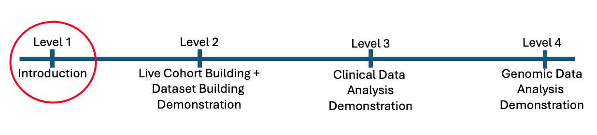{fig-align="center"}

::: notes
Course progression graphic reused from Session 1. Update it if the Level 2–4 sessions now use Workbench 2.0.
:::

# About All of Us

## Background

- A national initiative by the NIH
- Launched in 2018
- Goal: gather health data from **over 1 million people**
- Participants join voluntarily
  - by signing up at [JoinAllofUs.org](https://joinallofus.org)
  - or through a participating health care provider

## Vision and Goals

- Enable precision medicine using data on lifestyle, environment, and genetics
- Shift from one-size-fits-all to personalized healthcare
- Boost health research and medical breakthroughs
- Make healthcare tailored and equitable
- Support diverse studies reflecting all populations

## What Makes It Unique

- **Participant-centered:** participants can view and access their own data
- **Open science:** de-identified data available to registered researchers
- **Research opportunities:** health disparities, environmental impacts, disease prevention and treatment
- **Phenotypic and genotypic data** in one place
- **Scalability and innovation:** complex analyses, AI and machine learning

## Data Sources {.scrollable}

|   | Source | Description |
|------------------------|------------------------|------------------------|
| 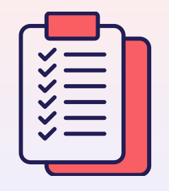{height="60"} | **Surveys** | Lifestyle, medical history, healthcare access, etc. |
| {height="60"} | **EHR** | Standardized with the OMOP Common Data Model |
| {height="60"} | **Wearables** | Heart rate, activity, or sleep data from devices like Fitbit |
| {height="60"} | **Physical measurements** | EHRs, self-reported height and weight, in-person visits |
| {height="60"} | **Genomic** | Whole genome sequencing and genotyping from blood, saliva, and urine |

## The Curated Data Repository (CDR)

- Data are organized in a **curated data repository (CDR)**
  - De-identified
  - Cleaned, validated, standardized (OMOP CDM)
  - Released in numbered versions (current: **CDRv9**)
- Hosted on **Google Cloud Platform**, queried with **Google BigQuery**
  - SQL-based; usable from R or Python
  - Billed for queries run and data processed (large genomic queries can be costly)

::: notes
CDRv9 is shown on the Workbench 2.0 home page (Controlled Tier tutorial workspace).
:::

## What's in CDR v9?

**More than 747,000 participants**

:::: {.columns}
::: {.column width="50%"}
| Data type | Participants |
|---|--:|
| Surveys | > 747,000 |
| Physical measurements | > 600,000 |
| Whole genome sequencing | > 535,000 |
| EHR | > 481,000 |
| Exploring the Mind | > 97,000 |
| Fitbit | > 68,000 |
| Long-read genomes | > 14,000 |
:::
::: {.column width="50%"}
| Genomics and multi-omics | Participants |
|---|--:|
| Genotyping arrays | 553,949 |
| Short-read WGS (SNPs/indels) | 535,662 |
| Structural variants | 96,405 |
| Long-read WGS | 14,521 |
| Proteomics | 9,969 |
| RNA-seq | 8,980 |
:::
::::

::: notes
Not every participant has every data type: e.g., about two-thirds have EHR data, and Fitbit data covers fewer than 1 in 10. Check the data type you need before planning a study. Genomic data is Controlled Tier only.
:::

## Data Access Tiers

- **Registered Tier:** EHR, surveys, social determinants of health, lab results, physical measurements, and wearables (sensors)
- **Controlled Tier:** everything in the Registered Tier **plus genomic data**
  - Requires additional Controlled Tier training
- Each tier is available in Workbench 2.0 as a **data collection**

# What's New in Workbench 2.0

## Researcher Workbench 2.0

- Built on **Verily Workbench**, the new platform behind the All of Us Researcher Workbench
- Modern interface with:
  - **JupyterLab** (in place of classic Jupyter Notebook)
  - A new **Data Explorer**
  - **Git repository** integration
  - Improved batch workflow support
  - A more organized storage system

## What Is Verily Workbench?

A **secure research environment** for governing and analyzing biomedical data, built on Verily's experience supporting All of Us

| What it does | Where you'll see it today |
|---|---|
| **Organizes data** of many types: clinical, omics, imaging | Data collections and the **Resources** tab |
| **Explores data without code**: point-and-click cohorts with visualizations | **Data Explorer** |
| **Analyzes at scale** with cloud computing | **Apps** (JupyterLab, R, SAS, Spark) and **Workflows** |
| **Governs and secures** data | **Policies**, **perimeters**, and group policies |
| Supports **secure collaboration** | **Sharing** roles: Owner, Writer, Reader |
| Offers **interfaces for every skill level** | Web interface, Data Explorer, command line (`wb`), cloud console |

::: notes
Source: Verily, "Verily Workbench overview" (support.workbench.verily.com/docs/getting_started/overview/). Data types it supports include omics (BAM, CRAM, VCF), clinical (CSV/TSV, PDF, OMOP, CDISC), and imaging (DICOM, JPG). Compliance: ISO 27001/SOC 2, GDPR, HIPAA. An activity monitor tracks data access and lineage. Policies can limit access by group membership and geography, and perimeters prevent data from being moved out.
:::

## Classic Workbench → Workbench 2.0

| Classic Workbench | Workbench 2.0 |
|------------------------------------|------------------------------------|
| Cohort Builder + Concept Selector + Dataset Builder | **Data Explorer** (one tool) |
| Workspace has CDR version + tier | Workspace + **data collection** added from the catalog |
| Cloud Analysis Environment | **Apps** (e.g., JupyterLab, RStudio) |
| Jupyter Notebook | **JupyterLab** |
| Workspace bucket (created for you) | A **Cloud Storage bucket you create** on the **Resources** tab |
| Code snippets to copy files | Buckets **mounted as folders** in every app |

::: notes
Based on the All of Us "Researcher Workbench 2.0 Glossary of Terms and Comparison Guide" and what we confirmed in the Workbench: new 2.0 workspaces have no bucket until you create one (migrated workspaces get an rw-migration-… bucket), and the Snippets menu is gone.
:::

# Getting Access

## Create Your Account

1.  Create an account at the [All of Us Research Hub](https://www.researchallofus.org/)
2.  Complete data access registration
    - ID verification
    - Mandatory trainings
    - Data User Code of Conduct
3.  For Controlled Tier data, complete the **Controlled Tier training**

::: notes
Students who already have Workbench access can skip this slide. Registration happens on the All of Us Research Hub before Workbench access; screenshots aren't included because the pages are only shown to new users.
:::

## Logging In

:::::: columns
::: {.column width="50%"}
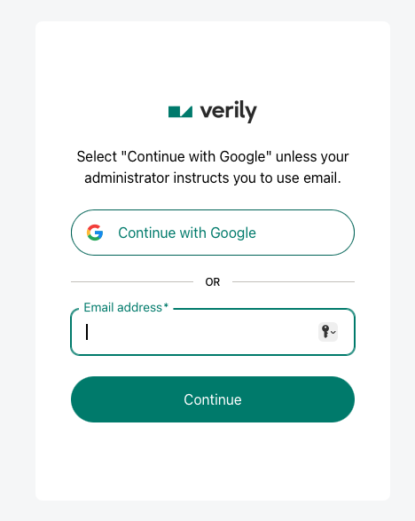
:::

:::: {.column width="50%"}
- Go to [**workbench.verily.com**](https://workbench.verily.com/)
- Select **Continue with Google**
- Sign in with your **All of Us account** (`yourname@researchallofus.org`), not your Yale or personal Google account

::: callout-tip
Use **Google Chrome** to log in.
:::
::::
::::::

::: notes
workbench.verily.com redirects to the Verily sign-in page. Make sure your data access requirements (trainings, etc.) are up to date before logging in.
:::

## The Home Page

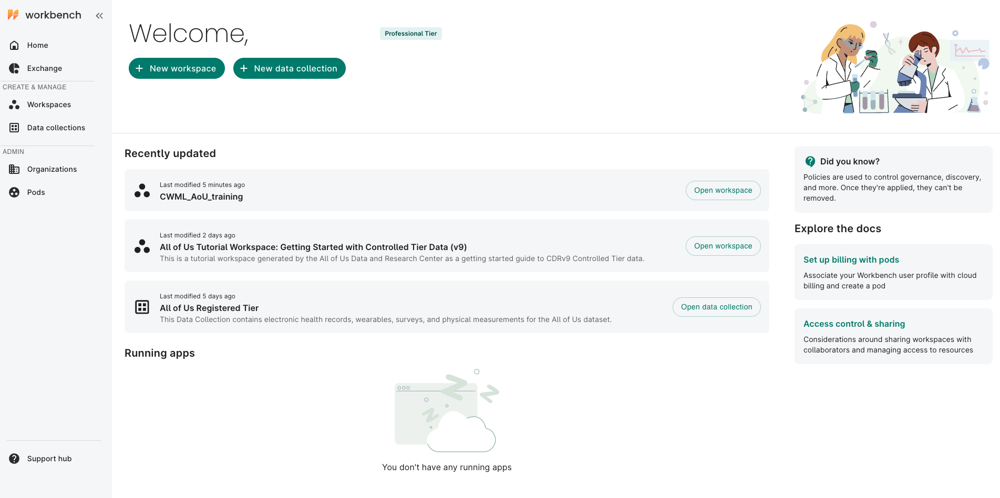{fig-align="center"}

::: notes
Screenshot shows the presenter's name. Crop it if needed.
:::

## Getting Around

::::: columns
::: {.column width="50%"}
**Left sidebar**

- **Home:** recent workspaces and data collections, plus running apps
- **Exchange:** the data catalog for browsing data collections
- **Workspaces:** your workspaces
- **Data collections:** collections you have access to
- **Pods:** billing (see Billing)
- **Support hub:** help and documentation
:::

::: {.column width="50%"}
**Home page**

- **+ New workspace**
- **Running apps:** check here so you don't pay for apps you forgot to stop!
- **Tutorial workspace:** *Getting Started with Controlled Tier Data (v9)*, a good place to start
- **Did you know?** Policies can't be removed once applied
:::
:::::

::: notes
Admin → Organizations shows the organization your account belongs to: for All of Us users, "aou-prod" (the All of Us production organization), with its terms of service and activity logs. Nothing to change there.
:::

# Data Collections

## What Is a Data Collection?

- A **curated dataset** published for researchers, e.g., the All of Us Registered Tier
- Comes with:
  - **Versions** (e.g., cdrv9)
  - **Policies** on how the data can be accessed and used
  - **Access levels** (Reader, Discover, …)
- You **don't copy** the data. Adding a collection to a workspace creates **references** to data that stays in the provider's cloud project.
- The workspace **inherits the collection's policies**, permanently

::: fragment
**Think of it as:** *data collection* = the data source; *workspace* = where you analyze it
:::

::: notes
Verily calls these "referenced resources". Because the data isn't copied, adding it is free; you pay for the queries and compute you run on it.
:::

## The Data Exchange

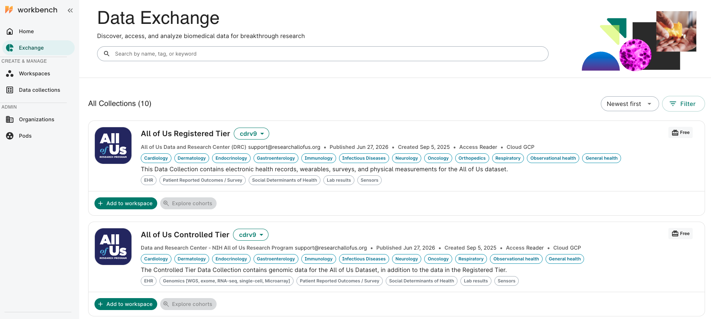{fig-align="center"}

::: notes
Open from the left sidebar: Exchange. Search by name, tag, or keyword; sort and filter.
:::

## All of Us Data Collections

|   | **Registered Tier** | **Controlled Tier** |
|------------------------|------------------------|------------------------|
| **Contains** | EHR, surveys, social determinants of health, lab results, wearables (sensors), physical measurements | Everything in the Registered Tier **plus genomics**: WGS, exome, RNA-seq, single-cell, microarray |
| **Use it for** | Clinical, survey, and lifestyle research: phenotypes, outcomes, health disparities | Genetic association studies (e.g., GWAS), variant analysis, and anything that needs genomic data |
| **Access** | Registered Tier training | **Controlled Tier** training |
| **Version** | Select from the version drop-down (current: **cdrv9**) | Same |

- Both are **free** to add (you pay only for compute and storage)
- **Add to workspace** straight from the Exchange, or from a workspace's **Resources** tab
- Pick the **smallest tier you need**. You can't have both tiers in one workspace.
- The only other collection you can add alongside: **GTEx Open Access**

::: notes
The Exchange lists 10 collections in total. Show the others in the live demo.
:::

## Other Collections on the Exchange {.compact}

| Collection | Provider | What it is | Data types |
|------------------|------------------|------------------|------------------|
| **GTEx Open Access** | Verily | Gene expression and its link to genetic variation | Genomics |
| **GP2 Tier 2** | Global Parkinson's Genetics Program | Parkinson's genetics, 70,000+ people | Genomics, surveys |
| **ASAP CRN Harmonized** | Aligning Science Across Parkinson's | Harmonized Parkinson's omics | Transcriptomics |
| **Project Baseline (Full)** | Verily | Deep health profiling study | EHR, genomics, imaging, eCRF, labs, sensors |
| **Project Baseline (Limited)** | Verily | Free subset of the full study | Imaging, surveys, eCRF, labs |
| **PRESCO Immune Profiler** | Verily | COVID-19 immune profiling, Long COVID (PASC) | Genomics, proteomics, labs |
| **Sightline Wastewater** | Verily | Community pathogen monitoring | Microbiomics |
| **Cervical Cancer: SDOH Screening** | Morehouse School of Medicine | Researcher-published collection | Immunology |

::: notes
Show these in the live demo.
:::

## Access Levels on the Exchange

- **Reader → Add to workspace:** you can add it right away
  - All of Us Registered and Controlled Tiers, GTEx Open Access
- **Discover → Get access:** you can see the description but have to **request access** first
  - **Instantly Accessible:** access is granted right away (PRESCO, Baseline Limited)
- **Free** badge: no charge for the data itself. Collections without it may cost money or need approval.
- **Explore cohorts:** shown on each collection, but not available for the All of Us collections

::: notes
The non-All of Us collections come from Verily and its partners. Their terms are separate from the All of Us Data User Code of Conduct. An All of Us workspace can hold one All of Us tier (Registered or Controlled) plus GTEx Open Access; the other collections can't be added to it. Explore cohorts is grayed out and can't be clicked for the All of Us collections (checked October 2026). For other collections it is meant to preview cohorts in Data Explorer before adding the collection.
:::

## Your Data Collections Page

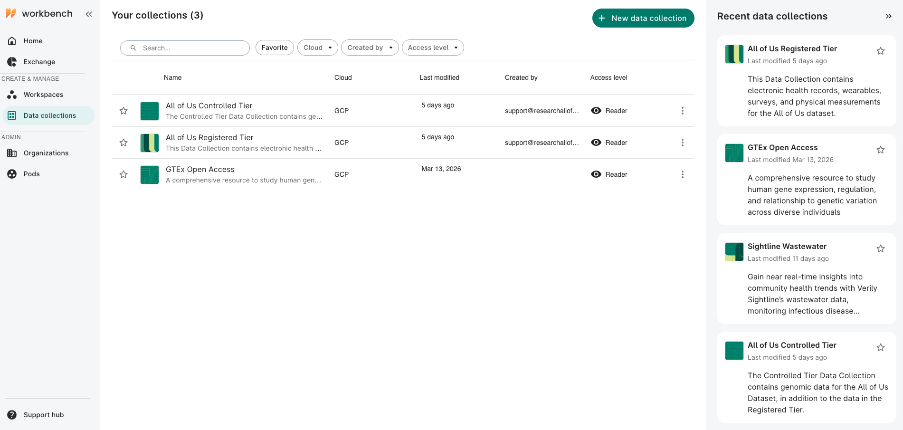{fig-align="center"}

## Using the Data Collections Page

- **Left sidebar → Data collections** lists every collection you have access to
  - Name, cloud (GCP), last modified, created by, and your **access level**
  - Filter by favorite, cloud, creator, or access level; ⭐ favorites to pin them
- **Reader** = you can view and use the data, but not change the collection
- The **Recent data collections** panel lists the ones you've opened lately
- **+ New data collection:** researchers can publish their own collections (e.g., the Morehouse collection on the Exchange)

::: fragment
**Exchange** = find and get access to collections · **Data collections** = the ones you already have
:::

::: notes
Collections only appear here after you have access: the All of Us tiers via your account access, GTEx because it's open. Creating a collection is beyond this intro.
:::

# Workspaces

## Your Workspaces

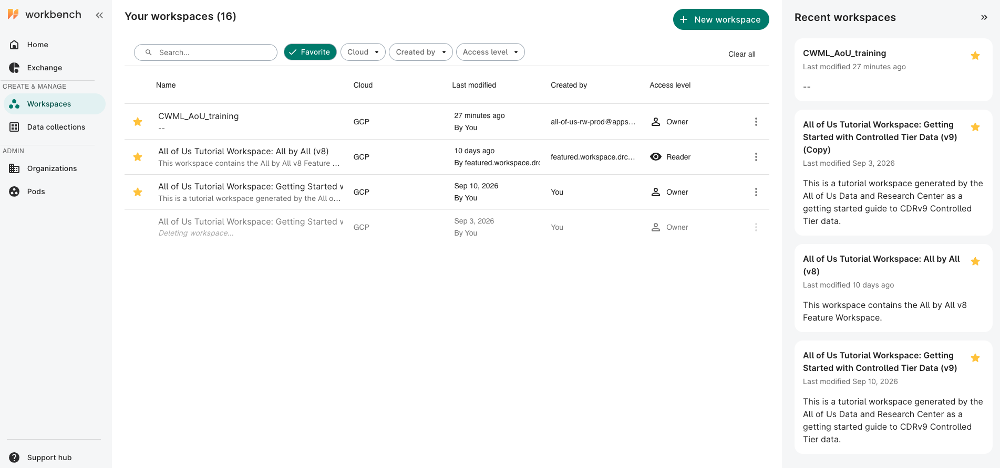{fig-align="center"}

## What Workspaces Are For

- A workspace is **where you do your research**: data collections, cohorts, datasets, notebooks, apps, and files for one project
- Have **more than one** (e.g., one per project or per tier)
- **Shareable** with collaborators
- **Billed individually** through the workspace's **pod**, so set up billing first

## Using the Workspaces Page

- **Left sidebar → Workspaces** lists every workspace you can access
  - Filter by favorite, cloud, creator, or access level; ⭐ favorites to pin them
  - **Recent workspaces** panel on the right

**Your access level** decides what you can do:

| Role | Change things (resources, apps, details) | Share | Delete | Duplicate |
|---|:-:|:-:|:-:|:-:|
| **Owner** | ✅ | ✅ | ✅ | ✅ |
| **Writer** | ✅ | ❌ | ❌ | ✅ |
| **Reader** | ❌ | ❌ | ❌ | ✅ |

Featured tutorial workspaces are **Reader**, so **duplicate** them to run the code (the "(Copy)" workspace).

::: notes
Featured tutorial workspaces shown: "Getting Started with Controlled Tier Data (v9)" and "All by All (v8)". The greyed-out row shows a workspace being deleted; deleting unused workspaces stops their charges. Source for roles: Verily, "Access control and sharing".
:::

## Sharing a Workspace

**Only Owners can share.** In the workspace, click **Share** (top right), then:

1. Enter your collaborator's **email**: the one linked to their Workbench account
2. Choose their role: **Owner**, **Writer**, or **Reader**

::: {.fragment}
- They must **already have a Workbench account**. You can't invite someone who hasn't registered yet.
- They get access to the resources **you created** in the workspace (buckets, datasets), at their role's level
- **References** to outside data are **not** shared automatically. The data's owner has to grant access.
- With a **group policy**, only group members can open it. You won't be warned if you share with someone outside the group.
:::

::: notes
For All of Us workspaces, collaborators also need their own All of Us data access (Registered or Controlled Tier) to see the data collection. Verily recommends sharing with Workbench groups rather than individuals for larger teams; that's beyond what students need here.
:::

# Billing

## Initial Credits

- **\$300 in initial credits** per registered researcher
  - Applied automatically to compute costs
  - **Expire 365 days** after you first get Workbench access
  - Tied to your personal pod, **`user-pod-firstname-lastname-####`**. A workspace's **Workspace details** panel (right side, under **Pod**) shows which pod pays for it.
- When credits run out or expire:
  - You can't launch or open analysis environments
  - Stored resources (buckets, disks) **may be deleted**
- Set up a **Google Cloud billing account** and **billing pod** *before* this happens

## Billing Pods

- A **pod** connects your workspaces to a Google Cloud billing account
  - Workspace costs are charged to the pod
  - Think of the pod as your billing account inside the Workbench
- One pod can pay for **many workspaces**
- You can **invite other users** to your pod (e.g., lab members)
- All of Us researchers have the **Pod Manager** role, so you can create your own pod

::: fragment
**Watch out:**

- A pod links to only **one** billing account
- A workspace's pod **can't be changed** later. To switch pods, you have to duplicate the workspace.
:::

::: notes
Initial credits are linked to the personal user pod. Check a workspace's Workspace details panel (Overview tab, right side) to see which pod it uses; a Yale billing pod would show its own name there.
:::

## Getting a Billing Account at Yale

Email **cloud.support\@yale.edu** with the subject **"setting up an All of Us billing account"** and include:

- Your All of Us Workbench email (e.g., `yourname@researchallofus.org`)
- Your **COA** number
- Whether this is an **NIH-funded** project

Yale Cloud Support will send the next steps for linking the billing account and creating your **pod**.

::: notes
Yale Cloud Support may give additional or different guidance.
:::

# All of Us Tutorial Workspaces

## Tutorial Workspaces

- Ready-made workspaces from the **All of Us Data and Research Center** with example notebooks and data already set up
- Find them on the **Workspaces** page (or the **Recent workspaces** list on the Home page)
- You have **Reader** access: you can browse, but not run anything
  - **Duplicate** the workspace to get your own copy you can run
  - Your copy is billed to the **pod** you choose

**Two to start with:**

1.  **Workspace Migration Controlled Tier**
2.  **Getting Started with Controlled Tier Data (v9)**

## Workspace Migration Controlled Tier

For researchers moving workspaces from the **Legacy Workbench (1.0)** to **Workbench 2.0**. It covers:

- Setting up a workspace in Workbench 2.0
- Setting up environments and packages
- Updating SQL queries from the Legacy Workbench
- Table differences between the two Workbenches
- Changes to genomic data and advanced tools

::::: columns
::: {.column .side width="50%"}
**Data collection:** Controlled Tier **v8** (`C2024Q3R8`). The same steps work for CDR v7.
:::

::: {.column .side width="50%"}
**Featured notebooks:**

- `04_Migrated_Workspaces_for_CT_(Python).ipynb`
- `04_Migrated_Workspaces_for_CT_(R).ipynb`
:::
:::::

::: notes
Most useful for students who had workspaces in the classic Workbench. New users can start with Getting Started with Controlled Tier Data (v9) instead. See the User Support Hub article on workspace migration for more detail.
:::

## Migration: What Carries Over

:::: {.columns}
::: {.column width="50%"}
**Migrated from 1.0:**

- Files and notebooks in your **workspace bucket**
- They're in a new bucket named like `rw-migration-aou-rw-…`

**Not migrated:**

- Cohorts, datasets, and concept sets. Rebuild them in **Data Explorer**.
:::
::: {.column width="50%"}
**Watch out:**

- **Re-syncing** a migration can overwrite your 2.0 work
- Only **workspace owners** can sync
- You pay storage in **both** Workbenches, so delete the 1.0 workspace once you've checked everything moved
:::
::::

::: {.fragment}
💾 Save new files to your **bucket** (`workspace/<bucket name>`). Files left on the app are lost when the app is deleted.
:::

## Setting Up Your Environment (R)

The tutorial's setup script defines your workspace variables:

```{.r}
source("/home/jupyter/workspace/aou-tutorial-notebooks/Setting_Env_Variables_p2.R")

library(bigrquery)
library(tidyverse)

CURRENT_DATASET <- Sys.getenv("WORKSPACE_CDR")   # the CDR in this workspace

download_data <- function(query) {
  tb <- bq_project_query(Sys.getenv("GOOGLE_PROJECT"), query)
  bq_table_download(tb)
}
```

- The script sets `WORKSPACE_BUCKET` and `WORKSPACE_CDR`. **Without it, they don't exist** (see *Workspace Variables* in the Apps section).
- The All of Us app image in 2.0 is **smaller**, so you may need to install packages
- In a migrated workspace, set `WORKSPACE_BUCKET` to your **migration bucket** (`gs://rw-migration-…`)

## Updating SQL Queries

Replace hard-coded 1.0 dataset paths with `CURRENT_DATASET`:

**1.0: won't run** ❌

```{.r code-line-numbers="false"}
query <- str_glue("SELECT * FROM `fc-aou-cdr-prod-ct.C2024Q3R8.condition_occurrence` LIMIT 5")
```

**2.0: runs** ✅

```{.r code-line-numbers="false"}
query <- str_glue("SELECT * FROM `{CURRENT_DATASET}.condition_occurrence` LIMIT 5")
df <- download_data(query)
```

::: {.fragment}
The standard OMOP tables (`condition_occurrence`, `person`, `measurement`…) keep their names. Only the path changes.
:::

## Cohort Builder Tables Have Changed

Data Explorer uses new **index tables** with different table and column names:

| 1.0 (Cohort/Dataset Builder) | 2.0 (Data Explorer) |
|---|---|
| `cb_search_person` | `T_ENT_person` |
| `ds_survey` | `T_ENT_surveyOccurrence` |
| `condition_occurrence` (in builder queries) | `T_ENT_conditionOccurrence`, `T_ESA_conditionOccurrence_person_id` |
| `cb_criteria` (concept hierarchy) | `T_HAD_conditionConcept_default` |

::: {.fragment}
**Recommendation:** don't edit old Cohort/Dataset Builder queries by hand. **Rebuild your cohort in Data Explorer** and use the queries it generates.
:::

::: notes
The index tables live in a dataset named like C2024Q3R8_index_111825, inside the data collection's BigQuery project (wb-silky-artichoke-2408). The same project appears in Data Explorer queries from other workspaces, so it belongs to the data collection, not to your workspace; your own project is only used for billing. Genomic data and workflow tools (dsub, Cromwell, Nextflow, Docker): see notebooks 05_How_to_use_workflow_tools and 06_Getting_Started_with_Genomic_Data in the Getting Started with Controlled Tier Data tutorial workspace.
:::

## Getting Started with Controlled Tier Data (v9)

For researchers **new to Workbench 2.0**: how to set up a workspace in Verily Workbench and access the **All of Us Controlled Tier v9** data.

:::: {.columns}
::: {.column .side width="50%"}
**Data collection:** Controlled Tier **v9** (`C2025Q4R6`), the same version used in this presentation
:::
::: {.column .side width="50%"}
**Featured tutorials:**

- Getting Started with Verily Workbench
- How to Get Started with Controlled Tier Data
- How to Use Workflow Tools
- Getting Started with Genomic Data
:::
::::

::: {.fragment}
👉 **Start here** if you're new to All of Us. Use the Migration workspace only if you're moving work from the classic Workbench.
:::

::: notes
The workflow tools and genomic data tutorials are the ones the Migration workspace points to for dsub, Cromwell, Nextflow, and Docker. Questions: AoU Researcher Workbench Support Hub or support@researchallofus.org.
:::

## Inside the Getting Started Workspace

| Folder | What it covers |
|---|---|
| `Setting_Env_Variables_…` | Set up workspace variables (versions for JupyterLab, RStudio, SAS) |
| `01_Getting Started with Verily Workbench` | The `wb` command line, buckets, and accessing the CDR (R or Python) |
| `02_How to Get Started with Controlled Tier Data` | **Data 101:** what's in the Controlled vs. Registered Tier, with example queries (R or Python) |
| `03_Getting_Started_with_Genomic_Data` | Short- and long-read WGS, arrays, Hail, PLINK, GWAS, extracting genomic data |
| `04_Getting_Started_with_Multiomics_Data` | RNA-seq, proteomics, and combining them |
| `05_How_to_use_workflow_tools` | dsub, Cromwell, Nextflow |

::: {.fragment}
👉 Start with **`Readme.ipynb`**, then folders **01 → 02**. Most notebooks come in **R** and **Python** versions.
:::

::: notes
The genomic (Hail) notebooks need a Spark (Dataproc) app; PLINK and bcftools steps use a standard app. Some text in folder 01 still mentions CDR v8.
:::

## Using a Tutorial Workspace

1.  **Check your billing pod first:** your All of Us initial credits, or your own pod linked to a Google Cloud billing account
2.  Open the workspace → **⋮** (next to **Share**) → **Duplicate**
3.  In your copy, create a **JupyterLab** app (Compute Engine). **Apps aren't copied** when you duplicate; resources are.
4.  In JupyterLab, open the **`aou-tutorial-notebooks`** folder
5.  Open **`Readme.ipynb`** for an overview of the tutorials, then work through the folders in order

::: fragment
⚠️ Running the notebooks uses compute, so it's billed to your pod. Stop the app when you're done.
:::

::: notes
Same steps for both tutorial workspaces (from their Overview pages). Questions: the AoU Researcher Workbench Support Hub or support\@researchallofus.org.
:::

# Setting Up a Workspace

## Creating a Workspace

**Left sidebar → Workspaces → + New workspace**

:::: annotated


::: {.red-circle style="left: 66.2%; top: 0.6%; width: 11.6%; height: 7.6%;"}
:::
::::

::: notes
Three steps: Enter details → Set policies → Add description.
:::

## Step 1: Enter Details

:::::: columns
::: {.column width="55%"}
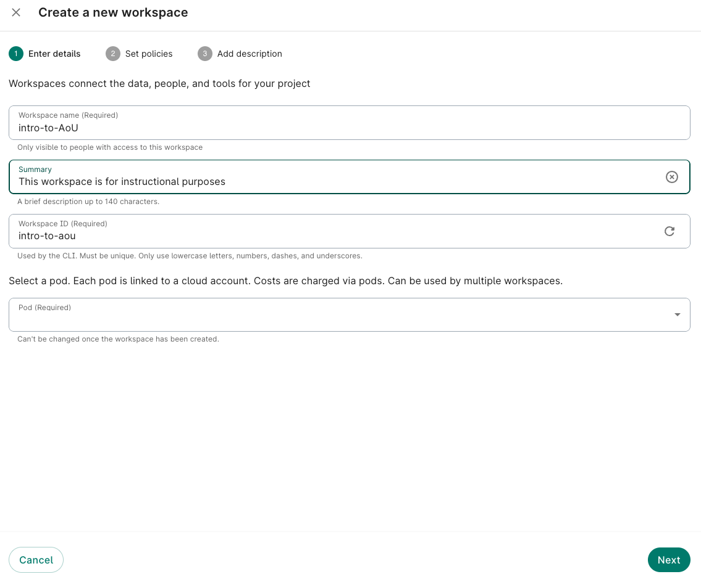
:::

:::: {.column .side width="45%"}
**You fill in:**

- **Workspace name:** only visible to people with access; you can change it later
- **Summary:** a short description (up to 140 characters)

**Filled in automatically:**

- **Workspace ID:** made from the name; used by the CLI. Changing it later **breaks links** to the workspace.
- **Pod:** your default billing pod

Click **Next**

::: fragment
⚠️ The pod **can't be changed** after the workspace is created
:::
::::
::::::

::: notes
The auto-selected pod is your personal user pod (user-pod-firstname-lastname-####). If you've set up a Yale billing pod, choose it here from the drop-down.
:::

## Step 2: Set Policies

:::::: columns
::: {.column width="55%"}
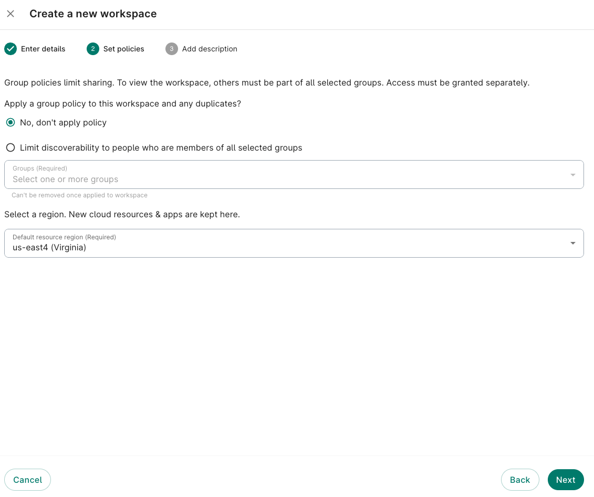
:::

:::: {.column .side width="45%"}
**Sharing (group policy):**

- **No, don't apply policy:** the default; fine for most projects
- **Limit discoverability:** only members of the selected groups can see the workspace

**Region:**

- Where your apps and resources are kept. Pick the one **closest to you** (Yale: **us-east4**).
- Can be changed later; only **new** resources use it

Click **Next**

::: fragment
⚠️ Group policies **can't be removed** once applied
:::
::::
::::::

::: notes
Group policies also carry over to duplicates of the workspace. Access still has to be granted separately; a group policy only limits who can be given access. Region also affects cost: Verily notes prices can vary by about 25% between regions. Yale is on the East Coast, so us-east4 (Virginia) is the closest region.
:::

## Step 3: Add Description

:::::: columns
::: {.column width="55%"}
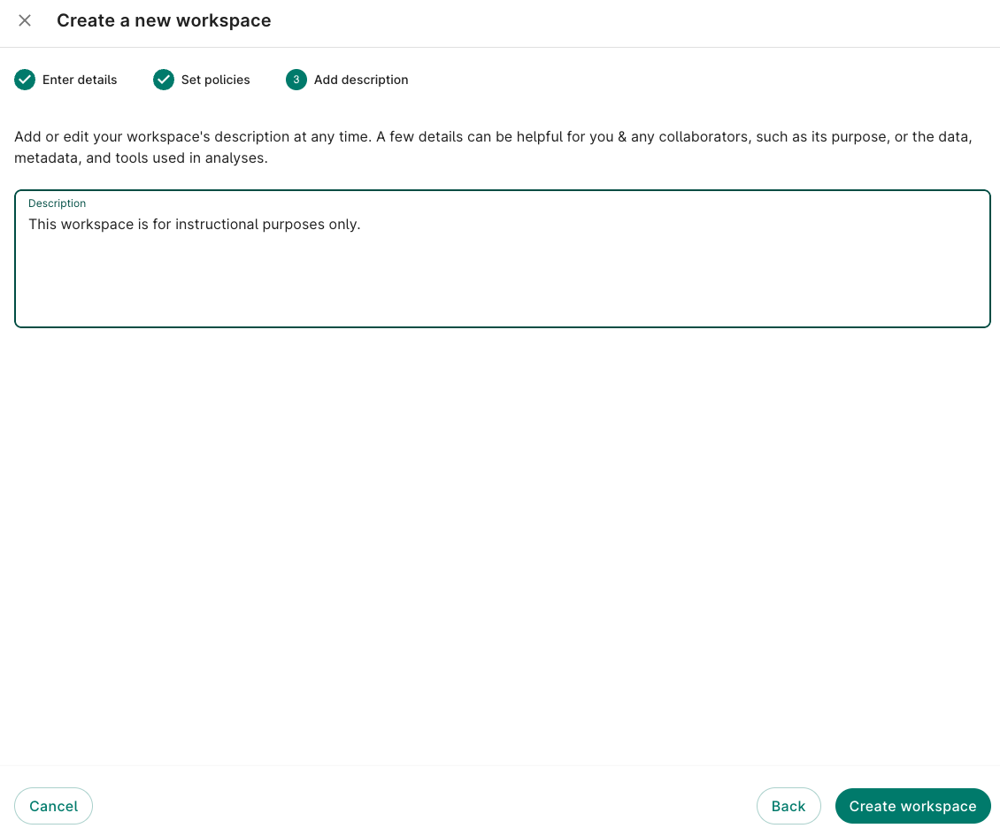
:::

:::: {.column .side width="45%"}
**Description:**

- What the workspace is for: its purpose, data, and tools
- Helps you and your collaborators
- You can **edit it any time**

Click **Create workspace**

::: fragment
⚠️ The description is **publicly accessible**. Anyone can see it, so don't put sensitive details in it.
:::
::::
::::::

## Your New Workspace

Go to the **Resources** tab → **+ Data from catalog**

::::: annotated
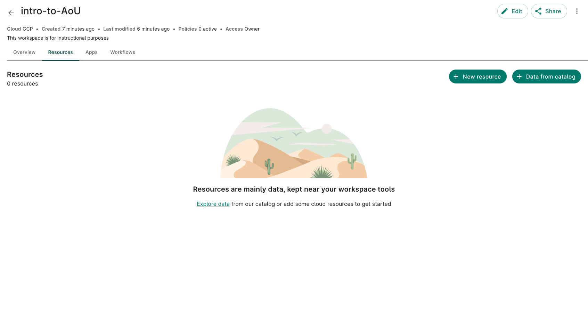

::: {.red-circle style="left: 6.4%; top: 13.4%; width: 7.4%; height: 6.2%;"}
:::

::: {.red-circle style="left: 86.0%; top: 19.2%; width: 13.8%; height: 8%;"}
:::
:::::

::: notes
Workspace tabs: Overview, Resources (data and cloud storage), Apps (JupyterLab, RStudio, SAS…), Workflows. Edit and Share are at the top right. A new workspace starts with 0 resources and 0 active policies; the policies come in when you add a data collection.
:::

## Adding a Data Collection

A new workspace has **no data** until you add a data collection.

**Resources** tab → **+ Data from catalog** (or **Add to workspace** on the Exchange), then:

1.  **Select collection:** All of Us Registered Tier or Controlled Tier
2.  **Select resource:** e.g., the CDR version
3.  **Review policies:** answer the **Researcher Use Statement** questions
4.  **Review selection** → **Add to your workspace**

## Step 1: Select Collection

::::::: columns
::::: {.column width="58%"}
:::: annotated
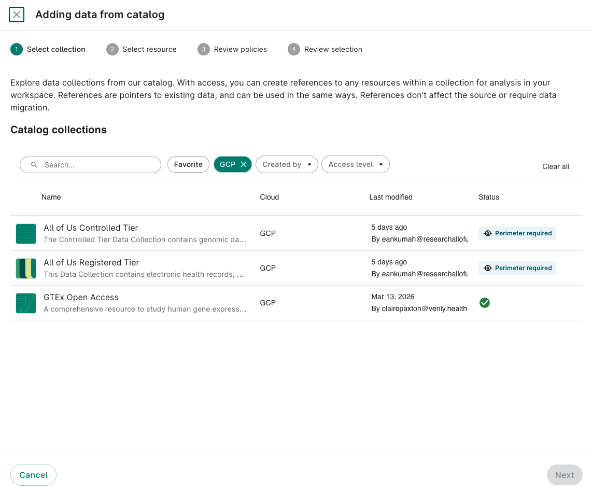

::: {.red-box style="left: 1.2%; top: 43.6%; width: 97.6%; height: 7%;"}
:::
::::
:::::

::: {.column .side width="42%"}
- Pick the collection you need. Here: **All of Us Controlled Tier**
- You add **references**: pointers to the existing data
  - No copying or data migration
  - The source data isn't affected
- **Status** column:
  - **Perimeter required:** adding it puts a security perimeter on your workspace
  - ✅ No extra policy needed (e.g., GTEx)

Click **Next**
:::
:::::::

::: notes
Only collections you have access to appear here (the same list as your Data collections page). The GCP filter is on by default.
:::

## Step 2: Select Resources

::::::: columns
::::: {.column width="58%"}
:::: annotated
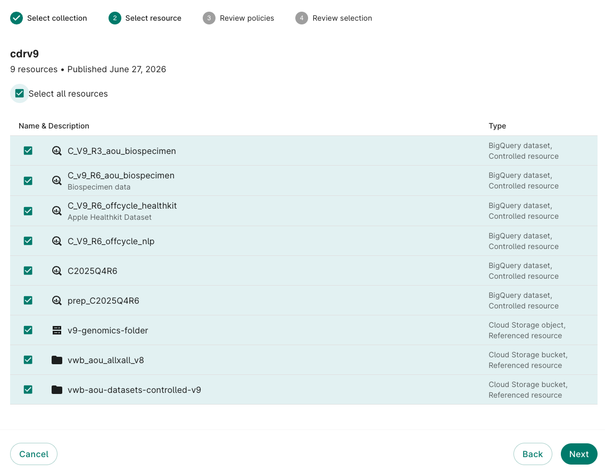

::: {.red-box style="left: 1.0%; top: 16.9%; width: 18%; height: 5.8%;"}
:::
::::
:::::

::: {.column .side width="42%"}
- The collection version (**cdrv9**) holds **9 resources**
- Choose **some or all**. Here: **Select all resources**
- Two kinds of resources:
  - **BigQuery datasets:** data tables you query with SQL
  - **Cloud Storage buckets/objects:** files, e.g., genomic data

Click **Next**
:::
:::::::

## What's in cdrv9 (Controlled Tier)?

| Resource | Type | What it holds |
|------------------------|------------------------|------------------------|
| `C2025Q4R6` | BigQuery | **The main CDR v9**: OMOP tables (EHR, surveys, measurements…); data through Jan 1, 2025 |
| `prep_C2025Q4R6` | BigQuery | Supporting tables for the CDR (no description given) |
| `C_V9_R3_aou_biospecimen`, `C_v9_R6_aou_biospecimen` | BigQuery | Biospecimen data |
| `C_V9_R6_offcycle_healthkit` | BigQuery | Apple HealthKit data |
| `C_V9_R6_offcycle_nlp` | BigQuery | **New in v9:** concepts extracted from **clinical notes** with NLP (> 99,000 participants) |
| `v9-genomics-folder` | Cloud Storage | Genomic data files |
| `vwb_aou_allxall_v8` | Cloud Storage | All by All (v8) association results |
| `vwb-aou-datasets-controlled-v9` | Cloud Storage | Controlled Tier dataset files. ⚠️ **Requester pays**: reading it is billed to your pod |

::: notes
Source: All of Us "Curated Data Repository (CDR) version 9 Release Notes" (Controlled Tier C2025Q4R6, Registered Tier R2025Q4R6, participant data cutoff January 1, 2025; first release of clinical notes with NLP concept extraction). The resources' Description fields in the Workbench are empty, so the prep_ and vwb-aou-datasets-controlled-v9 descriptions are based on their names. All are referenced resources in project wb-silky-artichoke-2408 (version-bound to cdrv9). The vwb-aou-datasets-controlled-v9 bucket has Requester Pays enabled.
:::

## Step 3: Review Policies

:::::::: columns
::::: {.column width="58%"}
:::: annotated
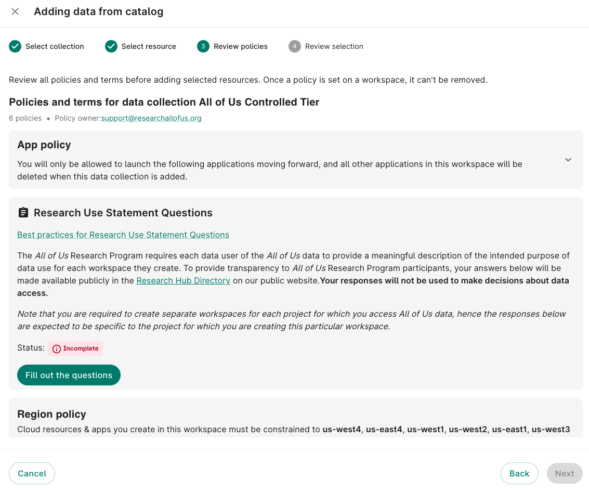

::: {.red-circle style="left: 1.6%; top: 72.4%; width: 20.4%; height: 5.8%;"}
:::
::::
:::::

:::: {.column .side width="42%"}
The Controlled Tier has **6 policies**, including:

- **App policy:** only approved apps can run; other apps in the workspace are **deleted**
- **Region policy:** apps and resources must stay in approved US regions
- **Research Use Statement:** click **Fill out the questions**. You **can't continue** until it's complete.

::: fragment
⚠️ Your answers are **public** in the [Research Hub Directory](https://www.researchallofus.org/research-projects-directory/)

⚠️ Policies **can't be removed** once set
:::
::::
::::::::

::: notes
The answers aren't used to make data access decisions; they're for transparency to participants. All of Us expects a separate workspace for each project, so the answers should be specific to this project. Scroll down in the dialog to see all 6 policies.
:::

## Research Use Statement: Question 1

:::::::: columns
::::: {.column width="58%"}
:::: annotated
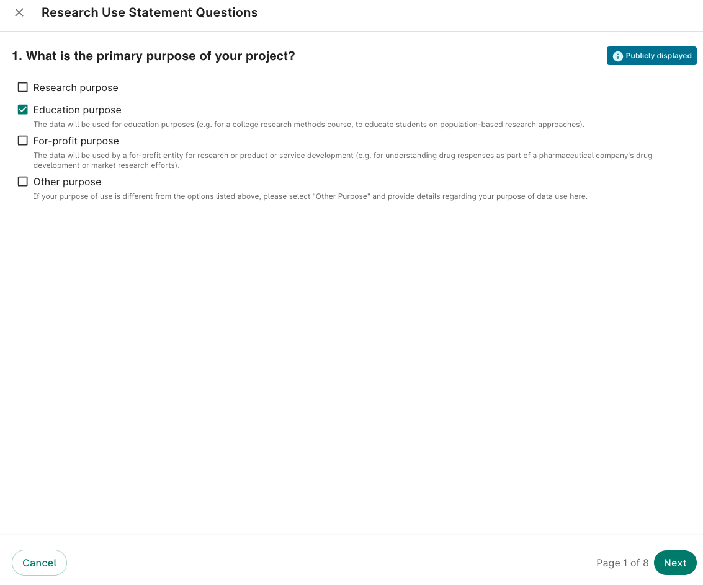

::: {.red-box style="left: 1.6%; top: 17.2%; width: 83%; height: 5.6%;"}
:::
::::
:::::

:::: {.column .side width="42%"}
**What is the primary purpose of your project?**

- Research
- **Education** ← our example (instructional workspace)
- For-profit
- Other

8 pages of questions in total

::: fragment
Answer for **your own project**. Answers marked **Publicly displayed** appear in the Research Hub Directory.
:::
::::
::::::::

::: notes
This example workspace is for teaching, so we answer as an education project. Students doing research should choose Research purpose and describe their actual project.
:::

## Research Use Statement: Question 2

:::::: columns
::: {.column width="58%"}
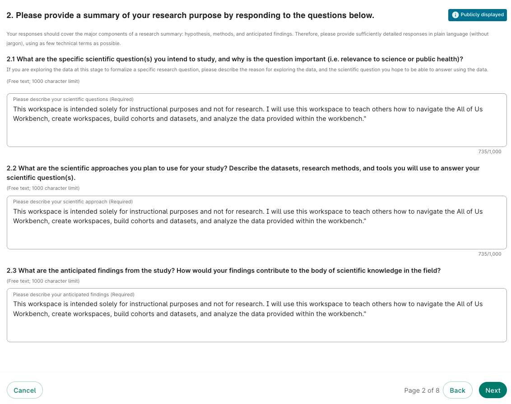
:::

:::: {.column .side width="42%"}
**Summarize your research purpose** in plain language:

- **2.1** Your scientific question(s), and why they matter
- **2.2** Your approach: datasets, methods, and tools
- **2.3** Your anticipated findings

Each answer: **100–1,000 characters**

::: fragment
⚠️ Answers under 100 characters give an error. Add enough detail to explain your project.
:::
::::
::::::

::: notes
Example answer for this instructional workspace (used for 2.1–2.3): "This workspace is intended solely for instructional purposes and not for research. I will use this workspace to teach others how to navigate the All of Us Workbench, create workspaces, build cohorts and datasets, and analyze the data provided within the workbench." Students should describe their real project: hypothesis, methods, and expected findings, with as little jargon as possible.
:::

## Research Use Statement: Question 3

:::::::: columns
::::: {.column width="58%"}
:::: annotated
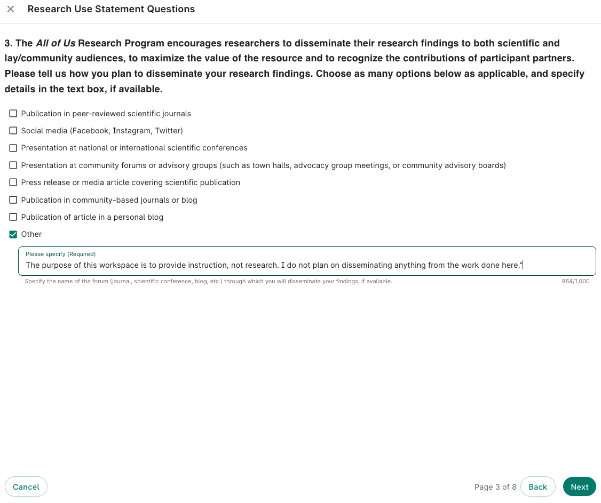

::: {.red-box style="left: 0.8%; top: 44.8%; width: 98.8%; height: 10.8%;"}
:::
::::
:::::

:::: {.column .side width="42%"}
**How will you share your findings?**

- Choose **all that apply**: journals, conferences, community forums, social media, blogs, press…
- Name the venue if you know it (journal, conference, blog, etc.)
- **Other** requires a short explanation

::: fragment
Our example: **Other**. The workspace is for teaching, so there are no findings to share.
:::
::::
::::::::

::: notes
All of Us encourages sharing results with both scientific and community audiences, to recognize participants' contributions. Example answer: "The purpose of this workspace is to provide instruction, not research. I do not plan on disseminating anything from the work done here."
:::

## Research Use Statement: Question 4

:::::::: columns
::::: {.column width="58%"}
:::: annotated
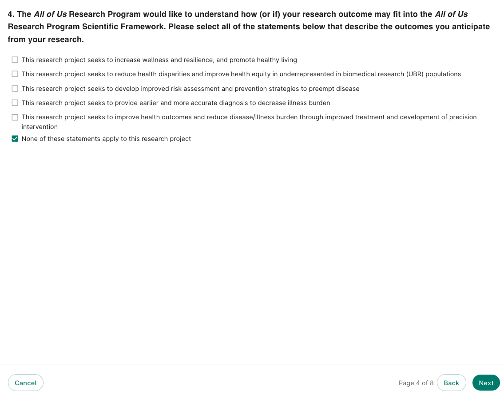

::: {.red-box style="left: 1.4%; top: 33.2%; width: 38.4%; height: 3.8%;"}
:::
::::
:::::

:::: {.column .side width="42%"}
**How does your project fit the All of Us Scientific Framework?**

Select all outcomes you expect:

- Wellness, resilience, healthy living
- Health equity for underrepresented (UBR) populations
- Risk assessment and prevention
- Earlier, more accurate diagnosis
- Better treatment and precision interventions

::: fragment
Our example: **None of these apply** (teaching workspace)
:::
::::
::::::::

## Research Use Statement: Question 5

:::::::: columns
::::: {.column width="58%"}
:::: annotated
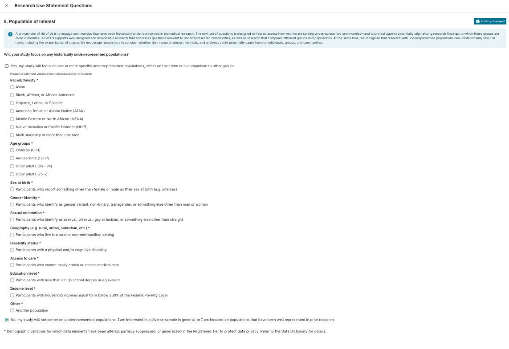

::: {.red-box style="left: 0.4%; top: 89.9%; width: 66.4%; height: 3.4%;"}
:::
::::
:::::

:::: {.column .side width="42%"}
**Population of interest:** will your study focus on historically underrepresented populations?

- **Yes:** select the groups, e.g., race/ethnicity, age, sex at birth, gender identity, sexual orientation, geography, disability, access to care, education, income
- **No:** a diverse sample in general, or well-represented populations

::: fragment
Our example: **No** (teaching workspace)
:::
::::
::::::::

::: notes
All of Us asks this to track how well it serves underrepresented communities and to guard against stigmatizing findings. Encourage students to think about whether their design, methods, or analyses could harm individuals, groups, or communities. Fields marked \* are altered, suppressed, or generalized in the Registered Tier for privacy; see the Data Dictionary.
:::

## Research Use Statement: Question 6

:::::::: columns
::::: {.column width="58%"}
:::: annotated
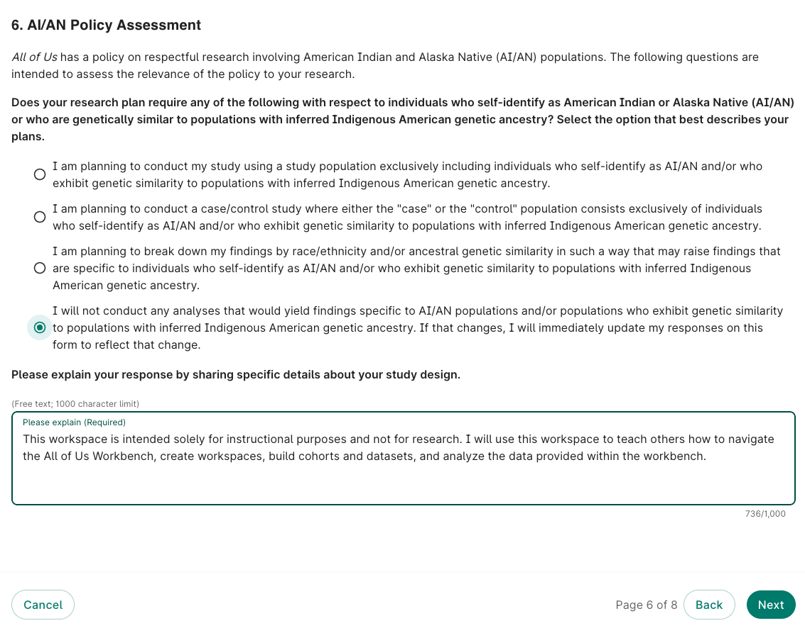

::: {.red-box style="left: 2.6%; top: 47.6%; width: 95.8%; height: 9%;"}
:::
::::
:::::

:::: {.column .side width="42%"}
**AI/AN Policy Assessment**

Will your study produce findings specific to **American Indian and Alaska Native (AI/AN)** populations?

- AI/AN-only study population
- AI/AN case or control group
- Results broken down so AI/AN-specific findings may appear
- **No AI/AN-specific analyses**

Then explain your answer (required)

::: fragment
Our example: **no AI/AN-specific analyses**. If that changes, you must update your answers.
:::
::::
::::::::

::: notes
All of Us has a policy on respectful research with AI/AN populations; this question checks whether it applies to your project. Students whose work could produce AI/AN-specific findings should read the policy before starting.
:::

## Research Use Statement: Question 7

:::::::: columns
::::: {.column width="58%"}
:::: annotated
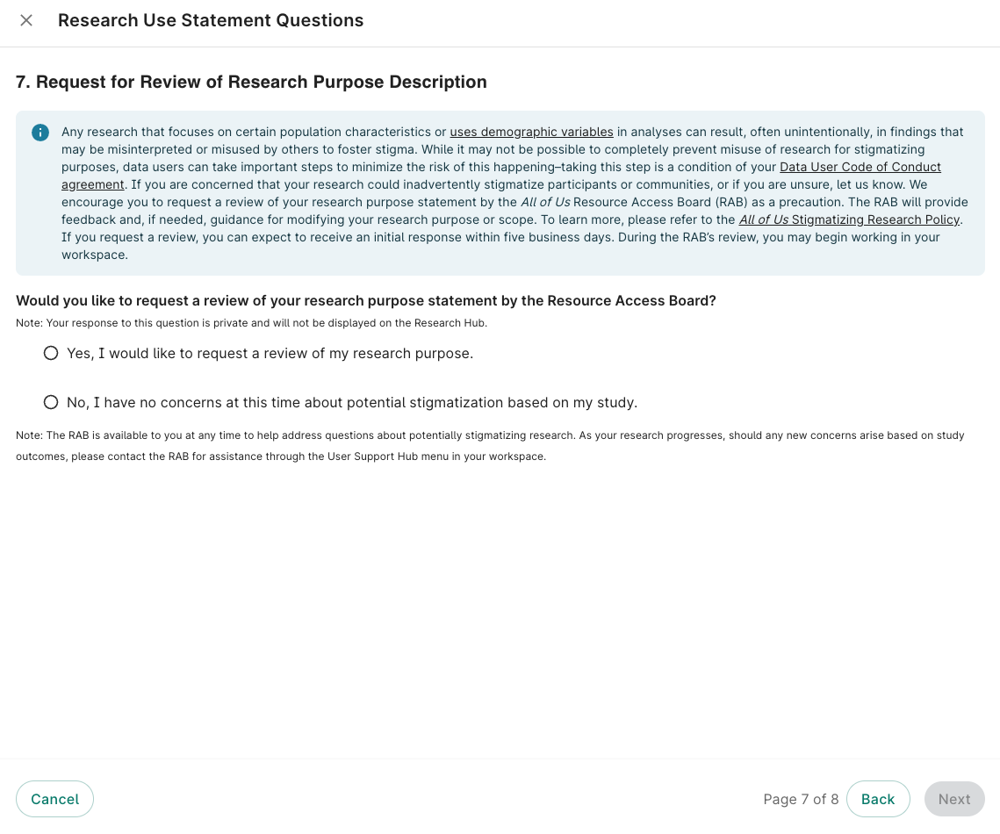

::: {.green-box style="left: 3.0%; top: 40.0%; width: 95.0%; height: 10.0%;"}
:::

::: {.red-box style="left: 3.0%; top: 46.2%; width: 95.0%; height: 4.4%;"}
:::
::::
:::::

:::: {.column .side width="42%"}
**Request a review of your research purpose?**

- Research using **demographic variables** can unintentionally produce findings that **stigmatize** participants or communities
- You can ask the **Resource Access Board (RAB)** to review your purpose
  - Reply within **5 business days**; keep working meanwhile
- This answer is **private** (not on the Research Hub)

::: fragment
Our example: **No** concerns. The RAB is available any time via the **User Support Hub**.
:::
::::
::::::::

::: notes
See the All of Us Stigmatizing Research Policy for more detail. If students are unsure, encourage them to request the review; it's a precaution, not a penalty.
:::

## Research Use Statement: Page 8

:::::::: columns
::::: {.column width="58%"}
:::: annotated
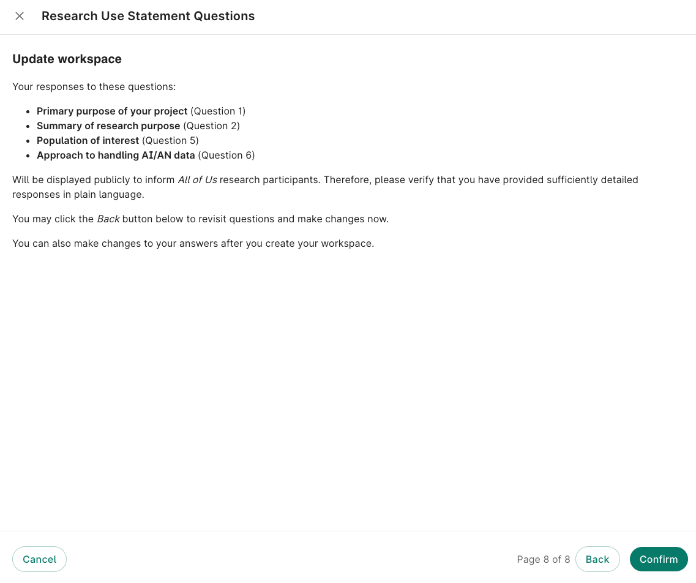

::: {.green-box style="left: 3.0%; top: 17.6%; width: 46.0%; height: 10.6%;"}
:::

::: {.red-circle style="left: 89.6%; top: 93.6%; width: 9.8%; height: 5.6%;"}
:::
::::
:::::

:::: {.column .side width="42%"}
**Review and confirm**

These answers are **publicly displayed** to inform All of Us participants:

- **Q1** Primary purpose of your project
- **Q2** Summary of research purpose
- **Q5** Population of interest
- **Q6** Approach to handling AI/AN data

Check that they're detailed and in plain language, then click **Confirm**

::: fragment
You can go **Back** to change answers now, or edit them later after the workspace is created
:::
::::
::::::::

::: notes
Q3 (dissemination), Q4 (scientific framework), and Q7 (RAB review) are not displayed publicly.
:::

## Step 3: Confirm Policies

::::::::: columns
:::::: {.column width="58%"}
::::: annotated
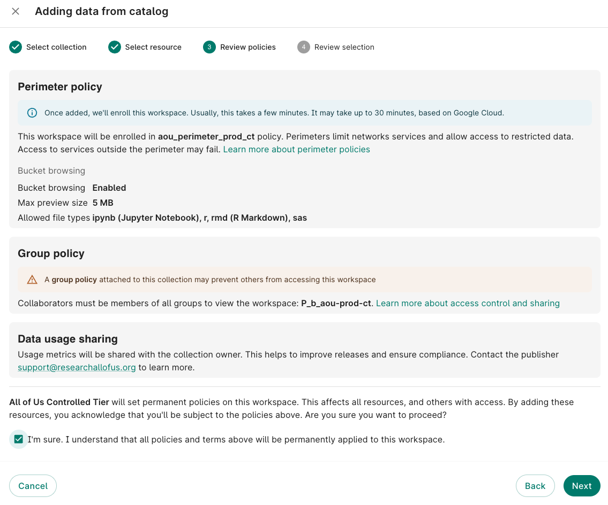

::: {.red-box style="left: 0.8%; top: 84.4%; width: 73.4%; height: 5.4%;"}
:::

::: {.red-circle style="left: 91.4%; top: 93.0%; width: 8.6%; height: 6.6%;"}
:::
:::::
::::::

:::: {.column .side width="42%"}
Scroll to the bottom of **Review policies**:

- **Perimeter policy:** the workspace is enrolled in a secure perimeter (can take up to **30 min**); services outside it may fail
- **Group policy:** collaborators must be in the All of Us Controlled Tier group
- **Data usage sharing:** usage metrics go to All of Us

Check **I'm sure…** → **Next**

::: fragment
⚠️ These policies are **permanent** for this workspace
:::
::::
:::::::::

::: notes
Bucket browsing in the perimeter: previews up to 5 MB, and only .ipynb, .r, .rmd, and .sas files can be viewed. The group is P_b_aou-prod-ct, so collaborators need Controlled Tier access too.
:::

## Step 4: Review Selection

:::::::: columns
::::: {.column width="58%"}
:::: annotated
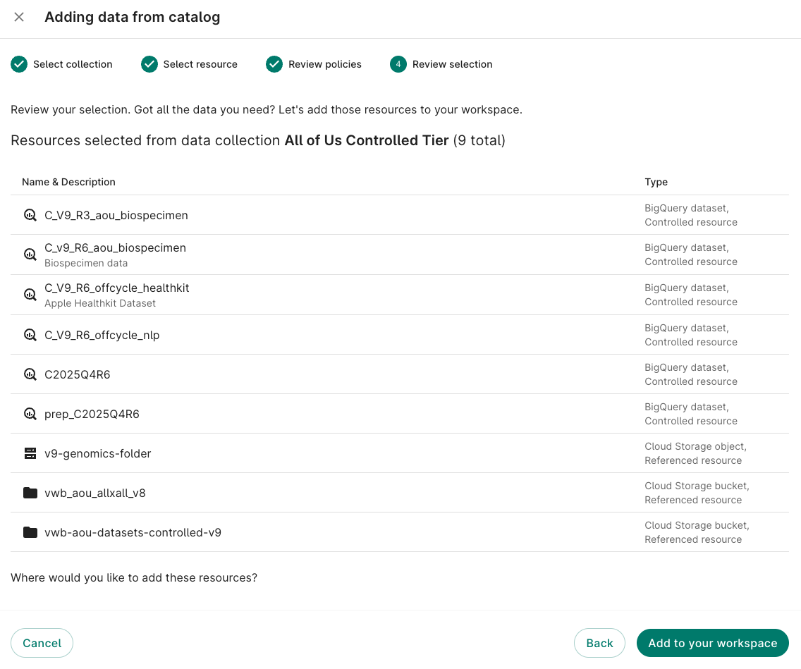

::: {.red-circle style="left: 78.4%; top: 92.8%; width: 21%; height: 6.6%;"}
:::
::::
:::::

:::: {.column .side width="42%"}
- Check the list of resources: **9** from the All of Us Controlled Tier
- Missing something? Go **Back**
- Click **Add to your workspace**

::: fragment
The resources then appear in your workspace's **Resources** tab. Allow up to **30 min** for the perimeter enrollment to finish.
:::
::::
::::::::

## Data Collection Rules

- Add it **to every workspace** that needs All of Us data
- Policies are **permanently** applied to the workspace
- **One tier per workspace:** Registered *or* Controlled, not both
- The workspace also takes on the collection's:
  - **Perimeter policy**
  - **Network policy:** no internet access for batch VMs and Dataproc workers
- Each user still needs the matching tier access on their own account

# Inside Your Workspace

## Workspace Layout

Every workspace page has the same layout:

- **Header:** cloud (GCP), dates, **Policies** (e.g., *6 active*; click to view them), and your **Access** level
- **Perimeter banner:** shown when the workspace holds restricted data (e.g., Controlled Tier). Services outside the perimeter may not work.
- **Four tabs:**

| Tab | What's there |
|---|---|
| **Overview** | The workspace description |
| **Resources** | Your data and storage |
| **Apps** | Analysis environments (JupyterLab, RStudio, SAS…) |
| **Workflows** | Batch jobs and pipelines |

## Overview Tab

:::: {.columns}
::: {.column width="58%"}
::: {.annotated}
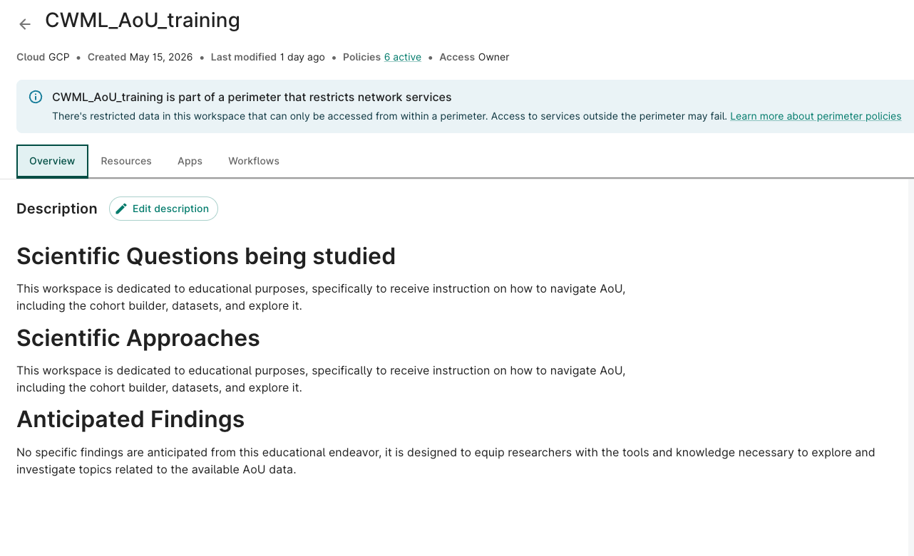

::: {.red-circle style="left: 1.2%; top: 25.2%; width: 9.0%; height: 7.4%;"}
:::

::: {.red-box style="left: 11.4%; top: 34.6%; width: 13.2%; height: 5.8%;"}
:::
:::
:::
::: {.column .side width="42%"}
- The first thing you see when you open a workspace
- Shows the **description**: what the project is about, e.g., its scientific questions, approaches, and anticipated findings
- Helps collaborators (and you, later) understand the workspace at a glance

**To update it:** click **Edit description**, make your changes, and save. Update it as your project changes.

::: {.fragment}
⚠️ The description is **publicly accessible**, so keep it accurate and leave out sensitive details.
:::
:::
::::

::: notes
Good practice: keep the description in sync with your Research Use Statement answers, which are also public.
:::

## Resources Tab

:::: {.columns}
::: {.column width="58%"}
::: {.annotated}


::: {.red-circle style="left: 10.0%; top: 25.2%; width: 7.4%; height: 7.4%;"}
:::
:::
:::
::: {.column .side width="42%"}
Where your workspace's **data and storage** live:

- **Data collections** you've added (e.g., the All of Us Controlled Tier resources)
- **Buckets** you create to save files
- Other cloud resources

Add more with **+ New resource** or **+ Data from catalog**
:::
::::

::: notes
More detail on each resource type follows.
:::

## Adding New Resources

**Resources** tab → **+ New resource** opens a menu of resource types:

::: {.annotated .short}
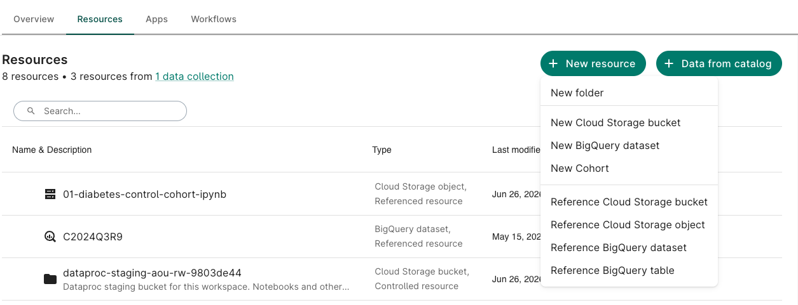

::: {.red-circle style="left: 7.8%; top: 1.0%; width: 9.0%; height: 11.6%;"}
:::

::: {.red-circle style="left: 66.8%; top: 14.6%; width: 15%; height: 12.4%;"}
:::

::: {.green-box style="left: 67.2%; top: 25.0%; width: 23.4%; height: 69.6%;"}
:::
:::

:::: {.columns}
::: {.column .side width="50%"}
**Create new** (folder, bucket, BigQuery dataset, cohort)

- Lives **in your workspace**, shared with collaborators
- Deleted if the workspace is deleted
:::
::: {.column .side width="50%"}
**Reference existing** (bucket, object, BigQuery dataset or table)

- A **pointer** to data that lives elsewhere; nothing is copied
- Access is managed by the data's owner
:::
::::

::: notes
Verily calls these "controlled" and "referenced" resources. The data collection resources you added from the catalog are referenced resources too.
:::

## Which Resource Do I Need?

| Resource | What it is | Use it when you want to… |
|---|---|---|
| **Folder** | A label for grouping resources on the Resources tab | Keep a busy workspace organized (e.g., *Data*, *Results*) |
| **Cloud Storage bucket** | Your own storage for files | Save CSVs, notebooks, plots, and cleaned data so they outlast your app |
| **BigQuery dataset** | Your own database for tables | Save large query results as tables you can query again with SQL |
| **Reference** a bucket, object, dataset, or table | A pointer to data that lives elsewhere | Use data you already have access to without copying it |

::: {.fragment}
👉 Most students need just **one bucket**. The others are optional.
:::

::: notes
New Cohort is covered in the Data Explorer section.
:::

## New Folder

:::: {.columns}
::: {.column width="55%"}
::: {.annotated}
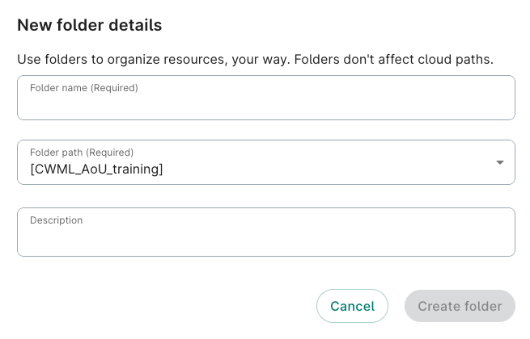

::: {.red-circle style="left: 77.4%; top: 84.0%; width: 21.6%; height: 13.6%;"}
:::
:::
:::
::: {.column .side width="45%"}
**Why:** organize resources on the Resources tab, your way

- **Folder name** (required)
- **Folder path:** where the folder goes; the workspace itself by default
- **Description** (optional)

Click **Create folder**

To put an existing resource in a folder: select it → **Move** (in its details pane)

::: {.fragment}
Folders don't change a resource's **cloud path** (`gs://…`), but they **do** appear in the app's mounted path: `~/workspace/<folder>/<bucket>`
:::
:::
::::

::: notes
Avoid spaces in folder names: they have to be quoted in file paths in code.
:::

## New Cloud Storage Bucket

:::: {.columns}
::: {.column width="50%"}
::: {.annotated}
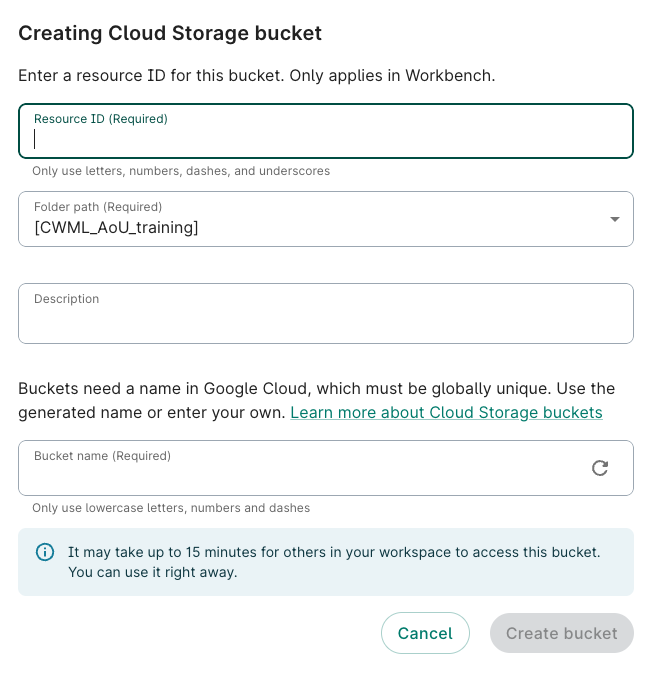

::: {.red-circle style="left: 73.6%; top: 90.0%; width: 24.4%; height: 8.6%;"}
:::
:::
:::
::: {.column .side width="50%"}
**Why:** new workspaces have **no bucket**, and you need one to save your work

- **Resource ID:** the name inside Workbench (letters, numbers, `-`, `_`). The tutorials use `workspace-bucket`.
- **Folder path** and **Description**
- **Bucket name:** the name in Google Cloud. It must be **globally unique**, so keep the generated one: your Resource ID + the workspace's project ID (↻ makes a new one).

Click **Create bucket**. You can use it right away; collaborators may wait **up to 15 min**.
:::
::::

::: notes
Controlled resources like this bucket are shared with workspace collaborators and deleted when the workspace is deleted. Apps that were already running won't see a new bucket until you restart the app or run wb resource mount. Mounted folders cache file info for about a minute, so two people writing at once may not see each other's changes right away. Migrated 1.0 workspaces already have a bucket: rw-migration-aou-rw-…
:::

## Bucket Names: Good Practice

- **Lowercase** letters, numbers, `-`, `_`, 3–63 characters, no spaces, no "google"
- Bucket names are **public**: anyone can check whether a name exists
  - ⚠️ No names, emails, NetIDs, or project details
- A bucket name **can't be changed** (the resource's name and description can). To rename, create a new bucket and copy the files over.
- Deleting a bucket frees its name for **anyone** to reuse

::: {.fragment}
👉 Easiest: accept the **generated name**. It's built from your **Resource ID** + the workspace's project ID, so keep the Resource ID free of personal details too.
:::

::: notes
Source: Google Cloud, "About Cloud Storage buckets" and "Create a bucket". Files (objects) also can't be renamed in place; renaming copies and deletes them. Avoid putting sensitive information in file names too.
:::

## New BigQuery Dataset

:::: {.columns}
::: {.column width="50%"}
::: {.annotated}
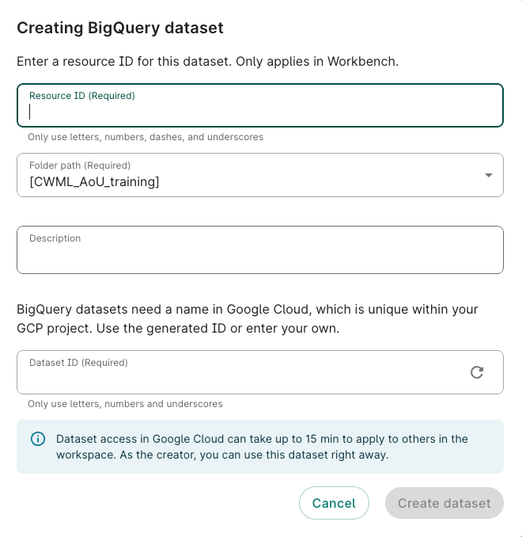

::: {.red-circle style="left: 72.6%; top: 90.0%; width: 24.8%; height: 8.4%;"}
:::
:::
:::
::: {.column .side width="50%"}
**Why:** save large query results as **tables**, then query them again with SQL instead of re-running long queries or loading big CSVs

- **Resource ID**, **Folder path**, **Description**
- **Dataset ID:** the name in Google Cloud. Unique within your project; letters, numbers, `_` only. Keep the generated one or choose your own. **Can't be changed later.**

Click **Create dataset**. Collaborators may wait **up to 15 min**.
:::
::::

::: notes
Optional for most class projects; a bucket with CSV files is usually enough. BigQuery storage and queries are billed to your pod.
:::

## Referencing Existing Data

A **reference** points to data that already exists elsewhere. Nothing is copied.

| Reference | You'll need |
|---|---|
| **Cloud Storage bucket** | The bucket name |
| **Cloud Storage object** (one file) | Its URL, e.g., `gs://bucket-name/path/file.csv` |
| **BigQuery dataset** | Project ID + Dataset ID |
| **BigQuery table** | Project ID + Dataset ID + Table ID |

Every reference also has a **Resource ID**, **Folder path**, and **Description**. Then click **Add to resources**.

::: {.fragment}
⚠️ **Access isn't shared automatically.** The data's owner controls it. In a Controlled Tier workspace, the **perimeter** may also block data from outside it.
:::

::: notes
Example uses: point to a collaborator's bucket, or to a shared file without copying it. The All of Us data collection resources you added earlier are references too. Deleting a reference removes the pointer, not the data. You can edit a reference's name and description, but not the bucket name, project ID, dataset ID, or table ID; to fix those, delete the reference and add it again. Some outside buckets are "Requester Pays": reading or browsing them is billed to your pod, and mounting them when an app starts can cost money too. The Workbench shows a warning when you add one.
:::

## Reference: Bucket or Object

:::: {.columns}
::: {.column width="50%"}
::: {.annotated}
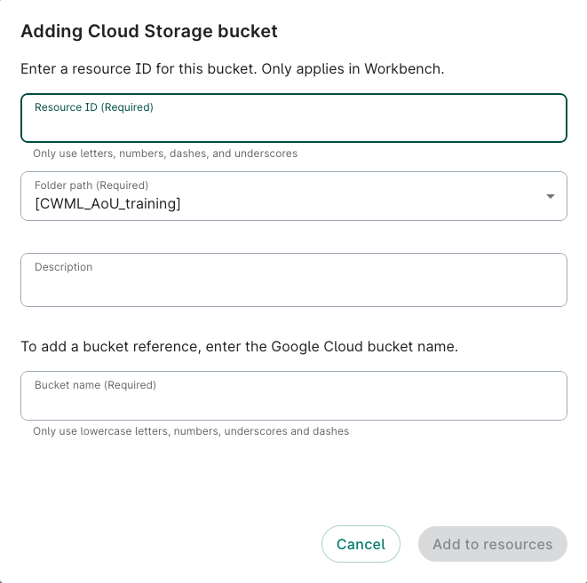

::: {.red-box style="left: 2.6%; top: 62.6%; width: 94.8%; height: 8.4%;"}
:::
:::

**Bucket:** enter the **bucket name**
:::
::: {.column width="50%"}
::: {.annotated}
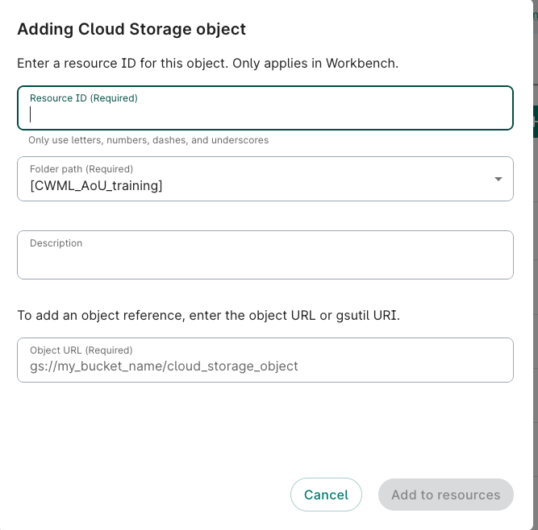

::: {.red-box style="left: 2.4%; top: 63.4%; width: 94.4%; height: 9.0%;"}
:::
:::

**Object:** enter its **`gs://` URL**
:::
::::

## Reference: BigQuery Dataset or Table

:::: {.columns}
::: {.column width="50%"}
::: {.annotated}
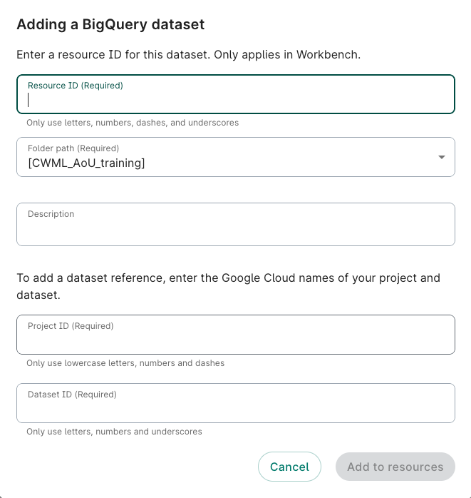

::: {.red-box style="left: 2.6%; top: 62.4%; width: 94.8%; height: 25.4%;"}
:::
:::

**Dataset:** Project ID + Dataset ID
:::
::: {.column width="50%"}
::: {.annotated}
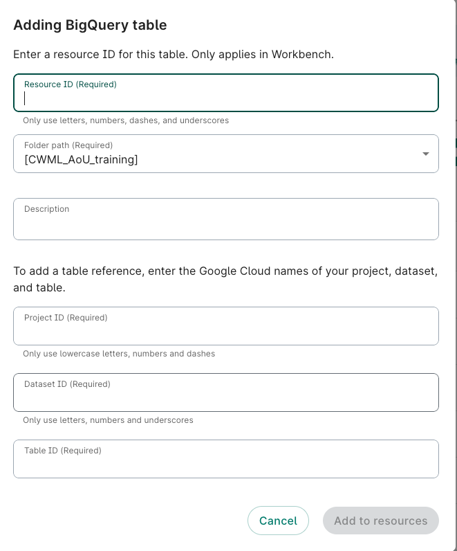

::: {.red-box style="left: 2.4%; top: 54.8%; width: 94.8%; height: 32.4%;"}
:::
:::

**Table:** same, **+ Table ID**
:::
::::

## Viewing Your Bucket in Google Cloud

:::: {.columns}
::: {.column width="30%"}
::: {.annotated}
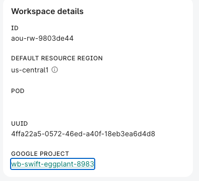

::: {.red-box style="left: 3.0%; top: 86.0%; width: 47.0%; height: 9.4%;"}
:::
:::
:::
::: {.column width="28%"}
::: {.annotated}
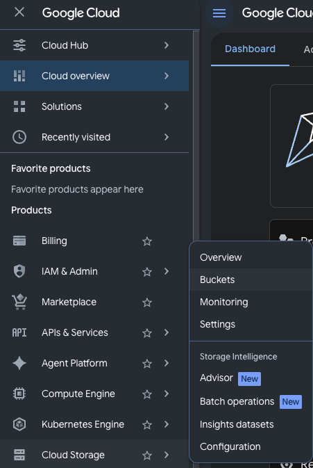

::: {.red-box style="left: 0.4%; top: 93.4%; width: 60.0%; height: 6.4%;"}
:::

::: {.red-box style="left: 60.6%; top: 57.2%; width: 39.0%; height: 5.0%;"}
:::
:::
:::
::: {.column width="3%"}
:::
::: {.column .side width="39%"}
1. In your workspace, find **Workspace details** (right side) and click the **Google Project** link
2. The **Google Cloud console** opens: menu → **Cloud Storage** → **Buckets**
3. Click the bucket your files are in

The details panel also shows the workspace **ID**, **default region**, **pod**, and **UUID**.
:::
::::

## What You Can See (and Can't)

::: {.annotated .short}
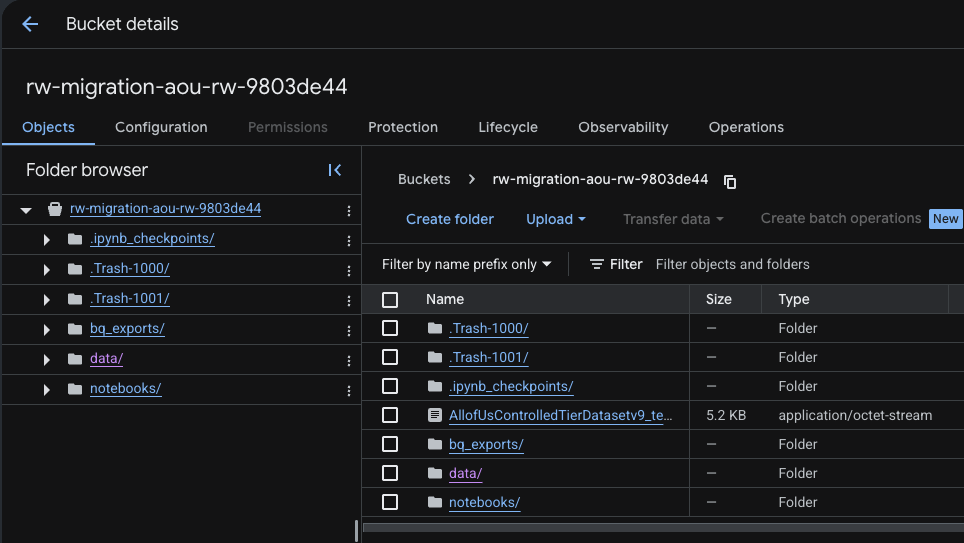

::: {.green-box style="left: 37.4%; top: 57.0%; width: 62.4%; height: 38.6%;"}
:::
:::

:::: {.columns}
::: {.column .side width="50%"}
✅ **You can see** folder and file **names**, sizes, and types, e.g., `notebooks/`, `data/`, and the `bq_exports/` folder from a data snapshot
:::
::: {.column .side width="50%"}
❌ **You can't open or download** the files. The perimeter blocks it. Open them from an **app** in the workspace instead.
:::
::::

::: {.fragment}
👉 Handy for checking that an export arrived, or finding a file's path
:::

::: notes
This bucket (rw-migration-aou-rw-…) is the migration bucket of a workspace moved from the classic Workbench. The .Trash-1000 and .Trash-1001 folders are most likely JupyterLab's trash for files deleted from the mounted bucket; they still take up storage until emptied. Bucket resources on the Resources tab also have a Browse button (seen on the vwb-aou-datasets-controlled-v9 bucket). Verily notes that in perimeter workspaces browsing only works if the perimeter administrator has enabled it; this training uses the Google Cloud console route instead.
:::

# Data Explorer

## Data Explorer

- A point-and-click tool for building datasets from All of Us data collections
- Replaces the classic **Cohort Builder**, **Concept Selector**, and **Dataset Builder**
- Answers questions **without code**, e.g., *"Who has this diagnosis, this treatment, **and** genomic data?"*
  - **Explore** the data with visualizations
  - **Build cohorts** with Boolean logic (**AND**, **OR**, **NOT**)
  - **Export** a ready-to-use dataset to your workspace
- What you can see depends on your **access level** (Registered or Controlled Tier)

::: notes
Source: Verily, "Verily Workbench overview", Data exploration section.
:::

## From Cohort to Data

| Step | Where | What you get |
|---|---|---|
| **1. Add a cohort** | **Resources** tab → **+ New resource** → cohort | A cohort resource in your workspace |
| **2. Build it** | **Data Explorer** | Your study population: inclusion and exclusion criteria |
| **3. Save a data snapshot** | **Data Explorer** → save data snapshot | CSV files and/or a notebook with the queries, saved to **your bucket** |

::: {.fragment}
- A **cohort** is a **controlled resource**: it lives in your workspace and collaborators can see it
- A **data snapshot** captures the data **at that point in time**, so your analysis stays reproducible
:::

::: notes
The definitions come from the "Add cohort to workspace" dialog.
:::

## Add a Cohort: Select Collection

:::: {.columns}
::: {.column width="55%"}
::: {.annotated}
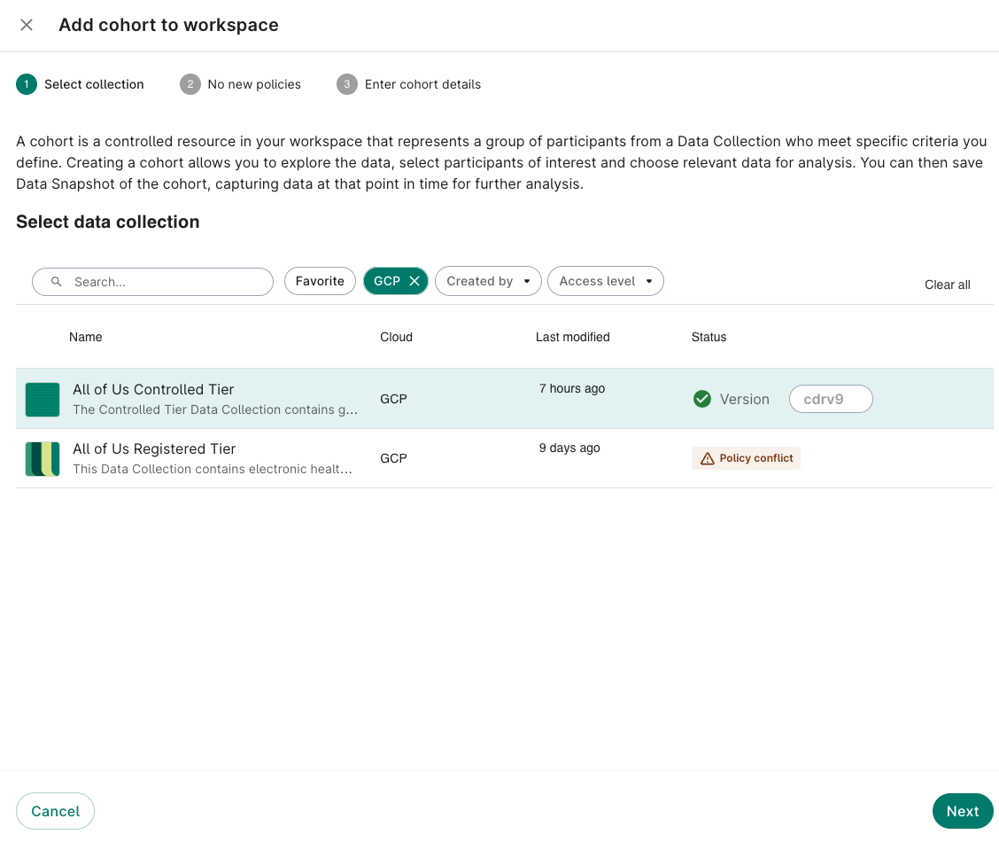

::: {.red-box style="left: 1.4%; top: 43.6%; width: 97.8%; height: 7.4%;"}
:::

::: {.green-box style="left: 68.8%; top: 45.2%; width: 19.0%; height: 4.4%;"}
:::

::: {.red-circle style="left: 92.2%; top: 93.4%; width: 7.6%; height: 5.8%;"}
:::
:::
:::
::: {.column .side width="45%"}
**Step 1:** pick the **data collection** your workspace already has, e.g., **All of Us Controlled Tier**

- Choose the **Version**: the newest, **cdrv9**
- The other tier shows **Policy conflict**: one tier per workspace

Click **Next**

**Step 2: No new policies.** Your workspace already has this collection's policies. Click **Next**.
:::
::::

::: notes
The screenshot's "Last modified … by" column showed a staff email; it has been painted out. An earlier test cohort used the older version v8r9, whose queries read dataset C2024Q3R9 (2024 Q3 data cutoff, CDR v8 generation); CDR v9 is C2025Q4R6 (release notes). Either way, students should copy dataset paths from their own Data Explorer query instead of typing them.
:::

## Add a Cohort: Cohort Details

:::: {.columns}
::: {.column width="55%"}
::: {.annotated}
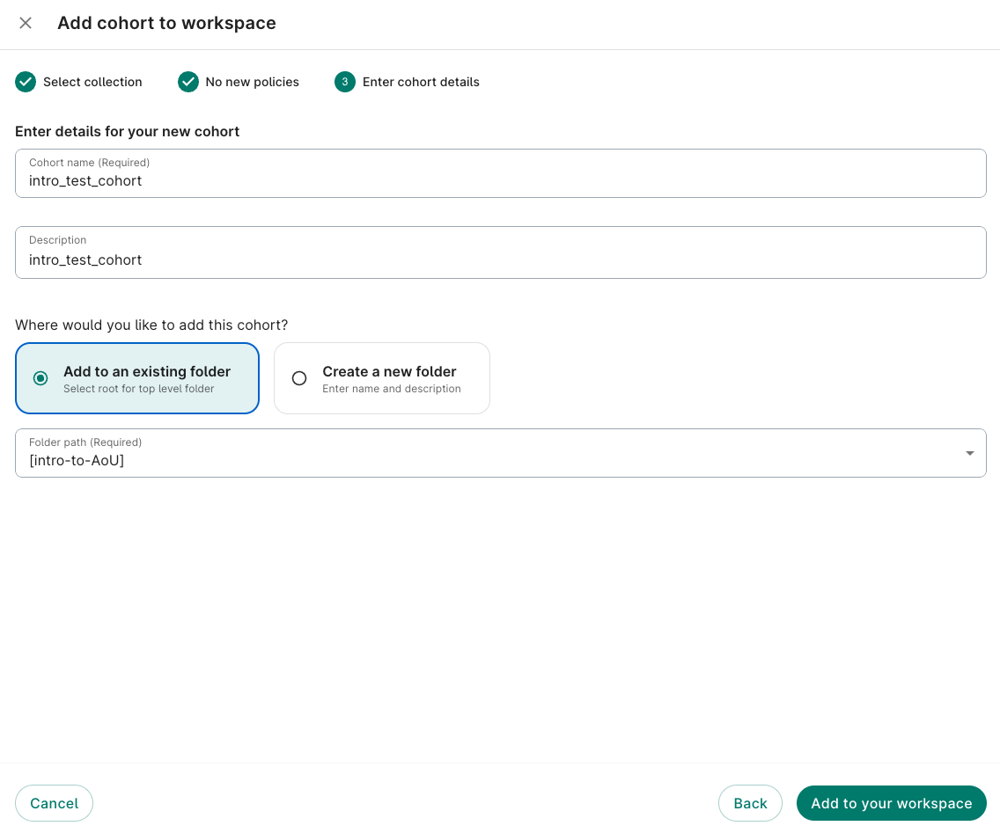

::: {.green-box style="left: 1.0%; top: 17.2%; width: 98.2%; height: 16.8%;"}
:::

::: {.green-box style="left: 1.0%; top: 40.4%; width: 48.6%; height: 9.6%;"}
:::

::: {.red-circle style="left: 79.0%; top: 93.4%; width: 20.2%; height: 5.8%;"}
:::
:::
:::
::: {.column .side width="45%"}
**Step 3: Enter cohort details**

- **Cohort name** (required) and **Description**
- Where to put it:
  - **Add to an existing folder** (pick the folder path; the workspace itself is the top level), or
  - **Create a new folder** (name, path, description)

Click **Add to your workspace**. Then build your cohort in **Data Explorer**.
:::
::::

::: notes
Use a name that says what the cohort is (e.g., diabetes_age50plus), not test names, so collaborators can tell cohorts apart. The cohort shows up on the Resources tab.
:::

## Building a Cohort

::: {.annotated .short}
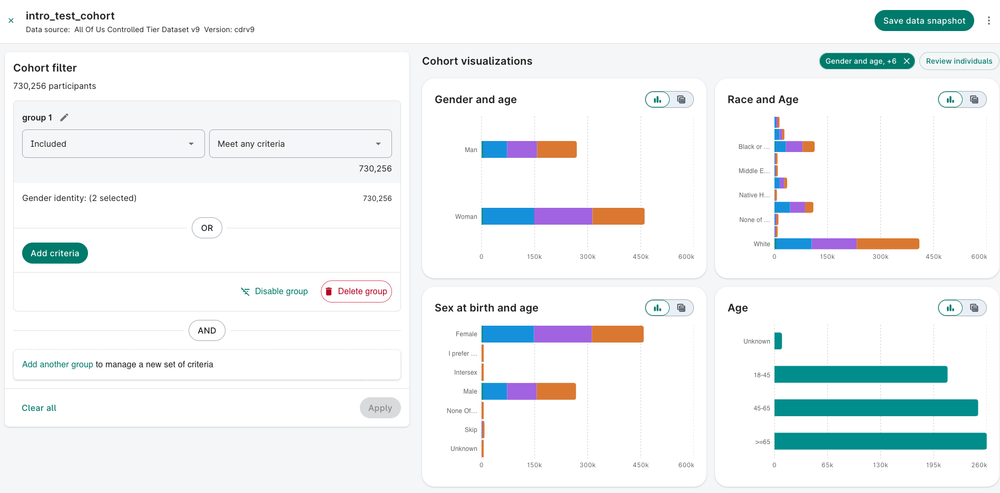

::: {.green-box style="left: 0.4%; top: 10.0%; width: 40.8%; height: 77.0%;"}
:::

::: {.red-circle style="left: 1.6%; top: 47.6%; width: 7.8%; height: 6.6%;"}
:::

::: {.red-circle style="left: 87.0%; top: 0.8%; width: 10.8%; height: 6.8%;"}
:::
:::

:::: {.columns}
::: {.column .side width="50%"}
**Cohort filter** (left): each **group** is **Included** or **Excluded** and must **meet any** (OR) or **all** (AND) of its criteria. Groups combine with **AND**. **Add criteria** → **Apply**; the participant count updates.
:::
::: {.column .side width="50%"}
**Cohort visualizations** (right): charts by gender, race, sex at birth, and age. When you're done, click **Save data snapshot**.

⚠️ **Review individuals** shows participant-level rows: never screenshot or share it
:::
::::

::: notes
Example: intro_test_cohort in the intro-to-AoU workspace, CDR v9, Gender identity = Man or Woman (730,256 participants). Only large counts are shown on these slides. Time-based criteria (e.g., within X days of an event) are supported.
:::

## Adding Criteria

::: {.annotated .short}
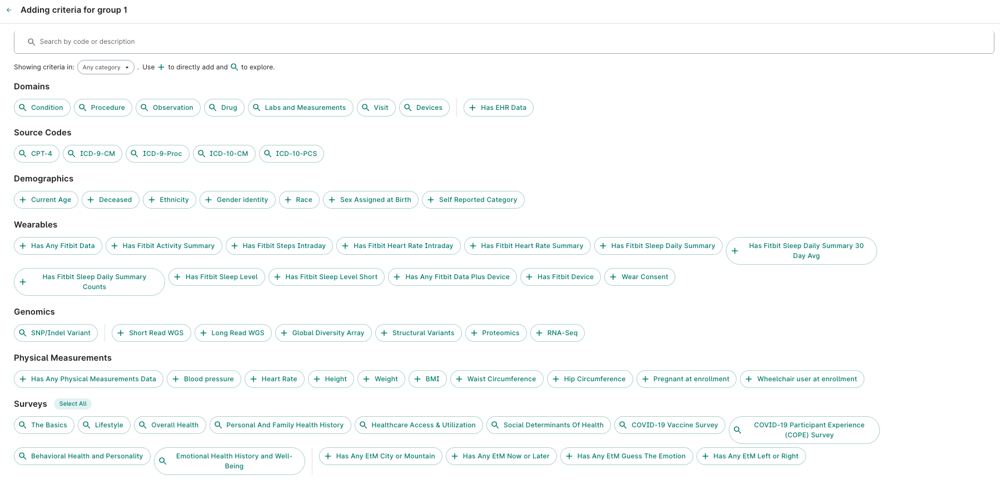

::: {.green-box style="left: 1.2%; top: 5.6%; width: 98.4%; height: 5.6%;"}
:::
:::

:::: {.columns}
::: {.column .side width="50%"}
**Add criteria** opens the full list: **domains** (conditions, drugs, labs, visits…), **source codes** (ICD-9/10, CPT-4), **demographics**, **wearables** (Fitbit), **genomics**, **physical measurements**, and **surveys**
:::
::: {.column .side width="50%"}
- **+** adds a criterion directly (e.g., *Has EHR Data*, *Current Age*)
- **🔍** lets you **explore** a category and pick specific concepts
- Or **search** by code or description (top)
:::
::::

::: notes
Example study population: Sex → Woman; Age → 65 or older; Condition → Breast cancer; Medication → Tamoxifen.
:::

## Concepts and Domains

| Domain                | Description                                    |
|-----------------------|------------------------------------------------|
| Conditions            | SNOMED standard codes (mapped from ICD9/ICD10) |
| Procedures            | SNOMED, CPT, ICD codes                         |
| Drugs                 | RxNorm; listed by ingredient                   |
| Measurements          | Labs and vitals, LOINC hierarchy               |
| Visits                | ED, outpatient, inpatient                      |
| Surveys               | Questions and responses                        |
| Physical Measurements | BP, HR, height, weight, BMI at enrollment      |
| Demographics          | Age, gender, race, ethnicity, deceased status  |

## OMOP Common Data Model

- An open standard for organizing and coding medical data consistently
- Each **concept** has a unique numeric `concept_id`
- All variations of the same clinical idea map to one **standard concept**
  - e.g., ICD-10 at one site and SNOMED-CT at another map to the same ID
- Explore the vocabularies at [Athena](https://athena.ohdsi.org/)

## Save a Data Snapshot: Select Data

::: {.annotated}
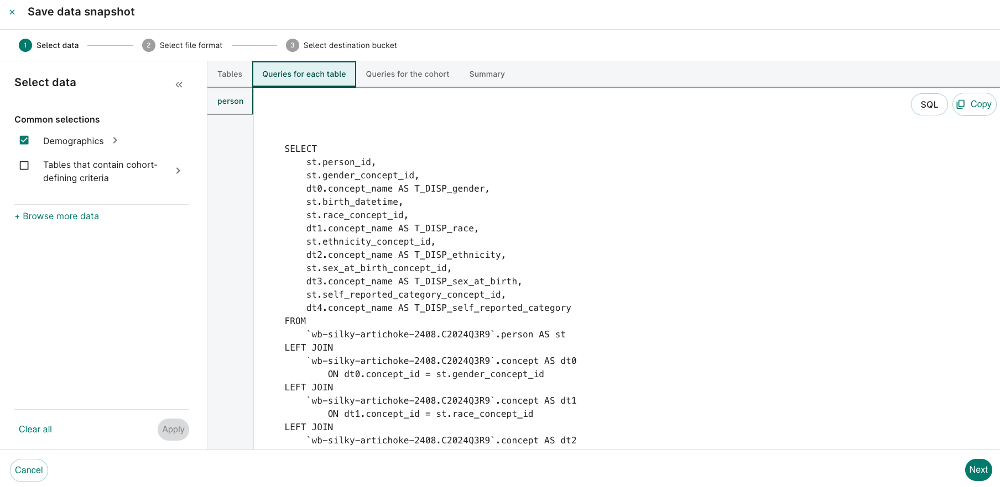

::: {.green-box style="left: 1.0%; top: 26.0%; width: 18.4%; height: 20.4%;"}
:::

::: {.green-box style="left: 20.6%; top: 12.4%; width: 30.8%; height: 5.6%;"}
:::

::: {.red-circle style="left: 95.2%; top: 18.6%; width: 4.8%; height: 5.6%;"}
:::

::: {.red-circle style="left: 95.8%; top: 93.0%; width: 4.2%; height: 6.4%;"}
:::
:::

:::: {.columns}
::: {.column .side width="50%"}
**Left:** pick the data (**Demographics**, **+ Browse more data**…) → **Apply**
:::
::: {.column .side width="50%"}
**Tabs:** tables, **SQL** (**Copy** it), **Summary** → **Next**
:::
::::

## Check the Summary

::: {.annotated .short}
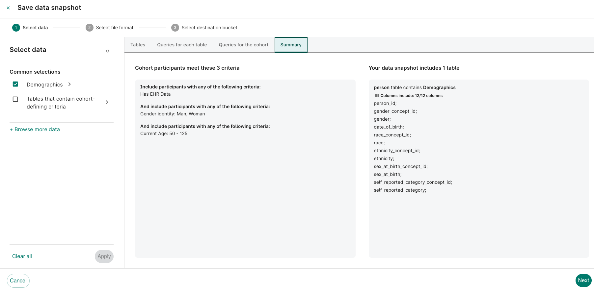

::: {.red-box style="left: 46.0%; top: 12.4%; width: 5.8%; height: 6.0%;"}
:::
:::

:::: {.columns}
::: {.column .side width="50%"}
**Left: your cohort's criteria**, e.g., *Has EHR data* **and** *Gender identity: Man, Woman* **and** *Current age: 50–125*
:::
::: {.column .side width="50%"}
**Right: what's in the snapshot**, e.g., the **person** table with 12 demographic columns
:::
::::

::: notes
Check this before saving: it's the plain-language version of the SQL. The example cohort is deliberately broad, so no small counts appear anywhere.
:::

## Save a Data Snapshot: File Format

:::: {.columns}
::: {.column width="55%"}
::: {.annotated}
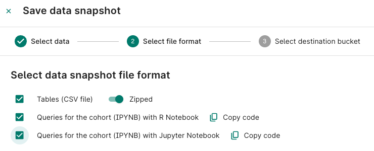

::: {.green-box style="left: 3.2%; top: 58.4%; width: 74.0%; height: 36.4%;"}
:::
:::
:::
::: {.column .side width="45%"}
Pick one or more:

- **Tables (CSV file):** the data itself, **zipped** or not
- **R Notebook** (`.ipynb`): R code with the queries
- **Jupyter Notebook** (`.ipynb`): the Python version

**Copy code** puts the code on your clipboard instead

Click **Next**
:::
::::

::: {.fragment}
👉 **Choose a notebook.** You can re-run and change the queries, and you learn how the data is pulled. CSVs are a fixed copy.
:::

## Save a Data Snapshot: Destination Bucket

:::: {.columns}
::: {.column .side width="34%"}
::: {.annotated .short}
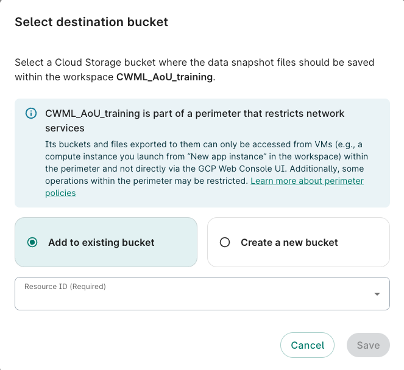

::: {.green-box style="left: 3.4%; top: 58.4%; width: 93.4%; height: 14.2%;"}
:::

::: {.red-box style="left: 3.4%; top: 74.6%; width: 93.4%; height: 9.6%;"}
:::
:::

**Existing bucket:** pick its **Resource ID** (grayed out if the workspace has no bucket yet)
:::
::: {.column width="28%"}
::: {.annotated}
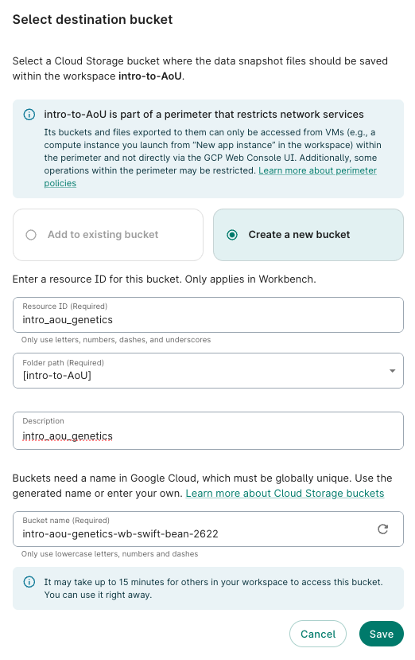

::: {.green-box style="left: 2.4%; top: 31.2%; width: 95.4%; height: 8.6%;"}
:::

::: {.green-box style="left: 2.4%; top: 76.8%; width: 95.4%; height: 6.4%;"}
:::

::: {.red-circle style="left: 84.4%; top: 93.4%; width: 14.2%; height: 5.4%;"}
:::
:::
:::
::: {.column .side width="38%"}
**Step 3:** where should the files go?

**New bucket:** the same fields as *New Cloud Storage Bucket*. The generated **bucket name** is your **Resource ID + your workspace's project ID**.

Click **Save**

::: {.fragment}
🔒 The files can only be opened from **apps in this workspace**, not from the Google Cloud console. That's the perimeter at work.
:::
:::
::::

::: notes
Example of a generated name: Resource ID intro_aou_genetics became bucket name intro-aou-genetics-wb-swift-bean-2622 (underscores turn into dashes). In a workspace with no bucket yet, "Add to existing bucket" is grayed out. Bucket names are public, so the Resource ID shouldn't contain personal details.
:::

## Inside the Exported R Notebook

The notebook has the **SQL** for each table, plus code to run it:

```{.r code-line-numbers="false"}
Sys.setenv(EXPORT_BUCKET = "gs://<your-bucket-name>")   # ⚠️ not set for you

bq_table_save(                                  # run the query (billed to your project)...
  bq_dataset_query("<data project>.<index dataset>", person_sql,
                   billing = "<your workspace project>"),
  person_path, destination_format = "CSV")      # ...and save it as CSVs in your bucket

person_df <- read_bq_export_from_workspace_bucket(person_path)   # read it back
```

::: {.fragment}
- **Set `EXPORT_BUCKET` first**, using the bucket name from the **Resources** tab
- **Run the export once.** Next time, just read the CSVs; re-running the query costs money.
- Exporting again **on the same day overwrites** the files; a new day makes a new folder
:::

::: notes
From an exported R notebook (cohort "cwml_aou_test_cohort", October 2026). The SQL reads OMOP tables from the data collection's BigQuery project (here wb-silky-artichoke-2408.C2024Q3R9) and the cohort from an index dataset (C2024Q3R9_index_022426.T_ENT_person); billing goes to your workspace project (GOOGLE_CLOUD_PROJECT). The notebook reads the CSVs back with gsutil. You can also read them from the mounted bucket folder (~/workspace/<bucket>/bq_exports/…) with read_csv. Don't run the notebook while screen-sharing: head(person_df) prints participant-level rows.
:::

# Apps

## Apps Tab

::: {.annotated .short}
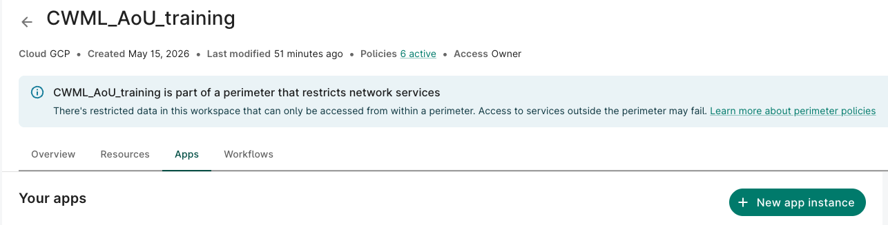

::: {.red-circle style="left: 18.2%; top: 60.0%; width: 6.6%; height: 16.0%;"}
:::

::: {.green-circle style="left: 81.0%; top: 81.0%; width: 17.4%; height: 18.6%;"}
:::
:::

:::: {.columns}
::: {.column .side width="50%"}
**What's here:**

- **Your apps:** the analysis environments in this workspace, with their status (*Running*, *Stopped*…)
- **Git repositories:** code linked to the workspace (see *Optional Extras*)
:::
::: {.column .side width="50%"}
**To start an app:** click **+ New app instance**, then:

1. Select app
2. Choose config
3. Compute options
4. Review details → **Create app**
:::
::::

::: notes
You need Writer or Owner access to create apps. Our example uses AoU Jupyter.
:::

## What Is an App?

- A **virtual computer in the cloud** with its own **disk** and software already installed (JupyterLab, R, Python, SAS…)
- Your buckets are **mounted** as folders, so your files are right there
- You pay for **computing while it runs** and for the **disk until you delete it**

| | Running | Stopped | Deleted |
|---|:-:|:-:|:-:|
| **Compute** charged | ✅ | ❌ | ❌ |
| **Disk** charged | ✅ | ✅ | ❌ |
| Files on the **app's disk** | kept | kept | **lost** |
| Files in your **bucket** | kept | kept | kept |

::: {.fragment}
👉 Apps **auto-stop** after **4 hours** idle by default. You can set 1 hour to 14 days.
:::

::: notes
Source: Verily, "Cloud apps overview" and "Basic cloud app operations". The disk is a persistent disk: it survives Stop/Start, but is deleted with the app.
:::

## Step 1: Select App

:::: {.columns}
::: {.column width="52%"}
::: {.annotated}
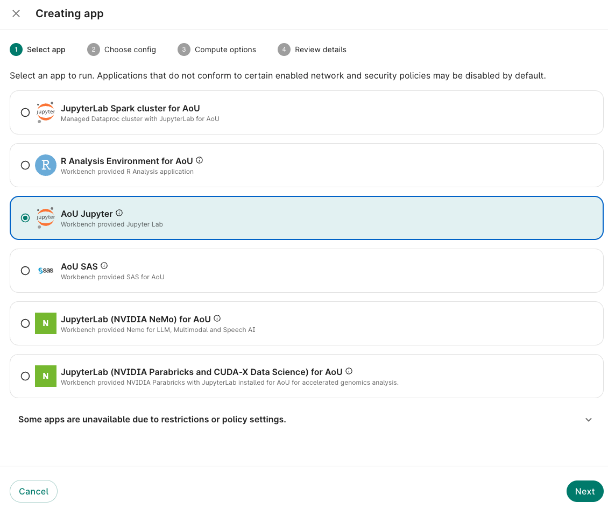

::: {.green-box style="left: 1.0%; top: 17.2%; width: 98.6%; height: 61.6%;"}
:::

::: {.red-box style="left: 1.8%; top: 38.4%; width: 97.0%; height: 8.8%;"}
:::

::: {.red-circle style="left: 91.4%; top: 93.0%; width: 8.4%; height: 6.6%;"}
:::
:::
:::
::: {.column .small width="48%"}
| App | Use it for |
|---|---|
| **JupyterLab Spark cluster** | Large-scale and genomic analysis (Dataproc cluster) |
| **R Analysis Environment** | R / RStudio |
| **AoU Jupyter** | Standard JupyterLab: Python or R notebooks |
| **AoU SAS** | SAS |
| **JupyterLab (NVIDIA NeMo)** | LLMs, multimodal, and speech AI (GPU) |
| **JupyterLab (NVIDIA Parabricks + CUDA-X)** | GPU-accelerated genomics |

👉 **Our example: AoU Jupyter.** Select it and click **Next**.
:::
::::

::: notes
Hover the ⓘ next to an app name for details. "Some apps are unavailable due to restrictions or policy settings": the All of Us app policy only allows approved apps in this workspace.
:::

## Step 2: Choose Config

:::: {.columns}
::: {.column width="55%"}
::: {.annotated}
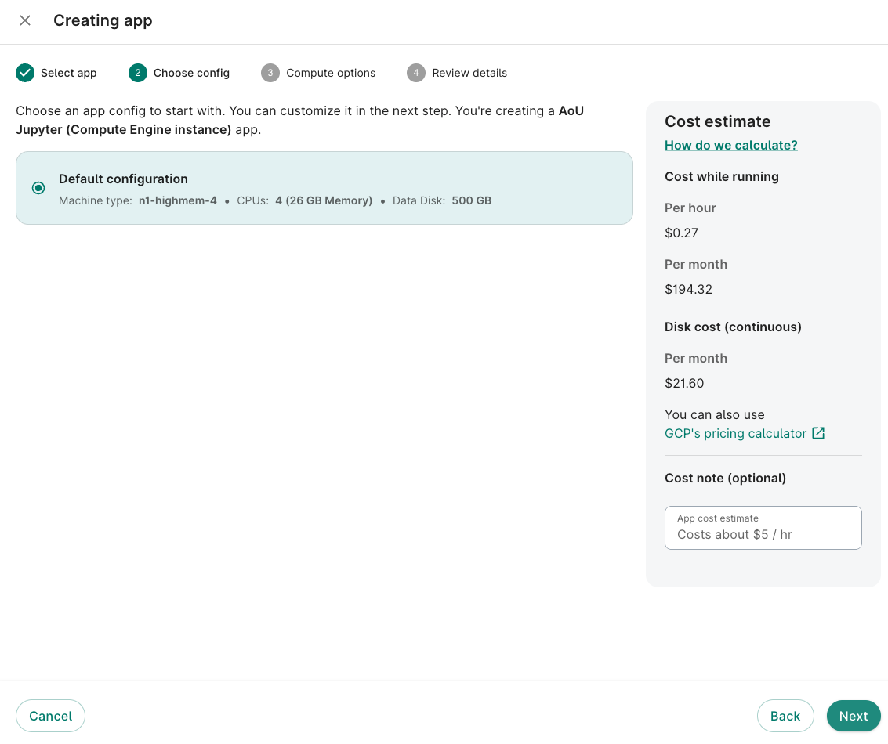

::: {.red-box style="left: 1.4%; top: 20.0%; width: 70.0%; height: 10.6%;"}
:::

::: {.green-box style="left: 72.2%; top: 13.0%; width: 27.4%; height: 66.4%;"}
:::

::: {.red-circle style="left: 92.0%; top: 93.0%; width: 7.8%; height: 6.6%;"}
:::
:::
:::
::: {.column .side width="45%"}
**Default configuration** (AoU Jupyter):

- Machine **n1-highmem-4**: 4 CPUs, 26 GB memory
- **500 GB** data disk

**Cost estimate** panel:

- **Cost while running:** \$0.27/hour, or \$194.32/month if left on 24/7
- **Disk cost (continuous):** \$21.60/month, **even when stopped**
- **How do we calculate?** and **GCP's pricing calculator** links
- **Cost note:** an optional reminder saved with the config

Click **Next**
:::
::::

::: notes
Saved configurations you or a collaborator created also appear here as options. Prices are estimates and vary by region.
:::

## Reading the Cost Estimate

**Example:** default AoU Jupyter, used **20 hours** in a month

| | |
|---|--:|
| Computing: 20 hours × \$0.27 | \$5.40 |
| Disk: the whole month, running or stopped | \$21.60 |
| **Total** | **≈ \$27** |

::: {.fragment}
👉 For light use, the **disk costs more than the computing**.

- **Delete** an app you're done with (save to your bucket first)
- A **smaller data disk** costs less (step 3)
:::

::: {.fragment}
**Not included:** BigQuery query costs, bucket storage, and data transfer
:::

::: notes
"Per month" assumes the app runs 24/7 (about 730 hours). For comparison, the default JupyterLab Spark cluster is about $0.64/hour ($465/month if left on) plus $37.60/month for disks. Source: Verily, "Cloud app cost estimates". This replaces the My AoU Cost Estimator app from Session 1.
:::

## Step 3: Compute Options

:::: {.columns}
::: {.column width="52%"}
::: {.annotated}
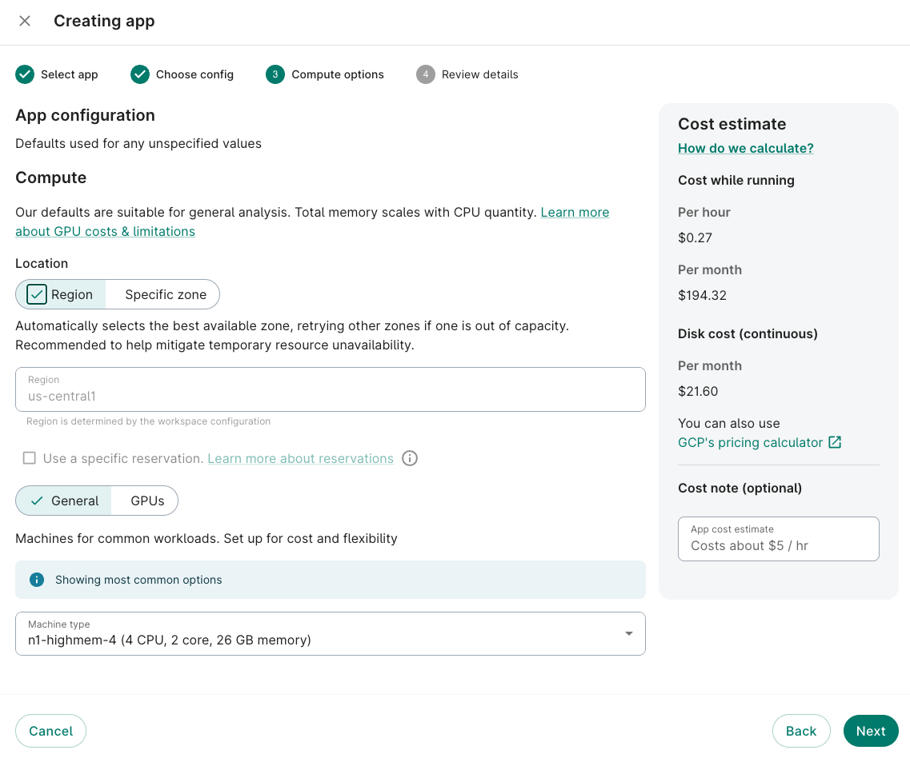

::: {.green-box style="left: 1.2%; top: 36.6%; width: 23.4%; height: 4.2%;"}
:::

::: {.green-box style="left: 1.2%; top: 63.4%; width: 18.6%; height: 5.0%;"}
:::

::: {.green-box style="left: 1.2%; top: 80.4%; width: 70.0%; height: 6.4%;"}
:::

::: {.red-circle style="left: 91.8%; top: 93.0%; width: 7.8%; height: 6.6%;"}
:::
:::
:::
::: {.column .side width="48%"}
- **Location:** keep **Region** (recommended). It picks a zone with free capacity for you. The region comes from the workspace.
- **General** or **GPUs:** General is fine for most analysis. GPUs cost much more and **can't be added later**.
- **Machine type:** CPUs + memory. More is faster but costs more; the estimate updates as you change it.
- **Scroll down** for **data disk size** (50 GB–64 TB; default 500 GB) and **autostop** (default 4 hours idle)

Click **Next**
:::
::::

::: notes
Leave "Use a specific reservation" unchecked; it's for reserved cloud capacity. This training workspace was created in us-central1, so that's the region shown. You can change the machine type and disk later, but only while the app is stopped.
:::

## Step 4: Review Details

:::: {.columns}
::: {.column width="52%"}
::: {.annotated}
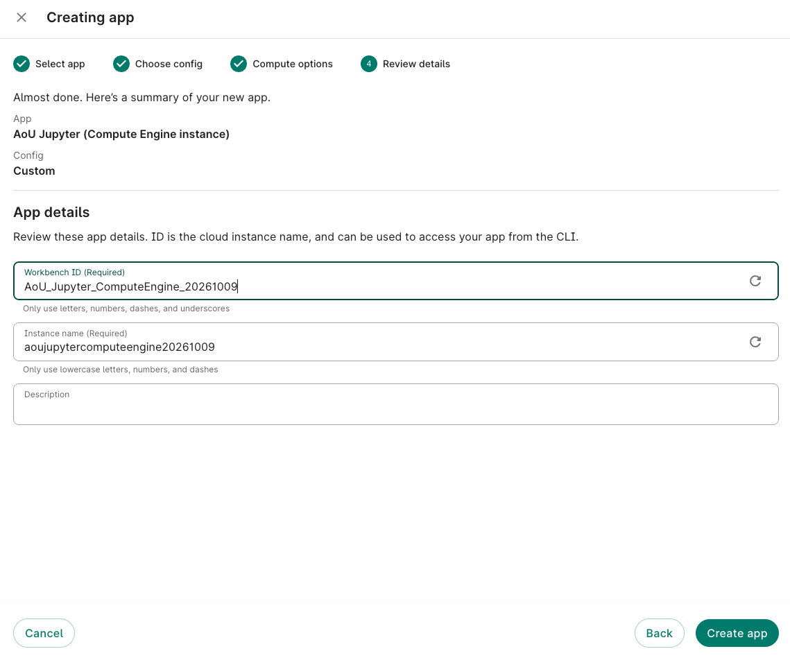

::: {.green-box style="left: 1.2%; top: 39.4%; width: 97.6%; height: 25.4%;"}
:::

::: {.red-circle style="left: 87.0%; top: 93.0%; width: 12.8%; height: 6.6%;"}
:::
:::
:::
::: {.column .side width="48%"}
- **Config:** shows **Custom** if you changed anything in step 3
- **Workbench ID:** the app's name in Workbench and the CLI (letters, numbers, `-`, `_`)
- **Instance name:** the cloud machine's name (lowercase, numbers, `-`). **Can't be changed later.**
- **Description** (optional)

Click **Create app**

::: {.fragment}
Status: *Creating* → *Provisioning* → *Starting* → **Running**. Then click the app's name to open it.
:::
:::
::::

::: notes
The generated names include the app type and date, which is fine to keep. Give the app a description if you'll have several.
:::

## Managing Your App

On the **Apps** tab:

| Action | What happens |
|---|---|
| **Open** | Click the app's name (when it's **Running**) |
| **Stop** | Stops it right away, with no confirmation. Computing charges stop; disk charges continue. |
| **Start** | Restarts a stopped app in about a minute |
| **Edit** | Name, description, and autostop: any time. Machine type and disk: only when **stopped**. |
| **Delete** | Removes the app **and its disk**. ⚠️ Anything not saved in a bucket is **lost**. |

: {tbl-colwidths="[15,85]"}

::: notes
You can't change an app's image (app type) or instance name; create a new app instead. Apps that are Starting or Stopping can't be changed until they finish. If someone loses Writer access to the workspace, their apps are stopped ("abandoned"); an Owner can restore the access or delete the app.
:::

## Working in Your App

- One query per domain/concept set
- Write your own code to clean and manipulate the data
- **Save cleaned data to workspace storage** so you don't re-run the queries every session

## Snippets Are Gone: Use Your Bucket Folder

**Classic Workbench:** copy files to and from the workspace bucket with **code snippets** (e.g., `copy_file_from_workspace_bucket.R`) that ran `gsutil`

**Workbench 2.0:** no Snippets menu. Your buckets are **automatically mounted as folders** in every app:

```
/home/jupyter/workspace/<bucket name>/     standard apps (JupyterLab, R, SAS)
/home/dataproc/workspace/<bucket name>/    Spark (Dataproc) apps
```

So you save and read files with **regular** R or Python functions, as if the bucket were a local folder. (No bucket yet? See *New Cloud Storage Bucket*.)

::: {.fragment}
- **Your own buckets:** read **and** write
- **References**, including data collection buckets (e.g., `v9-genomics-folder`): **read-only**. Don't save outputs there.
:::

::: notes
If you put a resource inside a folder on the Resources tab, the folder becomes part of the path (use quotes if the folder name has spaces). Mounts don't update on their own: a bucket you add (or rename) after the app starts won't show up until you restart the app or run wb resource mount (or wb resource mount --id=<resource> for one). A folder ending in _NO_ACCESS, _NOT_FOUND, or _MOUNT_FAILED means that mount failed. Duplicated workspaces keep their mounts. Source: Verily, "Access workspace files and folders".
:::

## Saving and Reading Files

**R**

```{.r code-line-numbers="false"}
bucket <- file.path(Sys.getenv("HOME"), "workspace", "workspace-bucket")

readr::write_csv(clean_df, file.path(bucket, "clean_data.csv"))   # save
clean_df <- readr::read_csv(file.path(bucket, "clean_data.csv"))  # read
```

**Python**

```{.python code-line-numbers="false"}
import os, pandas as pd
bucket = os.path.expanduser("~/workspace/workspace-bucket")

clean_df.to_csv(f"{bucket}/clean_data.csv", index=False)   # save
clean_df = pd.read_csv(f"{bucket}/clean_data.csv")         # read
```

::: notes
Replace workspace-bucket with your bucket's name as shown in the Resources tab. HOME / ~ points to /home/jupyter or /home/dataproc depending on the app, so this code works in both. The folder tree under ~/workspace matches the folders in the Resources tab. Apps use a standard disk, so files saved anywhere else on the app (e.g., the home directory) are lost if the app crashes or is deleted.
:::

## Workspace Variables

Some settings are **already defined** in every app. Others you define yourself.

| Variable | Set for you? | What it is |
|---|:-:|---|
| `GOOGLE_CLOUD_PROJECT` (also `GOOGLE_PROJECT`) | ✅ | Your workspace's Google Cloud project; BigQuery bills queries to it |
| `PET_SA_EMAIL` | ✅ | Your workspace service account (used by dsub) |
| `WORKSPACE_BUCKET` | ❌ | Classic Workbench only. Use your bucket's folder instead. |
| `WORKSPACE_CDR` | ❌ | Classic Workbench only. Define the dataset path yourself. |
| `EXPORT_BUCKET` | ❌ | Used by Data Explorer's exported notebooks. Set it yourself. |

```{.r code-line-numbers="false"}
project <- Sys.getenv("GOOGLE_CLOUD_PROJECT")                              # set for you
bucket  <- file.path(Sys.getenv("HOME"), "workspace", "workspace-bucket")  # your bucket
CURRENT_DATASET <- "<project-id>.<dataset-id>"   # copy from a Data Explorer query (FROM line)
```

::: notes
Checked in a new Workbench 2.0 workspace with env | grep -E 'WORKSPACE|GOOGLE|PET_SA'. The tutorial workspaces define WORKSPACE_BUCKET and WORKSPACE_CDR in their setup scripts, so code copied from classic Workbench notebooks will find them empty ("") elsewhere. The CDR dataset path is in the queries Data Explorer generates (the FROM clause), and in the data collection's BigQuery resources on the Resources tab.
:::

# Workflows

## Workflows Tab

::: {.annotated .short}


::: {.red-circle style="left: 16.4%; top: 3.0%; width: 8.0%; height: 36.0%;"}
:::

::: {.green-box style="left: 0.2%; top: 36.0%; width: 11.2%; height: 23.0%;"}
:::

::: {.green-circle style="left: 88.2%; top: 63.0%; width: 11.6%; height: 33.0%;"}
:::
:::

:::: {.columns}
::: {.column .side width="50%"}
**Two sub-tabs:**

- **Setup:** the workflows added to this workspace. Start new jobs here.
- **Job status:** follow your jobs and their tasks, and find logs and outputs
:::
::: {.column .side width="50%"}
**To start:** click **+ Add workflow**

A new workspace starts with **no workflows**. Add one before you can run a job.
:::
::::

## What Is a Workflow?

A **pipeline** that runs analysis steps for you, in order or in parallel, **without an app running**. Each step runs in its own container on a temporary cloud machine.

**Use it when you need to:** run the same analysis on many files or samples (e.g., genomics), or make it easy to reproduce and share

| Tool | Language | Where you run it |
|---|---|---|
| **Cromwell** | WDL | **Workflows** tab (or CLI) |
| **Nextflow** | Nextflow (`.nf`) | **Workflows** tab (or CLI) |
| **dsub** | Shell commands, one step | An app's **terminal** |

::: {.fragment}
👉 Most class projects **don't need workflows**: an app is enough. Ready-made workflows: [Dockstore](https://dockstore.org)
:::

::: notes
Source: Verily, "Workflows overview" and "Workflow engines". All three tools use the Google Batch API to run tasks, and read and write files in buckets (gs:// paths). Tasks run with the workspace's service account, which can access every bucket in the workspace. Costs (task machines and storage) are billed to the workspace's pod and are not shown in the app cost estimator.
:::

## Adding a Workflow

:::: {.columns}
::: {.column width="52%"}
::: {.annotated}


::: {.green-box style="left: 1.2%; top: 16.4%; width: 98.4%; height: 9.8%;"}
:::

::: {.red-box style="left: 1.2%; top: 27.0%; width: 98.4%; height: 6.6%;"}
:::

::: {.red-circle style="left: 91.8%; top: 93.0%; width: 8.2%; height: 6.6%;"}
:::
:::
:::
::: {.column .side width="48%"}
**Step 1: Provide source.** Where's the workflow file?

- **Workspace bucket:** pick the bucket. Workbench lists the workflow files it finds there (search by name).
- **Git repository:** a repo with the workflow (see *Optional Extras: GitHub*)

Select the workflow → **Next**

**Step 2: Review details** → add it

::: {.fragment}
Upload the workflow file (`.wdl` or `.nf`) to your bucket **first**. Until there's one to select, **Next** stays grey.
:::
:::
::::

::: notes
The bucket shown (dataproc-staging-aou-rw-…) is the staging bucket created for a Spark (Dataproc) app; your own bucket appears in the same list. Nextflow workflows should include a nextflow.config file next to the .nf file.
:::

## Running a Workflow

**Setup** tab → select the workflow → **+ New job**

1. Fill in the **inputs**. Workbench builds the form from the workflow file.
2. Choose an **output bucket** for the results
3. Start the job, then follow it on **Job status**: each task's progress, logs, and outputs

::: {.fragment}
**Batch jobs:** run one WDL workflow **many times in parallel**, e.g., once per sample

- Choose *Run a batch job with inputs defined by an input table*
- Upload a **CSV** (one row per run), then match its columns to the workflow's inputs
:::

::: notes
Source: Verily, "Use the Cromwell engine to run WDL workflows" and "Create batch jobs". Cromwell call caching is on by default, so re-running reuses results from steps that already finished. Limits: 1,000 outstanding jobs per user and 5,000 submitted in 24 hours; for a batch, the limit applies to each job, and a batch that exceeds it is rejected entirely. Genomic Variant Store (GVS) is an example of a large WDL workflow from the Broad Institute; Verily has a guide for it.
:::

## dsub: Jobs from an App

For **one-step** jobs, e.g., run a command on many files. It comes with apps created after **June 2025**.

```{.bash code-line-numbers="false"}
dsub_activate                        # turn on dsub in the terminal

dsub \
  --provider google-batch \
  --project "${GOOGLE_CLOUD_PROJECT}" \
  --service-account "${PET_SA_EMAIL}" \
  --logging gs://<your-bucket>/logs/ \
  --input  BAM=gs://<your-bucket>/sample.bam \
  --output BAI=gs://<your-bucket>/sample.bam.bai \
  --image  <container image with samtools> \
  --command 'samtools index ${BAM} ${BAI}' \
  --wait
```

::: {.fragment}
👉 More examples: tutorial notebook `05_How_to_use_workflow_tools` (dsub, Cromwell, Nextflow)
:::

::: notes
Source: Verily, "Run dsub jobs". Verily's example also sets the network and subnetwork; check the tutorial notebook for the exact flags in an All of Us workspace. Each dsub job starts its own cloud machine, billed to your pod.
:::

# Storage & Costs

## Storage

- **Workspace bucket:** shared, permanent, and the cheapest option for long-term storage. Recommended. (You create it; see *New Cloud Storage Bucket*.)
- **App disk:** attached to an app. Charged **until the app is deleted**, even when stopped. Files on it survive *Stop* but are **lost** on *Delete*.

::: notes
See *What Is an App?* and *Reading the Cost Estimate* in the Apps section.
:::

## Saving Money

- Save your data to workspace storage
- **Stop or delete apps** you aren't using; keep **autostop** on
- Your notebooks and data in workspace storage stay intact
- Start a new app any time to pick up where you left off
- Delete workspaces you no longer need

::: {.fragment}
⚠️ Deleting a workspace **permanently deletes** everything created in it, **including your bucket and its files**. It can't be undone. Copy anything you need first.
:::

::: notes
Only Owners can delete a workspace. References (e.g., the All of Us data collection) are only pointers, so the underlying data isn't affected.
:::

# Optional Extras

## What's in This Section

Useful tools you **don't need** for the basics:

- **Practice with synthetic data:** learn SQL on fake patients
- **Add a file from a URL:** pull a public file into your bucket
- **GitHub:** back up and share your code
- **AI tools:** why to use them **outside** the Workbench

::: notes
More extras will be added here over time.
:::

## Try It: Practice with Synthetic Data

Google hosts a free, **synthetic** (fake) OMOP dataset: **CMS SynPUF**. It has the same table layout as the All of Us CDR, with **no real participants**.

Add it as a **BigQuery dataset reference**:

- **Project ID:** `bigquery-public-data`
- **Dataset ID:** `cms_synthetic_patient_data_omop`

Then query it from an app:

```{.r code-line-numbers="false"}
library(bigrquery)
query <- "SELECT gender_concept_id, COUNT(*) AS n
          FROM `bigquery-public-data.cms_synthetic_patient_data_omop.person`
          GROUP BY gender_concept_id"
df <- bq_table_download(bq_project_query(Sys.getenv("GOOGLE_CLOUD_PROJECT"), query))
```

::: {.fragment}
👉 Use a **separate practice workspace** with no All of Us data. Controlled Tier perimeters may block outside data.
:::

::: notes
Source: Verily, "Work with OMOP data in BigQuery" (their example uses Python). Example notebooks: github.com/verily-src/workbench-examples. Because it's synthetic, students can share results and screenshots freely, unlike All of Us data. Queries are billed to your pod (BigQuery charges by data scanned; small queries like this cost very little). GOOGLE_CLOUD_PROJECT and GOOGLE_PROJECT are both set in Workbench apps, with the same value.
:::

## Add a File from a URL

Copy a **public** file from the web straight into your bucket. No download or upload needed.

:::: {.columns}
::: {.column width="52%"}
::: {.annotated}


::: {.green-box style="left: 3.0%; top: 28.8%; width: 94.2%; height: 15.0%;"}
:::

::: {.green-box style="left: 3.0%; top: 55.0%; width: 94.2%; height: 17.4%;"}
:::

::: {.red-circle style="left: 69.0%; top: 81.6%; width: 28.6%; height: 15.0%;"}
:::
:::
:::
::: {.column .side width="48%"}
1. **Resources** tab → select your bucket → **Add file via URL**
2. **URL:** a **public** or **signed** link to the file
3. **File name:** what to call it in the bucket (the default is `import-` + date and time)
4. Click **Add file to bucket** and wait for it to finish

- Files up to **100 MB**

::: {.fragment}
⚠️ **In a Controlled Tier workspace this may fail** ("Couldn't add that file"): the perimeter blocks many outside downloads. Instead, **upload** the file in JupyterLab, or keep it in a **GitHub repo** and clone it.
:::
:::
::::

::: notes
Source: Verily, "Add files to Cloud Storage via URL", and the dialog in an All of Us Controlled Tier workspace (the option is available there). The transfer runs while you wait, so keep the page open. Tested October 2026 in the intro-to-AoU Controlled Tier workspace: a public GitHub raw URL (reachable from outside, HTTP 200) failed with "Couldn't add that file. Try again later, or contact support for help." Most likely the perimeter blocks the transfer. It should work in workspaces without a perimeter (e.g., a practice workspace with no All of Us data). GitHub over git/SSH does work inside the perimeter.
:::

## Connect GitHub

**Why:** back up your code, track changes, and share it with collaborators

**Add your Workbench SSH key to GitHub** (once):

1. **Profile icon** (top right) → **Manage your profile** → **Groups & keys** tab
2. Copy your **public SSH key**. Workbench creates one for you.
3. In GitHub: **Settings** → **SSH and GPG keys** → **New SSH key**. Paste it and give it a clear name, e.g., *Workbench SSH key*.
4. If your GitHub **organization** uses single sign-on (SSO), **authorize** the key for it

::: notes
Source: Verily, "Git integrations with cloud apps". CLI alternatives: wb security ssh-key get (show the key) and wb security ssh-key generate (make a new one). The key is needed to push to any repo and to clone private ones; cloning a public repo over https works without it. GitHub is reachable from inside an All of Us (Controlled Tier) workspace: tested with ssh -T git@github.com, clone, and push. Source for the testing: the CWML guide "Sharing Your All of Us Workbench Code on GitHub".
:::

## Add a Repository

**Apps** tab → **Git repositories** → **+ Add repository**

- **Public repo:** use the `https://github.com/…` URL (no key needed)
- **Private repo:** use the `git@github.com:…` URL (needs your SSH key)
- It's **cloned automatically** into apps you create **afterward**. For an app you already have, run this in its terminal:

```{.bash code-line-numbers="false"}
wb git clone --resource=<repo resource name>
```

Then work as usual: `git add` → `git commit` → `git push`

::: {.fragment}
⚠️ **Commit code only.** Clear notebook outputs first, e.g., `jupyter nbconvert --clear-output --inplace *.ipynb`. Never commit data files or results.
:::

::: notes
This repository (CWML All-of-Us-Training-Resources) is a public example students could add. Outputs can contain participant-level data or small counts, which must not leave the Workbench.
:::

## GitHub: Things to Know

- **Test the connection:** `ssh -T git@github.com`. *"Hi username! You've successfully authenticated…"* means it works.
- **Set your name and email** once per app: `git config --global user.name` / `user.email`. For a public repo, use your GitHub **noreply** email.
- **Clone into your home folder (`~`), not `~/workspace/…`.** That's a mounted bucket, and Git doesn't work well there.
- **The clone lives on the app's disk.** Push before you delete the app.

::: {.fragment}
⚠️ **Before every push:** clear outputs, leave out data files (`.csv`, `.vcf`…), check for passwords or tokens, and read `git status`. Pushed data by mistake? Deleting it in a new commit **doesn't** remove it from Git history. Make the repo private and contact All of Us support.
:::

::: notes
From the CWML guide "Sharing Your All of Us Workbench Code on GitHub" (to become the GitHub page on the website). It covers adding work to an existing repo (branch and pull request), creating a new repo, keeping in sync, and troubleshooting. Two copies of a notebook drift apart: work from the repo copy, not the copy in ~/workspace.
:::

## AI Tools: Use Them Outside the Workbench

Interested in using an AI tool (e.g., Claude, ChatGPT, Gemini) for help with your code? **Use it outside the Workbench**, for **coding help only**.

**Why not inside the Workbench?**

- All of Us does **not allow participant-level data to leave the Workbench**, and that includes sending it to an AI service
- AI coding assistants like **Claude Code** can **open files and run code on their own**. It's easy for them to read **data files**, **query results**, or **notebook outputs** that contain participant-level data.
- Even one accidental read counts as a **Data User Code of Conduct violation**, even if nothing is stored

::: {.fragment}
👉 **How:** get your code from GitHub (outputs cleared, no data), ask the AI on your own computer, then bring the fixed code back into your workspace
:::

::: notes
Source: All of Us User Support Hub, "Frequently Asked Questions" (support.researchallofus.org/hc/en-us/articles/52861503885460): AI/ML tools used on participant data must run only within the Researcher Workbench, with no outgoing API; "transit of individual-level data to any external system is considered a DUCC violation, even if the data is not stored or used." Summary statistics that follow the dissemination policy (no counts under 20) may be shared. Claude Code and Gemini CLI can be installed in Workbench apps, but both send what they read to outside services (Anthropic, Google), so this training recommends not using them there.
:::

# Wrap-up

## Good Habits

- **Save everything to your bucket**: notebooks, cleaned data, plots, logs. Files left on the app's disk are lost if the app crashes or is deleted.
- **Use GitHub** for your code, and **push every day**. It's your backup if an app fails.
  - Connect GitHub with your Workbench **SSH key** (see *Optional Extras*)
  - ⚠️ **Code only:** clear notebook outputs before you commit. No participant-level data or counts of 1–20 may leave the Workbench.
- **AI tools: use them outside the Workbench**, for code only (see *Optional Extras*)
- **Stop apps** when you're not using them
- **Keep your description up to date**, along with your Research Use Statement

::: notes
Source: Verily, "Workbench best practices".
:::

## Helpful Resources

- [Researcher Workbench Getting Started Guide](https://support.researchallofus.org/hc/en-us/articles/41981050556564-Researcher-Workbench-Getting-Started-Guide)
- [Workbench 2.0 Glossary of Terms and Comparison Guide](https://support.researchallofus.org/hc/en-us/articles/44371414196116-Researcher-Workbench-2-0-Glossary-of-Terms-and-Comparison-Guide)
- [Data Explorer in Researcher Workbench](https://support.researchallofus.org/hc/en-us/articles/41981213271188-Data-Explorer-in-Researcher-Workbench)
- [Using All of Us Initial Credits](https://support.researchallofus.org/hc/en-us/articles/28920849686036-Using-All-of-Us-Initial-Credits)
- [Set up billing with pods (Verily)](https://support.workbench.verily.com/docs/getting_started/billing_setup/)
- [Verily Workbench documentation](https://support.workbench.verily.com/docs/)

## Future Directions

Future CWML/BIDS courses to help you work with All of Us:

- R, Python, SQL
- OMOP Common Data Model
- Open to suggestions!
- Let us know if you'd like to present your All of Us work
- Check the library training calendar for current courses

## Questions {.center}

## Course Survey {.center}

[Course survey](https://yalesurvey.ca1.qualtrics.com/jfe/form/SV_cZOk3RQmTrQLhYy)