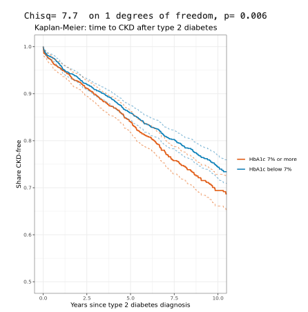

**Core series, class 9 of 9** · R (survival) · 90 minutes

[Open the notebook on GitHub](https://github.com/CWML/All-of-Us-Training-Resources/blob/main/notebooks/core/3.4%20survival_analysis.ipynb){.btn .btn-outline-primary .btn-sm}
[Core series overview](index.qmd){.btn .btn-outline-secondary .btn-sm}

## Overview

Among people with type 2 diabetes, **how long until chronic kidney disease (CKD)**, and who gets it sooner? With the dates gathered in 1.2 (time zero, the event, censoring), we draw **Kaplan–Meier curves** and fit a **Cox model**.

### Why this class matters

"How long until" questions are everywhere in health research: time to a complication, to a hospital readmission, to death. Survival methods are built for them, because they use **everyone's** follow-up, including people who leave the records without the event. This class also lists the traps specific to health record data, which a tidy-looking curve can hide.

### By the end you'll be able to

1. Build **time-to-event** data with censoring
2. Estimate and plot **Kaplan–Meier** curves with ggplot2, and compare them with a **log-rank test**
3. Fit a **Cox** model, and read **hazard ratios**
4. Check the **proportional-hazards** assumption
5. Explain the pitfalls of survival analysis in health records

### Analysis at a glance

| | |
|---|---|
| ❓ **Question** | After a type 2 diabetes diagnosis, how quickly do people develop CKD, and is it faster with higher HbA1c? |
| 🧪 **The analysis** | **Kaplan–Meier** curves by HbA1c group, a **log-rank** test, then a **Cox** model adjusted for age at diagnosis, sex, and BMI |
| 🎯 **Why** | People are followed for different lengths of time; censoring uses all of it |
| ✅ **What we conclude** | The share CKD-free over time, and hazard ratios |
| ⚠️ **What it can't tell us** | Cause. HbA1c and BMI are the **latest** values, often measured after time zero |
| 🔗 **Connections** | Dates from **1.2**, joined in **2.3**; builds on **3.2** and **3.3** |

### Time and cost

| | |
|---|---|
| ⏱️ **Class time** | 90 minutes |
| ⏱️ **Run time** | under 1 minute |
| 💰 **Cost** | about **$0.40**: no queries, only app time |
| 📋 **Before class** | run **2.3** |

## Class plan

| Time | Part | You do |
|---|---|---|
| 0:00 | **1. Key concepts**: survival curves, hazards, censoring | listen, ask |
| 0:15 | **2. Build the survival data** | run the cells |
| 0:30 | **3. Kaplan–Meier curves**, log-rank test, number at risk | ✋ **Try It Out** (5 min) |
| 0:55 | **4. Cox model** | run the cells |
| 1:10 | **5. Check proportional hazards** | run the cells |
| 1:20 | **6. Discuss the pitfalls** | discuss |

## Key concepts

| Term | Means |
|---|---|
| **Survival curve** | the share still **event-free** over time |
| **Censored** | the clock stopped without the event; counted for as long as we saw them |
| **Hazard** | the event rate at a moment, among those still at risk |
| **Hazard ratio (HR)** | the hazard in one group ÷ another: HR 1.5 = the event comes 50% faster |
| **Proportional hazards** | the Cox model's assumption that each HR stays constant over time |

## Follow along in the Workbench

1. Start your app and pull the newest notebooks, as in [1.1](1-1-build-cohorts.qmd#follow-along-in-the-workbench).
2. Open `notebooks/core/3.4 survival_analysis.ipynb`, with the **R** kernel.

## Try It Out

::: {.callout-tip}
## ✋ Try It Out · 5 minutes · Part 3, "Your turn"

Draw Kaplan–Meier curves by **sex at birth**, and run the log-rank test. Do men and women differ?

**✅ Check:** two curves and a log-rank p-value. Keep only the main categories, so each curve has enough people.
:::

## Code walk-through

```r
km_fit <- survfit(Surv(time_years, status) ~ hba1c_group, data = surv_data)   # <1>
km_df  <- tidy(km_fit) %>%                                                     # <2>
  mutate(group = str_remove(strata, "hba1c_group="))

ggplot(km_df, aes(time, estimate, colour = group)) +
  geom_step(linewidth = 0.9) +                                                  # <3>
  geom_step(aes(y = conf.low),  linetype = "dashed", alpha = 0.6) +
  geom_step(aes(y = conf.high), linetype = "dashed", alpha = 0.6)

survdiff(Surv(time_years, status) ~ hba1c_group, data = surv_data)             # <4>

cox_model <- coxph(Surv(time_years, status) ~ age10_at_t2d + sex_at_birth + BMI5 + hba1c_group,
                   data = cox_data)                                             # <5>
```
1. `Surv(time, status)` is the outcome: follow-up time, and 1 for CKD or 0 for censored. `survfit()` estimates one Kaplan–Meier curve per HbA1c group.
2. `tidy()` turns the curves into a table that ggplot2 can draw (the notebook also adds a starting point at 100%).
3. Kaplan–Meier curves are **steps**, not smooth lines; the dashed steps are the 95% confidence limits. This replaces the `survminer` package, which doesn't install in the app.
4. The **log-rank test**: are the curves different?
5. The **Cox model**: hazard ratios for several predictors at once, each adjusted for the others.

## What we found

Results from our test run in October 2026 (CDR v9), cases with follow-up after diagnosis.

| Years since diagnosis | Share CKD-free (95% CI) |
|---|---|
| 1 | 95.6% (95.0 to 96.3) |
| 3 | 90.6% (89.7 to 91.5) |
| 5 | 85.4% (84.2 to 86.6) |
| 10 | **73.0%** (71.3 to 74.8) |

- **By HbA1c group:** the curve for HbA1c 7% or more dropped faster; log-rank **p = 0.006**. 977 people without an HbA1c result were left out of this comparison.

| Cox model | Hazard ratio (95% CI) |
|---|---|
| Age at diagnosis, per 10 years | **1.50** (1.40 to 1.61) |
| Male (vs female) | 1.17 (1.01 to 1.35) |
| BMI, per 5 units | 1.10 (1.04 to 1.15) |
| HbA1c 7% or more | **1.28** (1.11 to 1.49) |

**💬 Discuss the pitfalls:**

1. **Covariate timing:** HbA1c and BMI are the latest values, often measured after time zero, sometimes after CKD.
2. **Late time zero:** records that start late make the first diabetes date too late.
3. **Competing risks:** people who die are censored as if they could still get CKD.
4. **Who gets tested:** people who see doctors more often are diagnosed sooner (**surveillance bias**).
5. **The outcome definition:** one CKD code, or a lab-based definition?

### The plot

{fig-alt="Kaplan-Meier curves of the share CKD-free over 10 years after a type 2 diabetes diagnosis, with dashed 95 percent confidence limits. Both curves fall steadily; the curve for HbA1c 7 percent or more drops faster, to about 0.69 at 10 years, than the curve for HbA1c below 7 percent, about 0.73. The log-rank test above the plot gives a chi-square of 7.7 and p equal to 0.006."}

The number-at-risk table uses `hide_small_counts()`, so it can be shared as text.

## Instructor notes

::: {.callout-tip collapse="true"}
## Instructor tip

- Start with the "everyone together" curve before splitting by HbA1c: one curve is easier to read.
- The pitfalls discussion is the most valuable part of the class for researchers new to EHR data. Leave at least 10 minutes.
- The Cox model drops categories that were filtered out (`droplevels()`): without it, rare sex-at-birth categories show up as `NA` rows.
:::

## Key takeaways

- Survival analysis needs **time zero**, an **event**, and **censoring**
- **Kaplan–Meier** curves show the share event-free; the **log-rank test** compares them
- The **Cox model** gives adjusted **hazard ratios**; check **proportional hazards**
- In health records, watch covariate timing, late time zero, competing risks, and who gets tested

## Next

That's the end of the core series. The **[omics series](../omics/index.qmd)** uses the same cohort with genetic, RNA, and protein data.
