**Core series, optional demonstration** · no code to build; R to use it · about 30 minutes

[Core series overview](index.qmd){.btn .btn-outline-secondary .btn-sm}
[1.1 Build the cohort (with SQL)](1-1-build-cohorts.qmd){.btn .btn-outline-secondary .btn-sm}

## Overview

In **1.1** we build the cohort with **SQL**. Workbench 2.0 also has a point-and-click tool, the **Data Explorer**, that builds a cohort from a menu of criteria: no code needed. This page shows how to build our **type 2 diabetes cases** with it, how to save a **data snapshot**, and how to read a Data Explorer cohort into a notebook.

::: {.callout-important}
## The Data Explorer uses CDR v8; the course notebooks use CDR v9

As of October 2026, the Data Explorer offers only version **v8r9**, the *All of Us* Controlled Tier **CDR v8** (BigQuery dataset `C2024Q3R9`). The course notebooks use **CDR v9** (`C2025Q4R6`). Participant IDs **changed** between v8 and v9, so:

- Use the Data Explorer to **learn the tool**, and to explore quickly.
- **Don't combine** a Data Explorer cohort with the course notebooks' files: the IDs won't match.
- **Don't copy** the dataset name from a Data Explorer query into `aou_setup.R`.
:::

### Why it's worth knowing

- It's the fastest way to **see** how many people meet a set of rules, and to try changes, without writing a query.
- Its **Summary** and **Queries** tabs show the **SQL** it writes: a good way to learn how a cohort turns into a query.
- Collaborators who don't code can build and share cohorts in the same workspace.

### Same rules, different numbers

Built in the Data Explorer, our cases came to **65,710** people. The SQL in 1.1 found **80,919**. Same rules, different counts:

| | Data Explorer | 1.1 (SQL) |
|---|---|---|
| Data | **CDR v8** (2024 data cutoff) | **CDR v9** (2025 cutoff): more participants, more years of records |
| Age | 18+ **today** | 18+ on **2025-01-01** |
| "Has EHR data" | *All of Us*'s ready-made flag | at least one EHR visit, including records participants share themselves |
| Cases | **65,710** | **80,919** |

**💬 Discuss:** the same rules on different data, or with slightly different definitions, give different counts. What should you always report with a count? (The data version, and the exact definitions.)

## Build the cases

### 1. Create the cohort

On the **Resources** tab: **+ New resource** → **New Cohort**.

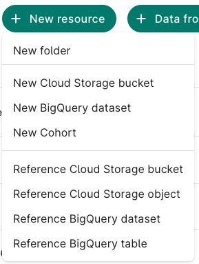{fig-alt="The New resource menu on the Resources tab, listing New folder, New Cloud Storage bucket, New BigQuery dataset, New Cohort, and four Reference options."}

**Select collection:** **All of Us Controlled Tier**. Its version shows as **v8r9**, the only one offered. **Next**, then **Next** again (no new policies are needed: the workspace already has this data collection).

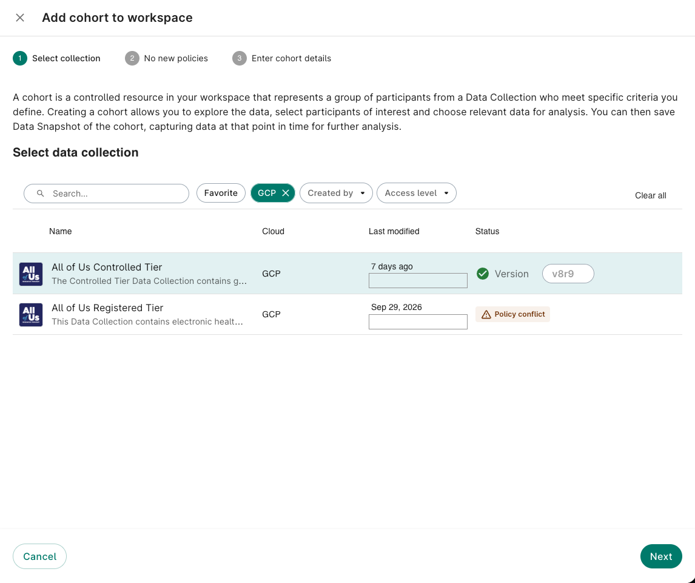{fig-alt="Add cohort to workspace dialog, step 1, Select collection. All of Us Controlled Tier is selected, with a green check and version v8r9. All of Us Registered Tier shows a policy conflict. The Last modified column's staff names are painted out."}

**Enter cohort details:**

| Field | Enter |
|---|---|
| Cohort name | `t2d_cases` |
| Description | *Type 2 diabetes cases for the CWML training series (Data Explorer demonstration, CDR v8): adults (18+) with EHR data and a type 2 diabetes diagnosis, and no type 1 diabetes diagnosis. Same rules as notebooks/sql/t2d_cohort.sql.* |
| Folder | **Create a new folder** called `cohorts`, so your cohorts stay together |

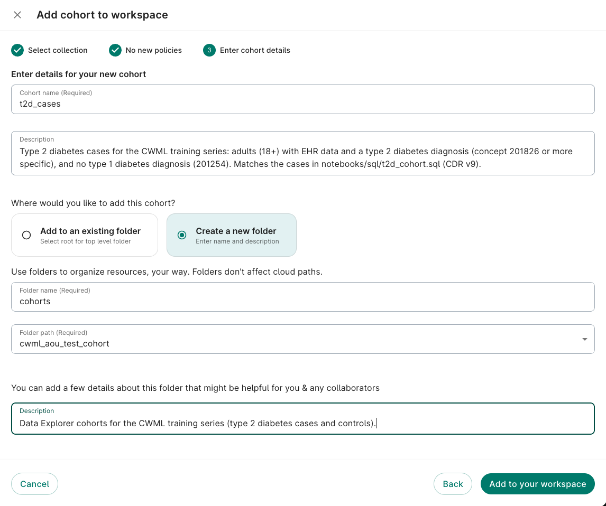{fig-alt="Step 3, Enter cohort details: cohort name t2d_cases, a description, and Create a new folder selected with the folder name cohorts and a folder description."}

Click **Add to your workspace**. The cohort opens with an empty **Cohort filter**: everyone in the data collection.

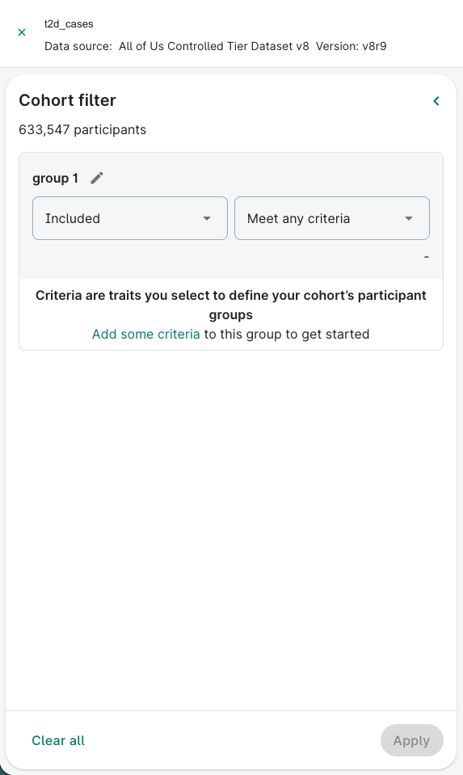{fig-alt="Empty Cohort filter for t2d_cases, data source All of Us Controlled Tier Dataset v8, version v8r9, showing 633,547 participants and group 1 set to Included and Meet any criteria."}

### 2. Add the criteria

Each **group** is a set of criteria; groups combine with **AND**. Within a group, choose **Meet any criteria**. Click **Add some criteria** to open the list:

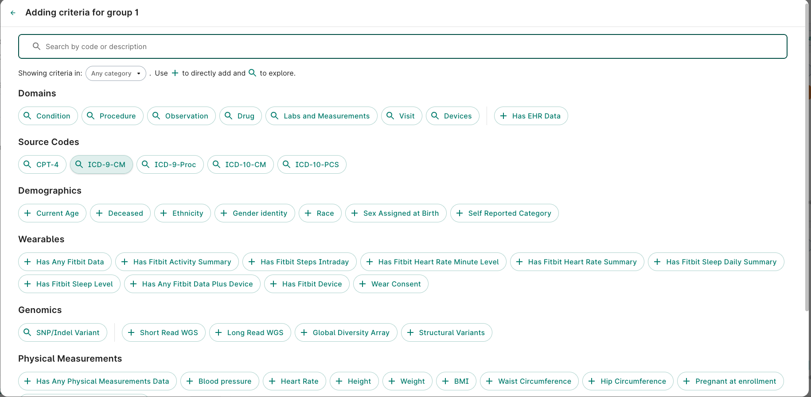{fig-alt="Adding criteria for group 1: a search box, then buttons for Domains (Condition, Procedure, Observation, Drug, Labs and Measurements, Visit, Devices, and Has EHR Data), Source Codes, Demographics (including Current Age), Wearables, Genomics, and Physical Measurements."}

| Group | Included or Excluded | Criteria |
|---|---|---|
| 1 | **Included** | Demographics → **Current Age**: 18 to 125 |
| 2 | **Included** | Domains → **Condition** → search *type 2 diabetes* → tick **Type 2 diabetes mellitus** (concept 201826) |
| 3 | **Excluded** | Domains → **Condition** → **Type 1 diabetes mellitus** (concept 201254) |
| 4 | **Included** | Domains → **Has EHR Data** |

For group 2, ticking *Type 2 diabetes mellitus* also includes every more specific concept **under** it: the rows below it in the list are ticked automatically (the same idea as `concept_ancestor` in 1.1). **View in hierarchy** shows the tree.

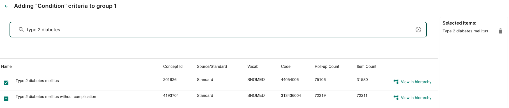{fig-alt="Adding Condition criteria: a search for type 2 diabetes. Type 2 diabetes mellitus, concept 201826, is ticked; the more specific Type 2 diabetes mellitus without complication, concept 4193704, is ticked automatically below it. Selected items lists Type 2 diabetes mellitus."}

For group 3, change **Included** to **Excluded**, then add *Type 1 diabetes mellitus*:

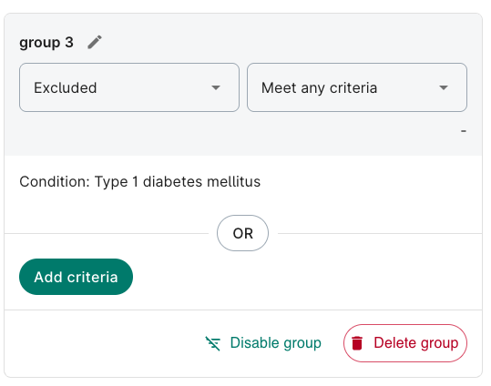{fig-alt="Group 3 set to Excluded, with the criterion Condition: Type 1 diabetes mellitus."}

The top of the finished filter, with the groups joined by **AND** (scroll down for groups 3 and 4):

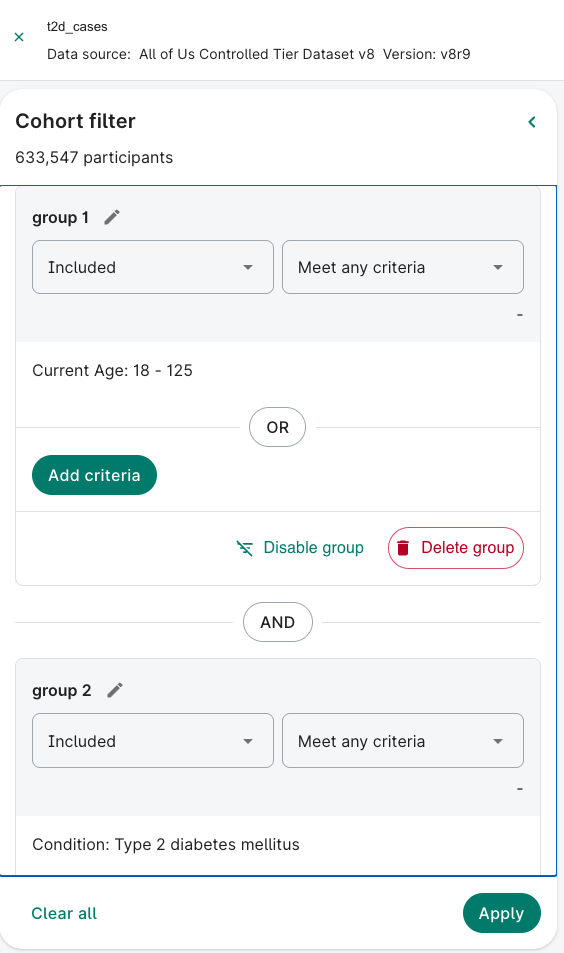{fig-alt="Cohort filter for t2d_cases with group 1, Included, Current Age 18 to 125, AND group 2, Included, Condition Type 2 diabetes mellitus, and an Apply button at the bottom."}

Click **Apply**. The participant count at the top updates: **65,710** in our test.

### 3. The controls (optional)

The same steps, with a cohort called `t2d_controls` and these groups:

| Group | Included or Excluded | Criteria |
|---|---|---|
| 1 | **Included** | Current Age: 18 to 125 |
| 2 | **Included** | Has EHR Data |
| 3 | **Excluded** | Condition → **Diabetes mellitus** (concept **201820**): every type of diabetes |

## Save a data snapshot

A **data snapshot** saves the cohort's data (as CSV files) and/or the **queries** that produce it (as a notebook) to a bucket. Click **Save data snapshot** at the top right of the cohort.

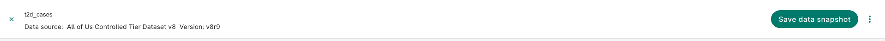{fig-alt="The top bar of the t2d_cases cohort, showing its data source and version, and a Save data snapshot button on the right."}

**Select data:** **Demographics** is ticked by default; **+ Browse more data** adds other tables (e.g. measurements). In each table, untick the columns you don't need.

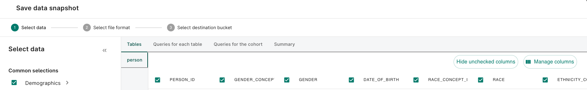{fig-alt="Save data snapshot, step 1, Select data, Tables tab: the person table with checkboxes for each column, such as PERSON_ID, GENDER, DATE_OF_BIRTH, and RACE."}

The **Summary** tab lists the criteria and the tables, in plain words: a good check before saving.

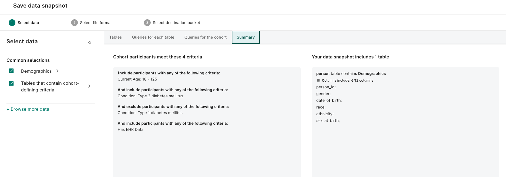{fig-alt="Summary tab: cohort participants meet 4 criteria (current age 18 to 125, type 2 diabetes mellitus, excluding type 1 diabetes mellitus, and has EHR data); the snapshot includes 1 table, person, with 6 of 12 columns."}

The **Queries for each table** and **Queries for the cohort** tabs show the SQL and the code (R or Python) that the snapshot uses. You can **Copy** them.

**Select file format:** CSV tables (zipped), and/or a notebook with the queries, in R or Python.

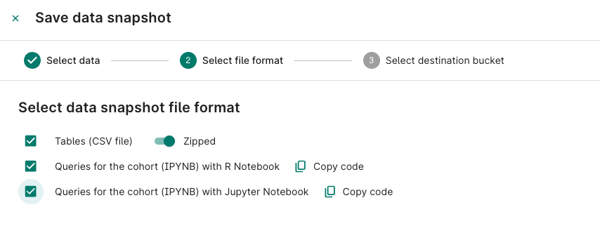{fig-alt="Select file format: options for Tables as zipped CSV files, Queries for the cohort as an R notebook, and Queries for the cohort as a Jupyter (Python) notebook, each with a Copy code link."}

**Select destination bucket:** pick your workspace bucket, then **Save**.

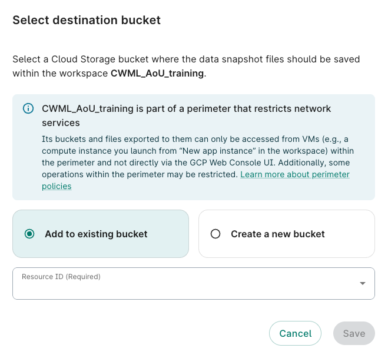{fig-alt="Select destination bucket: a note that the workspace is inside a security perimeter, a choice between adding to an existing bucket or creating a new one, and a Resource ID drop-down."}

The cohort appears on the **Resources** tab, in the folder you chose:

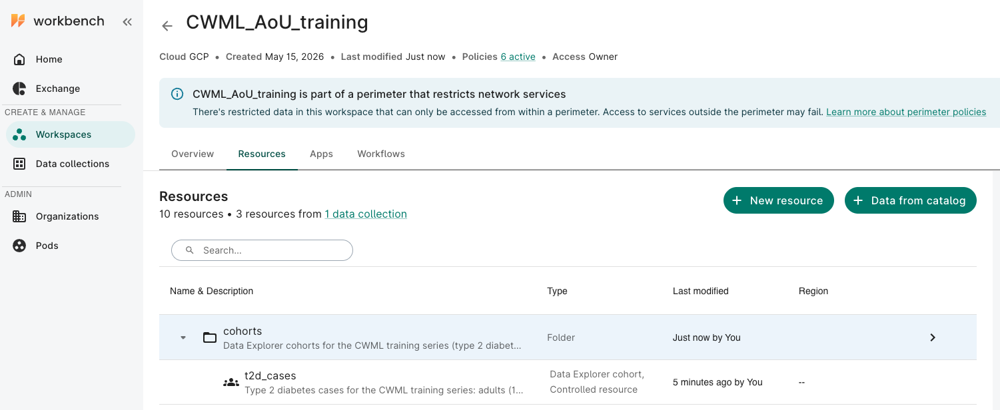{fig-alt="Resources tab listing the cohorts folder and, inside it, the t2d_cases Data Explorer cohort, a controlled resource."}

## Use a Data Explorer cohort in a notebook

Two ways. The first is simpler, and works with the course's `aou_setup.R`.

### A. Run its query from R (simplest)

1. In **Save data snapshot** → **Queries for each table** → **person**, click **Copy**.
2. In an R notebook in `notebooks/core/`, paste it between `r"---(` and `)---"`:

```r
source("../aou_setup.R")   # run_query() and BILLING_PROJECT

de_person_sql <- r"---(
  -- paste the query here: it starts with SELECT and ends with the WHERE clause
)---"

de_cases <- run_query(de_person_sql) %>%
  mutate(person_id = as.character(person_id))

nrow(de_cases)                    # should match the Data Explorer's count
de_cases %>% count(T_DISP_sex_at_birth)
```

- `r"---( … )---"` is a **raw string**: R keeps everything inside as it is, quotes and backslashes included, so the SQL needs no editing.
- The query reads the Data Explorer's own tables (`C2024Q3R9` and `C2024Q3R9_index_…`), so the people are **CDR v8** participants.
- Columns starting `T_DISP_` are the **display names** of concept IDs (e.g. `T_DISP_race` for `race_concept_id`).
- 💰 A few cents: it reads the `person` table and the Data Explorer's index tables.

### B. Use the snapshot's own notebook

If you chose **Queries for the cohort (IPYNB) with R Notebook**, the snapshot saves a notebook to your bucket that exports each table to CSV files and reads them back. Two things to know:

- It needs your bucket's **Cloud Storage address** in a setting called `EXPORT_BUCKET`, which Workbench 2.0 doesn't set for you. Find the address on the **Resources** tab (your bucket's details, starting `gs://`), then uncomment and edit the line near the top: `Sys.setenv(EXPORT_BUCKET = "gs://…")`.
- The code includes your workspace's **project ID** for billing. That's fine in your workspace, but don't publish it.

## Key takeaways

- The **Data Explorer** builds a cohort from criteria, with no code: groups combine with **AND**; a group can be **Excluded**
- Choosing a condition includes everything **under** it in the hierarchy
- A **data snapshot** saves CSV files and/or the queries as a notebook
- The Data Explorer currently uses **CDR v8**: don't combine its cohorts with the course's **v9** files
- The same rules on different data give **different counts**: always report the version and definitions

## Next

Back to **[1.1 Build the cohort](1-1-build-cohorts.qmd)**, which builds the same cohort with SQL on CDR v9.
