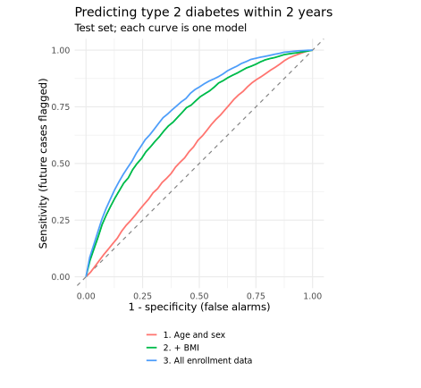
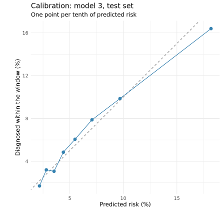
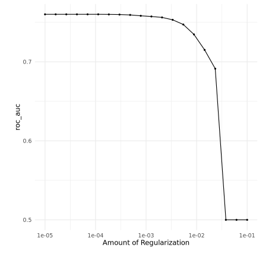

**Machine learning series, class 1 of 4** · R + SQL · 95 minutes

[Open the notebook on GitHub](https://github.com/CWML/All-of-Us-Training-Resources/blob/main/notebooks/ml/7.1%20first_prediction_model.ipynb){.btn .btn-outline-primary .btn-sm}
[Machine learning series overview](index.qmd){.btn .btn-outline-secondary .btn-sm}
[Machine learning for beginners](ml-for-beginners.qmd){.btn .btn-outline-secondary .btn-sm}

## Overview

Can we tell, on the day someone joins *All of Us*, who is likely to be diagnosed with type 2 diabetes in the next **2 years**? In this class we build that prediction from what's known at enrollment: age, sex, BMI, blood pressure, and a few survey answers. We fit a **logistic regression**, test it on people it has never seen, and then try **LASSO**, a method that chooses predictors for us.

### Why this class matters

Every earlier class **explained**: is income, steps, or a variant linked to diabetes? Prediction asks a different question, for **one person**, and has different traps. The biggest is **leakage**: using information you wouldn't have had at the time. In *All of Us*, most people with diabetes were diagnosed before they joined, so a careless model learns the **consequences** of diabetes, not its warning signs.

### By the end you'll be able to

1. Turn a research question into a **prediction** question: who, from what, predicting what, by when
2. Build an outcome that only uses the **future**, and predictors that only use the **past**
3. Split the data into **training** and **test** sets, and say why
4. Fit a **logistic regression** with **tidymodels**, and measure it with the **AUC**
5. Check **calibration**: do predicted risks match what happened?
6. Tune a **LASSO** with **cross-validation**, and compare it with the simple model

### Analysis at a glance

| | |
|---|---|
| ❓ **Question** | From what's known at enrollment, how well can we predict a **new** type 2 diabetes diagnosis within 2 years? |
| 🧪 **The analysis** | Adults without diabetes at enrollment, with BMI and blood pressure measured then; a 75/25 train/test split; logistic regression (age and sex, + BMI, + everything), then LASSO tuned by 5-fold cross-validation |
| 🎯 **Why** | Logistic regression is the standard first model for a yes/no outcome. Testing on held-out people shows how it would do on **new** people |
| ✅ **What we conclude** | How well enrollment data separate people who will and won't be diagnosed (AUC), whether the risks are right (calibration), and how much each kind of data adds |
| ⚠️ **What it can't tell us** | Cause: a predictor can predict without causing anything. And whether the model works outside *All of Us* |
| 🔗 **Connections** | The cohort query from **1.1**; plausible values from **2.1**; logistic regression from **3.2**; survey answers from **5.1–5.3**; "measure first, then follow" from **6.2** |

### Time and cost

| | |
|---|---|
| ⏱️ **Class time** | 95 minutes |
| ⏱️ **Run time** | about 10 minutes, plus up to **15 minutes the first time** to install tidymodels |
| 💰 **Cost** | about **$1 to $2** per student: the cohort query, and one query for everyone's enrollment data, priced first |
| 📋 **Before class** | read [Machine learning for beginners](ml-for-beginners.qmd); **3.2** (logistic regression) is helpful |

## Class plan

| Time | Part | You do |
|---|---|---|
| 0:00 | **1. Key concepts**: explaining vs predicting; the timeline; leakage | listen, discuss |
| 0:15 | **2–3. The cohort; what's known at enrollment**, in one query | run the cells |
| 0:30 | **4. Who's in the analysis**: the flow table; the outcome | run the cells |
| 0:40 | **5. Training and test sets** | run the cells |
| 0:45 | **6. Logistic regression and the AUC**: three models | run the cells, discuss |
| 1:00 | **7. ROC curve and calibration**; a screening rule | run the cells, discuss |
| 1:15 | **8. LASSO with cross-validation** | ✋ **Your turn** (10 min) |
| 1:30 | **Wrap-up** | |

## Key concepts

### The prediction question

```
                enrollment (time zero)                       2 years later
                        |──────────── follow-up ──────────────|
  predictors: age, sex, BMI and blood pressure     outcome: a NEW type 2 diabetes
  measured around this day; survey answers         diagnosis in these 2 years? yes / no
  given by 30 days after it
  excluded: type 2 diabetes on or before this day
```

| | Our choice | Why |
|---|---|---|
| **Who** | adults with no diabetes at enrollment | you can't predict a diagnosis that has already happened: about **77%** of cases were diagnosed before enrollment |
| **From what** | data from around enrollment only | a model used on the day someone joins can only use what's known that day |
| **Predicting what** | a new type 2 diabetes code within 2 years | the shared case definition (**1.1**), dated |
| **Who counts** | people seen in health records for 2 years, or diagnosed sooner | someone whose records stop early might have been diagnosed without us seeing it |

### Is it leakage?

| Predictor | Leakage? |
|---|---|
| BMI at enrollment | ✅ no: known at time zero |
| HbA1c after enrollment | ❌ yes: it's how diabetes is diagnosed |
| A metformin prescription | ❌ yes: a treatment for diabetes |
| A survey answered after the diagnosis | ❌ yes: the answer may reflect the diagnosis (**5.2**) |

More in [Machine learning for beginners](ml-for-beginners.qmd#leakage-the-most-common-way-to-fool-yourself).

## Follow along in the Workbench

Open `notebooks/ml/7.1 first_prediction_model.ipynb` in your app, with the **R** kernel. The setup cell installs tidymodels the first time (up to 15 minutes): start it before class if you can.

## ✋ Your turn · 10 minutes · after Part 8

1. **A longer window.** Change `HORIZON_YEARS <- 2` to `3` in the setup cell, and run Parts 4 to 7 again. What happens to the number of people, the number of new cases, and the AUC? Why does the number of people **fall**?
2. **Which predictor matters most?** Fit model 3 without BMI, `fit_logistic(setdiff(PREDICTORS, "bmi"))`, and compare its test AUC with model 3's.
3. **Does it work as well for everyone?** Compute the test AUC separately for women and men:

```r
test_pred %>%
  group_by(sex_at_birth) %>%
  roc_auc(truth = t2d_future, .pred_yes, event_level = "second")
```

## Code walk-through

### What's known at enrollment, in one query

Enrollment is each person's first survey. BMI and blood pressure are the values **closest** to it, within a year before and 30 days after; survey answers must be given by 30 days after. Later answers could be leakage.

```sql
answers AS (
  SELECT s.person_id, s.question_concept_id, s.answer, s.survey_datetime
  FROM `{CURRENT_DATASET}.ds_survey` AS s
  JOIN enroll AS e ON s.person_id = e.person_id
  WHERE s.question_concept_id IN (...)
    AND DATE(s.survey_datetime) <= DATE_ADD(e.enroll_date, INTERVAL 30 DAY)  -- <1>
)
```
1. Only answers given by 30 days after enrollment: what a model used at enrollment could know.

### A flow table, one rule at a time

```r
keep <- accumulate(rules, `&`)                                    # <1>

tibble(rule = names(rules), people = map_int(keep, sum)) %>%
  mutate(removed = lag(people) - people,
         across(c(people, removed), ~ if_else(removed %in% 1:20, NA_integer_, .x)))  # <2>
```
1. `accumulate()` combines each rule with every rule before it: rule 1, then 1 and 2, then 1, 2 and 3, …
2. A step that removes 1 to 20 people would show a small count: it's hidden.

### Three models, one function

```r
fit_logistic <- function(predictors) {
  workflow() %>%
    add_formula(reformulate(predictors, response = "t2d_future")) %>%   # <1>
    add_model(logistic_reg()) %>%
    fit(data = train)                                                    # <2>
}

test_auc <- function(fit, model) {
  augment(fit, new_data = test) %>%                                      # <3>
    roc_auc(truth = t2d_future, .pred_yes, event_level = "second") %>%   # <4>
    transmute(model, test_auc = round(.estimate, 3))
}
```
1. `reformulate()` builds a formula from a list of names: `t2d_future ~ age + sex_at_birth + bmi`.
2. Fitted on the **training** set only.
3. `augment()` adds each test person's predicted risk, `.pred_yes`.
4. The outcome's levels are `no`, `yes`, so the event, `yes`, is the **second** level.

### LASSO, tuned by cross-validation

```r
lasso_recipe <- recipe(t2d_future ~ ., data = train) %>%
  step_spline_natural(age, bmi, sbp, deg_free = 4) %>%             # <1>
  step_dummy(all_nominal_predictors()) %>%
  step_interact(terms = ~ starts_with("sex_at_birth"):matches("^(age|bmi|sbp)_")) %>%   # <2>
  step_normalize(all_numeric_predictors())                          # <3>

lasso_tuning <- tune_grid(lasso_workflow,
                          resamples = vfold_cv(train, v = 5, strata = t2d_future),   # <4>
                          grid      = grid_regular(penalty(range = c(-5, -1)), levels = 20),
                          metrics   = metric_set(roc_auc))

chosen <- select_by_one_std_err(lasso_tuning, desc(penalty), metric = "roc_auc")   # <5>
```
1. Natural **splines**: each number becomes 4 columns, so its effect can bend.
2. **Interactions** with sex: the curves can differ for women and men.
3. All columns on the same scale, so the penalty treats them fairly.
4. 5-fold **cross-validation**, on the training set only.
5. The **largest** penalty (the simplest model) within one standard error of the best.

## What we found

From our test run in November 2026 (CDR v9). The query read 31.8 GB, about **$0.20**.

### Who was studied

| Rule | People | Removed |
|---|---|---|
| in the cohort query, with an enrollment survey | 426,596 | |
| not "excluded" (type 1 or unclear diabetes) | 412,831 | 13,765 |
| no type 2 diabetes by enrollment | 350,404 | 62,427 |
| 18 or older; sex at birth Female or Male | 346,925 | 3,479 |
| BMI and blood pressure at enrollment | 295,908 | 51,017 |
| health records for 2 years, or diagnosed sooner | **152,586** | 143,322 |

**8,487** people (**5.6%**) were diagnosed with type 2 diabetes within 2 years of enrolling (2017 to 2024). The 2-year rule removed the most people: those who enrolled recently, and those whose health records stop. A survival model (**3.4**, **6.2**) could keep them.

The 75/25 split gave 114,439 people for training and 38,147 for testing, each with about 5.5% new cases.

### How well the models predict

| Model | Test AUC |
|---|---|
| 1. Age and sex | 0.577 |
| 2. + BMI | 0.709 |
| 3. All enrollment data (+ blood pressure, general health, income, education, smoking) | **0.743** |
| 4. LASSO: splines and interactions | 0.748 |

{fig-alt="ROC curves for three models on the test set. The age-and-sex curve stays close to the dashed diagonal. The model with BMI bows well above it, and the model with all enrollment data sits a little higher again, reaching a sensitivity of about 0.7 at 0.3 false alarms."}

- **Age and sex** barely beat a coin toss: everyone here was free of diabetes at enrollment, at every age.
- **BMI** added the most.
- **The survey answers** added a useful amount more, mostly through **general health**.
- **LASSO** matched logistic regression: with a few strong predictors, bending the lines added little.

### What the model uses

Odds ratios from model 3, with 95% confidence intervals:

| Predictor | OR (95% CI) |
|---|---|
| BMI, per unit (kg/m²) | 1.07 (1.07 to 1.07): about 1.40 per 5 units |
| Male (vs female) | 1.43 (1.35 to 1.51) |
| Age, per year | 1.02 (1.02 to 1.02) |
| General health *Good* (vs *Excellent*) | 2.13 (1.86 to 2.43) |
| General health *Fair* | 3.21 (2.80 to 3.68) |
| General health *Poor* | 4.74 (4.06 to 5.54) |
| Income under 25k (vs 100k or more) | 1.39 (1.26 to 1.54) |
| Less than high school (vs college degree) | 1.56 (1.42 to 1.72) |
| Current smoker (vs never) | 1.07 (0.99 to 1.16) |

**Self-rated health** was the strongest survey predictor: people who rate their health as poor may already have diabetes, undiagnosed. That helps a prediction, and says nothing about cause.

### Are the risks right?

{fig-alt="Calibration plot for model 3 on the test set: observed percentage diagnosed against predicted risk, one point per tenth of predicted risk. Seven points lie close to the dashed diagonal, from about 2% to 10%; the highest group is at about 18% predicted and 16% observed, a little below the line. The two lowest-risk groups are hidden."}

Predicted risks ranged from about **0.9%** in the lowest tenth to **18%** in the highest, and the observed rates followed them closely, up to **16.4%** in the top tenth: a little **over**-predicted. The two lowest-risk tenths had 1 to 20 new cases, so they're hidden.

**A screening rule:** the 10% of people with the highest predicted risk included **30%** of all future cases. **16.4%** of them were diagnosed within 2 years, compared with **4.2%** of everyone else.

### Choosing the LASSO penalty

{fig-alt="Cross-validated AUC against the LASSO penalty, on a log scale from 0.00001 to 0.1. The AUC is flat at about 0.76 for small penalties, falls slowly from about 0.003, drops steeply after 0.01, and reaches 0.5 at the largest penalties."}

The AUC was flat for small penalties, then fell as the penalty removed useful predictors. At the largest penalties, every coefficient was zero, and the AUC was **0.5**: the same risk for everyone.

## Instructor notes

- **Draw the timeline** first: time zero, predictors before it, the 2-year window after it. Most of the class follows from it.
- **Open with the surprise:** about 77% of people with type 2 diabetes in *All of Us* were diagnosed before they enrolled. Ask: what would a model learn from them?
- **"Is this leakage?"** Read out the leakage table's predictors one at a time, and ask for a show of hands.
- **AUC vs calibration:** ask which matters for a patient told "your risk is 8%".
- **LASSO ≈ logistic regression here** is a result, not a failure: with a few strong predictors, more flexibility adds little. 7.2 tests that with trees.

::: {.callout-tip}
## Instructor tip
Run the setup cell **before class**: installing tidymodels can take 15 minutes the first time in a new app. Ask students to do the same.
:::

## Key takeaways

- A **prediction** question has four parts: who, from what (known **when**?), predicting what, and **by when**.
- **Leakage** is avoided by dating every predictor, and starting the clock at **time zero**.
- Judge a model on a **test set** it never saw: **AUC** for ranking, **calibration** for the numbers.
- **Cross-validation** chooses settings on the training set, so the test set stays honest.
- A simple model with the right predictors is hard to beat.

## Next

[**7.2 Trees and boosting**](7-2-trees-and-boosting.qmd): random forests and gradient boosting on the same data. Do flexible models find anything logistic regression missed?
