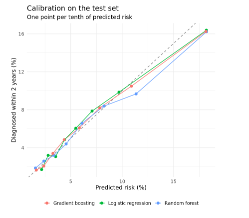
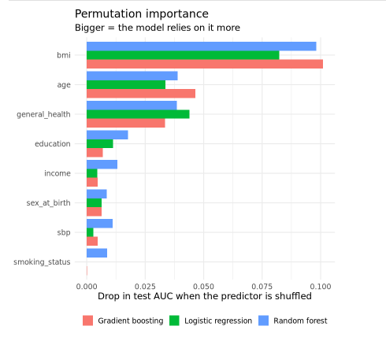
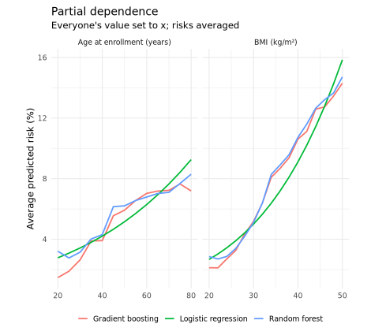

**Machine learning series, class 2 of 4** · R (+ a Python companion) · 95 minutes

[Open the notebook on GitHub](https://github.com/CWML/All-of-Us-Training-Resources/blob/main/notebooks/ml/7.2%20trees_and_boosting.ipynb){.btn .btn-outline-primary .btn-sm}
[Python companion (7.2b)](https://github.com/CWML/All-of-Us-Training-Resources/blob/main/notebooks/ml/7.2b%20trees_in_python.ipynb){.btn .btn-outline-primary .btn-sm}
[Machine learning series overview](index.qmd){.btn .btn-outline-secondary .btn-sm}

## Overview

In [7.1](7-1-first-prediction-model.qmd), a logistic regression predicted new type 2 diabetes within 2 years with a test AUC of about **0.74**, and LASSO did no better. Is that the limit of what enrollment data can tell us, or did the models miss something? In this class we try two of the most popular machine learning methods for tables of data, **random forests** and **gradient boosting**, on the **same people** and the **same test set**, and look inside them.

### Why this class matters

"Machine learning" often means tree-based models: they win many prediction competitions on tabular data. Knowing when they help, and when a simple model is just as good, is one of the most useful judgements in applied prediction. So is being able to look **inside** a model, whatever kind it is.

### By the end you'll be able to

1. Explain how a **decision tree**, a **random forest**, and **gradient boosting** make predictions
2. Fit a random forest (**ranger**) and a boosted model (**xgboost**) with tidymodels
3. **Tune** boosting with cross-validation, and read the results
4. Compare models fairly: the same test set, with **AUC**, **Brier score**, and **calibration**
5. Look inside any model with **permutation importance** and **partial dependence**

### Analysis at a glance

| | |
|---|---|
| ❓ **Question** | Do flexible tree-based models predict new type 2 diabetes within 2 years better than logistic regression, from the same enrollment data? |
| 🧪 **The analysis** | The 7.1 data and the same split; logistic regression, a random forest, and gradient boosting tuned by 3-fold cross-validation; AUC, Brier score, calibration; permutation importance; partial dependence for BMI and age |
| 🎯 **Why** | Trees find curves and interactions by themselves. If they don't beat logistic regression, the signal in these predictors is simple |
| ✅ **What we conclude** | Whether flexibility helps here, which predictors each model relies on, and what shape of risk each learned |
| ⚠️ **What it can't tell us** | Cause. Importance means "the model uses it", not "it causes diabetes" |
| 🔗 **Connections** | Everything in **7.1**; logistic regression from **3.2** |

### Time and cost

| | |
|---|---|
| ⏱️ **Class time** | 95 minutes |
| ⏱️ **Run time** | about 15 minutes, plus up to 10 minutes the first time to install ranger and xgboost |
| 💰 **Cost** | **$0** in queries: it reads the file 7.1 saved, `ml_t2d_2yr.csv` |
| 📋 **Before class** | run **7.1** to the end in the same workspace |

## Class plan

| Time | Part | You do |
|---|---|---|
| 0:00 | **1. Key concepts**: a tree on the board; forests and boosting | listen, draw |
| 0:20 | **2. The 7.1 data and the same split**; the baseline | run the cells |
| 0:25 | **3. A random forest** | run the cells |
| 0:35 | **4. Gradient boosting, tuned** (start it, then discuss while it runs) | run, discuss |
| 0:50 | **5. A fair comparison**: AUC, Brier score, calibration | run the cells, discuss |
| 1:05 | **6. Inside the models**: importance and partial dependence | run the cells, discuss |
| 1:25 | **Wrap-up**; the Python companion | ✋ **Your turn** |

## Key concepts

### A decision tree

A **decision tree** is a flowchart of yes/no questions; each **leaf** predicts the share of its people who were diagnosed.

```
                      BMI under 30?
                 yes /             \ no
        general health            age under 50?
        Excellent/Very Good?     yes /      \ no
         yes /     \ no          risk 4%    risk 11%
        risk 1%   risk 4%
```

(Made-up numbers, to show the idea.) Trees find **curves** and **interactions** by themselves, but a single deep tree overfits. The two methods in this class combine **many** trees:

| | Random forest | Gradient boosting |
|---|---|---|
| **Idea** | many deep trees, each on a random sample of people and predictors; predictions **averaged** | many small trees built **one after another**, each correcting the mistakes so far |
| **Like** | asking a crowd and averaging | a student who studies their wrong answers, again and again |
| **Tuning** | works well with defaults | needs tuning: learning rate, tree depth, number of trees |
| **R package** | `ranger` | `xgboost` |

### Comparing models fairly

| Measure | Asks | Better is |
|---|---|---|
| **AUC** | does the model **rank** future cases above others? | higher |
| **Brier score** | the average of (predicted risk − what happened)²: ranking **and** the numbers at once | lower |
| **Calibration** | in each tenth of predicted risk, does the average prediction match the share diagnosed? | on the diagonal |

### Looking inside any model

| Method | How | Shows |
|---|---|---|
| **Permutation importance** | shuffle one predictor in the test set; how much does the AUC drop? | which predictors the model **relies** on |
| **Partial dependence** | set everyone's BMI to 20, 22, … 50, and average their predicted risks | the **shape** of risk the model learned for BMI |

Both are **averages over thousands of people**, so they're safe to share. A plot of one person's predictions is not.

### Which method, when?

Each method has a job it does best. No method wins everywhere, so the honest approach is to try a simple one first and keep a complex one only if it earns its place.

| | Logistic regression | LASSO | Random forest | Gradient boosting |
|---|---|---|---|---|
| **Best when** | a few predictors, chosen in advance, and the model must be explained | **many** predictors for the number of cases (thousands of proteins in 7.3) | you want a flexible model that works well without much tuning | many people, curves and interactions, and time to tune |
| **Finds curves and interactions** | only those you add (splines, interaction terms) | only those you add | by itself | by itself |
| **Explaining it** | easy: one odds ratio per predictor | easy: the predictors it kept, and their weights | hard: needs importance and partial dependence | hard: the same |
| **Tuning** | none | one setting (the penalty) | little: the defaults usually work | several settings, by cross-validation |
| **Watch out for** | a number's effect that bends, if you didn't add a spline | the predictors it picks can change from one sample to another | risks pulled away from 0% and 100%: check calibration; uses a lot of memory | overfitting, if the learning rate is too fast or there are too many trees |

**A practical order:**

1. **Start with logistic regression.** It's the baseline: quick, and easy to explain.
2. **Many predictors?** Try **LASSO**.
3. **Then try a flexible model.** Gradient boosting is often the stronger of the two tree methods on tables like ours.
4. **Keep the complex model only if** it's clearly better on the **same test set**, in AUC **and** calibration, by enough to matter to the people who'll use it. If not, the simple model wins: it's easier to explain, check, and trust.

## Follow along in the Workbench

Open `notebooks/ml/7.2 trees_and_boosting.ipynb` with the **R** kernel. **Run 7.1 first**: 7.2 reads the file 7.1 saves. The Python companion, `7.2b trees_in_python.ipynb`, uses the **Python 3** kernel and the same file.

## ✋ Your turn · 10 minutes

1. **Overfit on purpose.** Refit the random forest with `min_n = 2` (tiny leaves). What happens to its test AUC and Brier score? Why does the Brier score suffer more?
2. **Another predictor.** Which predictor would you add, if it were **known at enrollment**? How would you check it isn't leakage?
3. **Python.** Run `7.2b trees_in_python.ipynb`: gradient boosting with **scikit-learn**, on the same file. Do you get a similar AUC?

## Code walk-through

### Reading a saved file, safely

```r
ml_data <- load_data("ml_t2d_2yr.csv", col_types = cols(person_id = "c")) %>%
  mutate(t2d_future = factor(t2d_future, levels = c("no", "yes")),          # <1>
         income     = factor(income, levels = c("100k or more", …)))

ml_data %>% summarise(across(all_of(PREDICTORS), ~ sum(is.na(.x))))         # <2>
```
1. A CSV file stores text, not the order of groups: set the levels (and the reference groups) again.
2. A group name that doesn't match the levels silently becomes `NA`. Every count here should be 0.

### A random forest and tuned boosting

```r
rf_fit <- workflow() %>%
  add_formula(t2d_future ~ .) %>%
  add_model(rand_forest(trees = 500, min_n = 50) %>%                        # <1>
              set_engine("ranger", num.threads = CORES, seed = 2026) %>%
              set_mode("classification")) %>%
  fit(data = train)

xgb_tuning <- tune_grid(xgb_workflow,
                        resamples = vfold_cv(train, v = 3, strata = t2d_future),
                        grid      = crossing(tree_depth = c(2, 4, 6),         # <2>
                                             learn_rate = c(0.02, 0.1)),
                        metrics   = metric_set(roc_auc))
```
1. `min_n = 50`: no leaf smaller than 50 people, so risks don't jump to 0% or 100%.
2. `crossing()` makes every combination: 3 depths × 2 learning rates = 6 settings, each scored by cross-validation.

### Permutation importance, by hand

```r
shuffled <- test %>% mutate("{predictor}" := sample(.data[[predictor]]))   # <1>
risk     <- predict(fit, shuffled, type = "prob")$.pred_yes
base_auc - roc_auc_vec(shuffled$t2d_future, risk, event_level = "second")  # <2>
```
1. `"{predictor}" :=` names the column from a variable; `sample()` shuffles it.
2. The drop in AUC: how much the model relied on that predictor.

## What we found

From our test run in the Workbench (November 2026): the 7.1 data, with the same split (114,439 people in training, 38,147 in test).

### Boosting won, by a little

| Model | Test AUC | Brier score |
|---|---|---|
| Logistic regression (7.1's model 3) | 0.743 | 0.0494 |
| Random forest | 0.744 | 0.0493 |
| Gradient boosting (tuned) | **0.751** | **0.0491** |
| Everyone gets the average risk | 0.500 | 0.0515 |

- The **random forest** matched logistic regression, no more.
- **Gradient boosting** gained **0.008** in AUC: real, but small, and close to the noise of one test set.
- The **Brier scores** show the limits of the data: the best model is only about 5% better than giving everyone the same risk. That's normal when the outcome is rare (5.4% here) and the predictors are routine measures.

**Tuning:** the best setting was the **shallowest** trees (depth 2, learning rate 0.1; cross-validated AUC 0.759). All six settings were within 0.009 of each other; the worst was deep trees with a fast rate (depth 6, rate 0.1), which overfit. Shallow trees winning is a clue: the signal is mostly **curves**, not complicated interactions. The test AUC (0.751) came out a little below the cross-validated one: picking the best of six flatters the winner.

### Calibration

{fig-alt="Calibration plot: predicted risk on the x-axis against the percentage diagnosed within 2 years, one point per tenth of predicted risk, for gradient boosting, logistic regression, and random forest. All three lie close to the dashed diagonal; all three overpredict in the top tenth (about 18 percent predicted, 16 percent observed), and the random forest also overpredicts in its ninth tenth." width="80%"}

All three models are close to the line. All three **overpredict** in the top tenth (about 18% predicted, 16% diagnosed), as in 7.1; the random forest also overpredicts its ninth tenth (about 11% predicted, 10% diagnosed).

### Which predictors each model relies on

{fig-alt="Bar chart of the drop in test AUC when each predictor is shuffled, for each model. BMI is first for all three, with drops of about 0.08 to 0.10, followed by age and general health; education, income, sex at birth, blood pressure, and smoking status show small drops, larger for the random forest." width="80%"}

- **BMI** first for all three, then **age** and **general health**. Logistic regression leans more on general health; the trees, more on age.
- The **random forest spreads** its reliance across more predictors: each question in each tree may use only a random few predictors, so weaker ones get used too.
- Importance is not cause: it says what the model **uses**.

### The shapes the models learned

{fig-alt="Two panels of average predicted risk. Age, 20 to 80: logistic regression rises smoothly from about 3 to 9 percent; the tree models rise quickly until about 45 and then more slowly, and boosting dips after 75. BMI, 20 to 50: logistic regression curves upward from about 3 to 16 percent; the tree models show an S-shape, flat below about 24, steep from 25 to 35, and slower above 40." width="80%"}

- **BMI:** the trees learned an **S-shape**: flat below about 24, a steep rise from 25 to 35, then slower. Logistic regression is too low between 30 and 40, and too high at 50. This is where boosting's extra AUC comes from.
- **Age:** the trees rise quickly until about 45, then slowly; logistic regression rises steadily.
- The two tree methods, built in very different ways, agree closely: the shapes are likely real.

### The same in Python (7.2b)

scikit-learn's split is a **different** random 75/25, so its numbers differ a little from R's:

| Model | R (7.2) test AUC | Python (7.2b) test AUC |
|---|---|---|
| Logistic regression | 0.743 | 0.747 |
| Gradient boosting (tuned) | 0.751 | 0.756 |
| **Gain from boosting** | **0.008** | **0.009** |

- The same model moved by **0.004** just from a different split: that's the noise of one test set.
- Boosting's gain **held** on a second split with a second package, and the same setting won the tuning (depth 2, rate 0.1). So the gain is likely real, if small.
- Importance came out in the same order: BMI, age, general health, then everything else under 0.01.

**The lesson:** flexible models found real curves that logistic regression missed, but the gain was small. A logistic regression with splines for BMI and age (7.1's LASSO reached 0.748) gets much of the way there, and stays easy to explain. Which one you'd use depends on whether 0.008 matters more than explaining the model; see [Choosing a method](../choosing-a-method.qmd).

## Instructor notes

- **Draw a tree** with the class, from 3 or 4 questions: students should see that trees find interactions by themselves.
- **Start the tuning cell before the discussion** in Part 4: it takes 5 to 10 minutes.
- **The punchline may be "no better"**: that's a real and common finding for tables with a few strong predictors. A systematic review of 71 studies found no performance benefit of machine learning over logistic regression, in comparisons at low risk of bias (Christodoulou et al., *Journal of Clinical Epidemiology*, 2019, [doi:10.1016/j.jclinepi.2019.02.004](https://doi.org/10.1016/j.jclinepi.2019.02.004)).
- **Partial dependence is an average**, not one person's curve: safe to plot from *All of Us* data, unlike one person's predictions.

## Key takeaways

- **Random forests** average many deep trees; **gradient boosting** adds many small trees, each fixing the last one's mistakes.
- Boosting needs **tuning**; cross-validation does it without touching the test set.
- Compare models on the **same test set**, with AUC, Brier score, and calibration.
- **Permutation importance** and **partial dependence** look inside any model.
- More flexible isn't always better: with a few strong predictors, logistic regression is hard to beat.

## Next

**7.3 A protein signature** (planned): thousands of proteins and a few hundred new cases. Here, LASSO earns its keep.
