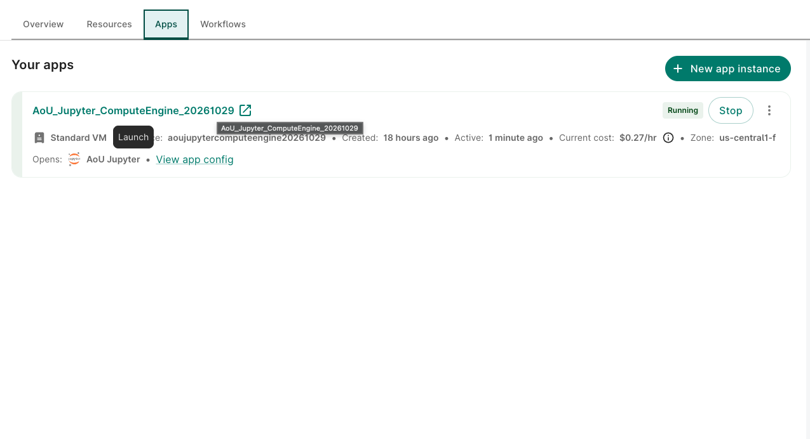
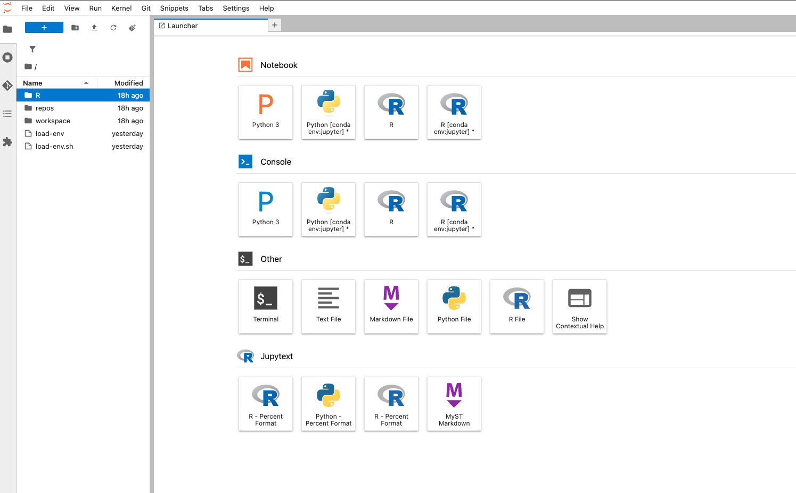
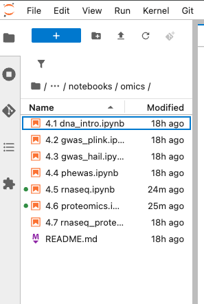
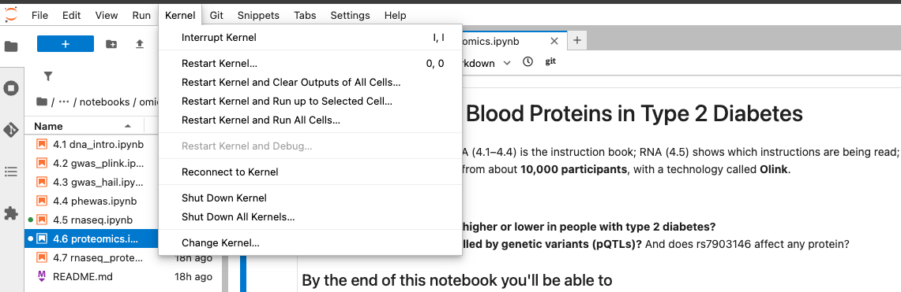

**Omics series, class 1 of 7** · R + PLINK · 120 minutes

[Open the notebook on GitHub](https://github.com/CWML/All-of-Us-Training-Resources/blob/main/notebooks/omics/4.1%20dna_intro.ipynb){.btn .btn-outline-primary .btn-sm}
[Omics series overview](index.qmd){.btn .btn-outline-secondary .btn-sm}
[Omics for Beginners](omics-for-beginners.qmd){.btn .btn-outline-secondary .btn-sm}

## Overview

*All of Us* has sequenced the genomes of more than 535,000 participants. This class answers the first questions anyone has about that data: **what is it, where is it, who has it, and how do I connect it to people's health records?** It ends with a first look at **rs7903146**, the variant in the gene *TCF7L2* that is the strongest known genetic risk factor for type 2 diabetes.

### Why this class matters

Every later genetics class (4.2–4.4) depends on what happens here: the **cohort** linked to genomes, the **related people** removed, the **genetic ancestry** that every model adjusts for, and a small **extract** of the genome that's cheap to work with. Doing these steps carefully once, and understanding them, prevents the most common mistakes in genetic studies.

### By the end you'll be able to

1. Explain DNA, variants, alleles, and genotypes in plain language
2. Describe the *All of Us* genomic data and its file formats
3. Find the genomic files, and the ready-made ancestry and relatedness files
4. Link genomes to the type 2 diabetes cohort and choose a fair sample
5. Use **PLINK 2** to extract one region of the genome, and look at one famous variant

### Analysis at a glance

| | |
|---|---|
| ❓ **Question** | Where is the genomic data, who in our cohort has it, and is the **T** allele of rs7903146 more common in people with type 2 diabetes? |
| 🧪 **The analysis** | Counts and **allele frequencies** in cases and controls; a first **logistic regression** of case status on the number of T alleles (unadjusted) |
| 🎯 **Why** | Before any genome-wide analysis, check that the genomes link to the cohort and that a **known** signal shows up. Logistic regression, because the outcome is yes/no |
| ✅ **What we conclude** | The direction and rough size of a well-known association, and a sample ready for 4.2 |
| ⚠️ **What it can't tell us** | The effect after accounting for age, sex, and ancestry; anything about other variants; whether the variant **causes** diabetes |
| 🔗 **Connections** | Saves the sample and files used by **4.2** and **4.3**; its ancestry PCs are used in **4.2–4.4** |

### Time and cost

| | |
|---|---|
| ⏱️ **Class time** | 120 minutes |
| ⏱️ **Run time** | about 5 minutes to run every cell. Slowest: the cohort query (1–2 minutes) |
| 💰 **Cost** | about **$1 to $2** per student: one BigQuery query (under $1) plus the app (about $0.27 an hour) |
| 📋 **Before class** | a Controlled Tier workspace with a bucket; the course notebooks in the app; **0.0 setup** run once |

## Class plan

| Time | Part | You do |
|---|---|---|
| 0:00 | **1. Key concepts**: DNA, variants, genotypes, the *All of Us* genomic data, *TCF7L2* | listen, ask |
| 0:20 | **2. A tour of the genomic data**: folders, formats, file sizes | ✋ **Try It Out 1** (5 min) |
| 0:35 | **3. The cohort, and who has a genome**: the cohort query, matching IDs, removing related people, the sample | run the cells; ✋ **Try It Out 2** (5 min) |
| 1:00 | ☕ **Break** (5 min) | |
| 1:05 | **4. Genetic ancestry**: PCs, why ancestry matters, the PC plot | run the cells |
| 1:20 | **5. Extract one region with PLINK** | ✋ **Try It Out 3** (5 min) |
| 1:40 | **6. One famous variant: rs7903146** | run the cells; ✋ **Try It Out 4** (5 min) |
| 1:55 | **Wrap-up**: what we found, what's next | discuss |

## Key concepts

The essentials are below. [Omics for Beginners](omics-for-beginners.qmd) has the full glossary.

### Variants and genotypes

People's DNA is 99.9% the same. The places where it differs are **variants**. At rs7903146, people have a **C** or a **T** (and, very rarely, a **G**). Each person has two copies (one from each parent), so their **genotype** is counted as 0, 1, or 2 copies of the **T** allele:

| Genotype | Copies of T |
|---|---|
| C/C | 0 |
| C/T | 1 |
| T/T | 2 |

Each extra copy of **T** raises the odds of type 2 diabetes by about 30 to 40% in large published studies. *TCF7L2* affects how the pancreas releases **insulin**.

### How the genomic files are organised

*All of Us* provides the genomes in several **formats**, one set of files per chromosome. We use the **PLINK 2** format, a set of three files:

```
acaf_threshold.chr10.pgen   genotypes (compressed): 80 GB
acaf_threshold.chr10.pvar   the variants: one row each
acaf_threshold.chr10.psam   the people: one row each
```

**ACAF** is the subset of **common** variants (above about 1% frequency in at least one ancestry group).

One chromosome is **80 GB**, so the class never reads a whole one: PLINK **jumps** to the region we need and reads only that.

### Why remove related people, and adjust for ancestry?

- **Relatives** share long stretches of DNA, which makes results look more certain than they are. *All of Us* provides a list of people to remove so that no two remaining people are closely related.
- **Genetic ancestry** affects both allele frequencies and disease rates. Without accounting for it, a variant can look linked to a disease just because both are more common in one group (**confounding**). *All of Us* provides each person's ancestry group and **principal components (PCs)**: a few numbers that summarise their genetic ancestry, used as covariates from 4.2 on.

## Follow along in the Workbench

1. Open your workspace on the [Researcher Workbench](https://workbench.verily.com/) → **Apps** tab → start your **AoU Jupyter** app (or create one with the default settings) → **Open**.
2. Get the newest notebooks: in JupyterLab, **File → New → Terminal**, then:
   ```bash
   cd ~/repos/All-of-Us-Training-Resources
   git checkout -- notebooks/
   git stash && git pull && git stash pop
   ```
   The first line discards any outputs saved in your copy of the notebooks; the stash keeps your bucket name in `aou_setup.R`.
3. In the file browser on the left, open `repos` → `All-of-Us-Training-Resources` → `notebooks` → `omics` → **`4.1 dna_intro.ipynb`**.
4. Check the kernel (top right of the notebook) says **R**. If it doesn't, click it and choose **R**.
5. Run the first code cell (**Shift + Enter**). It should end with *Setup done*, followed by your dataset and data folder.

### What you'll see

**1. The Apps tab:** your app is *Running*. Click the icon next to its name to open JupyterLab. The row also shows the app's cost while running.

::: {.annotated}
{fig-alt="Workspace Apps tab listing one running AoU Jupyter app, with its open-in-new-tab icon outlined next to the app name. The row also shows the Stop button and the current cost, 0.27 dollars per hour."}

::: {.red-box style="left: 28.6%; top: 21.5%; width: 3.4%; height: 6.5%;"}
:::
:::

**2. Open a terminal:** **File → New → Terminal**, or the **Terminal** tile on the Launcher (the page JupyterLab opens with).

::: {.annotated}
{fig-alt="JupyterLab Launcher with tiles for Notebook, Console, and Other. The Terminal tile, in the Other row, is outlined."}

::: {.red-box style="left: 29.4%; top: 55.8%; width: 7.4%; height: 12.2%;"}
:::
:::

**3. Find the notebook** in the file browser on the left: `repos` → `All-of-Us-Training-Resources` → `notebooks` → `omics`.

{fig-alt="JupyterLab file browser opened to notebooks/omics, listing the seven omics notebooks from 4.1 dna_intro to 4.7 rnaseq_proteomics, and a README."}

**4. Wrong kernel?** The kernel's name is at the top right of the notebook. If it isn't the one you need, use **Kernel → Change Kernel…**.

::: {.annotated}
{fig-alt="JupyterLab Kernel menu open over a notebook, listing Interrupt, Restart, and Shut Down options. The last item, Change Kernel, is outlined."}

::: {.red-box style="left: 18.9%; top: 78.0%; width: 11.6%; height: 9.0%;"}
:::
:::

## Try It Out

::: {.callout-tip}
## ✋ Try It Out 1 · 5 minutes · Part 2

Run the cells in **Part 2** up to the file-size table. How big is chromosome 10 in the **PLINK 2** format, and in the **PLINK 1** format? Why might a format matter for cost?

**✅ Check:** the table has two rows, both in GB, and PLINK 1 is about 10 times bigger.
:::

::: {.callout-tip}
## ✋ Try It Out 2 · 5 minutes · Part 3, "Your turn"

How many eligible people were removed because they're on the **relatedness** list? This is the exercise at the end of Part 3 in the notebook.

**Hint:** count cases and controls with a genome, split by whether their ID is in `related$sample_id`.

**✅ Check:** your table has a `TRUE` row (removed) and a `FALSE` row (kept). The answer is under **Show answer** in the notebook.
:::

::: {.callout-tip}
## ✋ Try It Out 3 · 5 minutes · Part 5

Run the PLINK cells. In the log lines PLINK prints, find **how many samples** it kept and **how many variants** are in the region.

**✅ Check:** 5,000 samples (or slightly fewer), and roughly 14,000 variants.
:::

::: {.callout-tip}
## ✋ Try It Out 4 · 5 minutes · Part 6, "Your turn"

Is the T allele **equally common** in every ancestry group? This is the exercise at the end of Part 6 in the notebook.

**✅ Check:** one row per ancestry group, with an allele frequency between 0 and 1. Don't share rows where `people` is 1 to 20.
:::

## Code walk-through

The key steps, line by line. The notebook explains every cell; these are the ones beginners most often ask about.

### Linking genomes to the cohort

```r
cohort <- run_query(str_glue(cohort_sql, AGE_DATE = "2025-01-01")) %>%   # <1>
  mutate(person_id = as.character(person_id))                            # <2>

psam <- read_tsv(file.path(pgen_dir, "acaf_threshold.chr10.psam"),
                 col_types = cols(.default = "c"))                       # <3>
genome_ids <- psam[["#IID"]]                                             # <4>

cohort <- cohort %>% mutate(has_genome = person_id %in% genome_ids)      # <5>
```
1. Run the shared type 2 diabetes query (in `notebooks/sql/t2d_cohort.sql`), with age calculated on 2025-01-01, the v9 data cutoff.
2. Turn `person_id` into **text**. The genome files store IDs as text, and a number never matches text in R, even with the same digits.
3. Read the `.psam` file (one row per person with a genome), with every column as text.
4. The ID column is called `#IID`. The `#` is part of its name, so it's written in quotes inside `[[ ]]`.
5. `%in%` asks, for each person in the cohort: is your ID in the genome list? The answer (`TRUE` or `FALSE`) becomes a new column.

### Choosing a fair sample

```r
eligible <- cohort %>%
  filter(cohort %in% c("case", "control"),        # <1>
         has_genome,                              # <2>
         !person_id %in% related$sample_id,       # <3>
         between(age, 18, 100),                   # <4>
         sex_at_birth %in% c("Female", "Male"))   # <5>

set.seed(2026)                                    # <6>
gwas_samples <- eligible %>%
  arrange(person_id) %>%                          # <7>
  group_by(cohort) %>%
  slice_sample(n = 2500) %>%                      # <8>
  ungroup()
```
1. Keep cases and controls (drop the "excluded" group, e.g. people with type 1 diabetes).
2. Keep people with a genome.
3. Drop people on the relatedness list (`!` means "not").
4. Ages 18 to 100: a few recorded ages above 100 are probably data errors.
5. Sex at birth is a covariate later, so it must be recorded as Female or Male.
6. Fix the random number generator, so everyone gets the same "random" sample.
7. Sort first: BigQuery doesn't return rows in a fixed order, and the same seed only gives the same sample if the rows start in the same order.
8. Pick 2,500 at random **within each group** (because of `group_by()`).

### Counting the T allele

```r
write_lines("chr10:112998590:C\tT", allele_file)            # <1>

system(str_glue(
  "plink2 --pfile {shQuote(out_prefix)} ",
  "--chr 10 --from-bp 112998590 --to-bp 112998590 ",        # <2>
  "--export A --export-allele {shQuote(allele_file)} ",     # <3>
  "--out {shQuote(lead_prefix)}"
), intern = TRUE)
```
1. A one-line file: the variant's ID and the allele to count. `\t` is a tab.
2. Just one position: rs7903146.
3. `--export A` writes each person's genotype as 0, 1, or 2 copies of an allele. Because rs7903146 has **two** ALT alleles (T and G), PLINK would count the **REF** allele (C) by default; `--export-allele` tells it to count **T**.

[The PLINK command that extracts the region](omics-for-beginners.qmd#how-to-read-the-code) is explained line by line on the Omics for Beginners page.

## What we found

Results from our test run in October 2026 (CDR v9). Your numbers will be similar, but not identical if your sample differs.

### The cohort and the genomes

| | Cases | Controls |
|---|---|---|
| In the cohort, with a genome | 70,020 | 287,628 |
| **Eligible** (unrelated, 18–100, sex recorded) | 63,310 | 264,250 |
| **Our sample** | 2,500 | 2,500 |

**535,662** people had a short-read genome. Chromosome 10 was **80 GB** in the PLINK 2 format and **846 GB** in PLINK 1. PLINK extracted the *TCF7L2* region for our 5,000 people in about **10 seconds**: **14,430 variants**.

**💬 Discuss:** most people in our cohort have a genome, but not all. Who might be missing, and could that matter?

### Genetic ancestry of our sample

| Ancestry group | Cases | Controls |
|---|---|---|
| African (`afr`) | 569 | 393 |
| Admixed American (`amr`) | 518 | 372 |
| East Asian (`eas`) | 65 | 77 |
| European (`eur`) | 1,323 | 1,622 |
| South Asian (`sas`) | 20 or fewer | 29 |
| Middle Eastern (`mid`) | 20 or fewer | 20 or fewer |

**💬 Discuss:** cases include **more** people of African and Admixed American ancestry than controls do. Why does that make adjusting for ancestry important in 4.2?

### rs7903146

- In *All of Us* as a whole, rs7903146 is **multi-allelic**: REF **C**, ALT **T** or **G**. About **28%** of alleles are T; G is extremely rare.
- Variant IDs in the files are **chromosome:position:REF** (`chr10:112998590:C`), not rsIDs.

| | Cases | Controls |
|---|---|---|
| T allele frequency | **0.301** | **0.270** |

**Odds ratio per T allele (unadjusted): 1.17** (95% confidence interval 1.07 to 1.27; p = 0.0006).

**💬 Discuss:** large published studies report about **1.3 to 1.4**, mostly in people of European ancestry. Why might our first estimate be smaller? (Mixed ancestry, no adjustment, diagnosis codes as the case definition, younger controls who may develop diabetes later.) In 4.2, after adjustment, it rises to about **1.25**.

::: {.callout-note collapse="true"}
## Why the first odds ratio was 0.86 (a lesson from testing)

The first time we ran this notebook, the odds ratio came out **below 1** (0.86). The variant hadn't changed: PLINK was counting the **C** allele, because for a multi-allelic variant it counts REF by default. 1 ÷ 0.857 = 1.17, the same result counted the other way. Always check **which allele** a result is "per copy" of: the column name in PLINK's output ends with it (`_T`).
:::

## Instructor notes

::: {.callout-tip collapse="true"}
## Instructor tip: timing and pitfalls

- **Run Part 3's cohort query during Part 2's discussion** if the class is short on time: it takes 1–2 minutes.
- **The most common error** is IDs stored as numbers. If `--keep: 0 samples remaining`, check that `person_id` was turned into text before `keep.txt` was written.
- **Stuck `git pull`:** in our testing, a pull that looked stuck had actually finished. Press Enter before assuming it's frozen.
- **Questions to expect:** "Is genetic ancestry the same as race?" (No: one is estimated from DNA, the other is a social category people report.) "Why not use everyone?" (Cost and time: 5,000 people are enough to see the *TCF7L2* signal.)
:::

::: {.callout-tip collapse="true"}
## Instructor tip: a newer approach to ancestry

A newer method, **genomic-relatedness-matched association (GRMA)**, compares people with their closest genetic relatives instead of adjusting for PCs (*All of Us* Office Hours, 2026-08-28). It's a good discussion point on whether PCs remove all confounding.
:::

## Key takeaways

- A **variant** is a place where people's DNA differs; a **genotype** counts copies of an allele (0, 1, 2)
- *All of Us* genomes are huge: **read only the region you need**
- The **participant ID** links genomes to health records; IDs must be the **same type** (text) to match
- Use the ready-made **relatedness** and **ancestry** files instead of computing your own
- Always check **which allele** a result counts

## Further reading

- [All by All browser](https://allbyall.researchallofus.org): ready-made association results; search `chr10-112998590-C-T` for rs7903146
- [PLINK 2 documentation](https://www.cog-genomics.org/plink/2.0/)
- [*All of Us* Data Browser](https://databrowser.researchallofus.org/): public summary counts
- The *All of Us* CDR v9 data dictionary: the **Genomic and Multi-omics File Paths** tab lists where every file is

## Next

**[4.2 GWAS with PLINK](4-2-gwas-plink.qmd)**: test every variant in the *TCF7L2* region, adjusted for age, sex, and ancestry.
