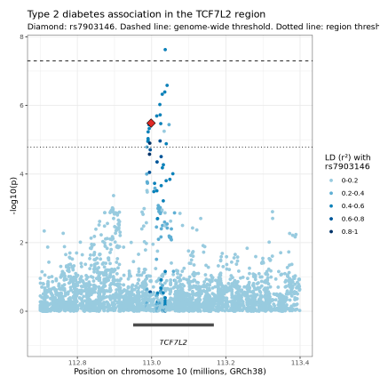
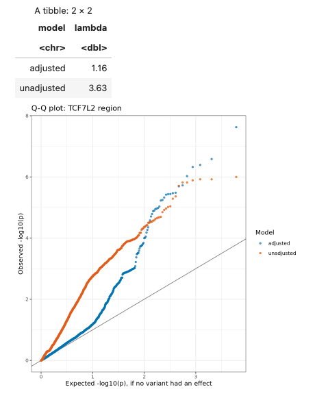

**Omics series, class 2 of 7** · R + PLINK · 120 minutes

[Open the notebook on GitHub](https://github.com/CWML/All-of-Us-Training-Resources/blob/main/notebooks/omics/4.2%20gwas_plink.ipynb){.btn .btn-outline-primary .btn-sm}
[Omics series overview](index.qmd){.btn .btn-outline-secondary .btn-sm}
[Omics for Beginners](omics-for-beginners.qmd){.btn .btn-outline-secondary .btn-sm}

## Overview

In 4.1 we saw that people with type 2 diabetes carry the **T** allele of rs7903146 a little more often. A **genome-wide association study (GWAS)** does that for **every** variant, one at a time, adjusted for age, sex, and genetic ancestry. To keep it fast and cheap, we test every variant in **one region** (around the gene *TCF7L2*) instead of the whole genome. The steps are the same.

### Why this class matters

GWAS is the main tool for finding genetic risk factors, and its results appear in thousands of papers. Knowing what goes into one (quality control, covariates, the significance threshold, linkage disequilibrium) is what lets you read those papers critically, and run your own.

### By the end you'll be able to

1. Explain what a GWAS tests, and why it adjusts for covariates such as ancestry
2. Apply standard **quality-control** filters to variants, and say why each matters
3. Prepare phenotype and covariate files, and run `plink2 --glm`
4. Read GWAS results: odds ratios, p-values, and the genome-wide threshold
5. Make and read a **regional plot** (coloured by linkage disequilibrium) and a **Q-Q plot**

### Analysis at a glance

| | |
|---|---|
| ❓ **Question** | Which variants in the *TCF7L2* region are linked to type 2 diabetes? |
| 🧪 **The analysis** | **Logistic regression** once per variant: case/control ~ copies of the allele + age + sex + 10 ancestry PCs, after variant QC |
| 🎯 **Why** | The outcome is yes/no; one test per variant because we don't know in advance which matters; adjusted so age, sex, or ancestry don't masquerade as genetic effects |
| ✅ **What we conclude** | Which variants pass the thresholds, their odds ratios, and whether the known variant replicates |
| ⚠️ **What it can't tell us** | Which variant is **causal** (neighbours in LD move together), or how it acts; small samples miss real effects |
| 🔗 **Connections** | Builds on **4.1**; repeated in Hail in **4.3**; its top variant starts **4.4** |

### Time and cost

| | |
|---|---|
| ⏱️ **Class time** | 120 minutes |
| ⏱️ **Run time** | about 3 minutes; every PLINK step takes seconds |
| 💰 **Cost** | about **$1** per student: no BigQuery query if 4.1's sample is saved, plus the app (about $0.27 an hour) |
| 📋 **Before class** | run **4.1**, which saves the sample this class reuses |

## Class plan

| Time | Part | You do |
|---|---|---|
| 0:00 | **1. Key concepts**: what a GWAS tests, covariates, multiple testing, LD, the plots | listen, ask |
| 0:25 | **2. Setup and samples**: load 4.1's sample, extract the region | run the cells |
| 0:35 | **3. Quality control** | run the cells; ✋ **Try It Out 1** (5 min) |
| 0:50 | **4. Run the GWAS**: phenotype and covariate files, `plink2 --glm` | run the cells |
| 1:10 | ☕ **Break** (5 min) | |
| 1:15 | **5. Read the results**: top variants, rs7903146, the regional plot | ✋ **Try It Out 2** (5 min) |
| 1:40 | **6. Why adjust?** Adjusted vs unadjusted, the Q-Q plot | ✋ **Try It Out 3** (10 min) |
| 1:55 | **7. Scaling up; wrap-up** | discuss |

## Key concepts

### One regression per variant

$$\text{log odds of type 2 diabetes} = \beta_0 + \beta_1 \times \text{copies of the allele} + \beta_2 \times \text{age} + \dots$$

The **odds ratio** per copy is $e^{\beta_1}$. The **covariates** (age, sex, 10 genetic PCs) are there because each differs between cases and controls and could create a misleading link. Ancestry matters most: allele frequencies **and** diabetes rates differ between ancestry groups.

### Many tests, a strict threshold

Testing about a million independent variants at p < 0.05 would give about 50,000 false positives. So a GWAS uses **p < 5 × 10⁻⁸** (**genome-wide significance**). For our region we also show a **Bonferroni** threshold: 0.05 divided by the number of variants tested.

### Linkage disequilibrium (LD)

Nearby variants are inherited together, so when one is truly linked to diabetes, its neighbours show a signal too. A GWAS finds **regions**; finding the causal variant (**fine-mapping**) is a separate step. The regional plot colours each variant by its **r²** with rs7903146.

### Quality control

| Filter | Removes | Why |
|---|---|---|
| `--maf 0.01` | alleles carried by under 1% | too few carriers give unstable results |
| `--geno 0.1` | variants missing in over 10% of people | hard-to-measure variants; missingness can differ by group |
| `--hwe 1e-10` | genotype counts extremely far from Hardy-Weinberg equilibrium | usually genotyping errors (lenient, because our sample mixes ancestries) |

## Follow along in the Workbench

1. Start your app and pull the newest notebooks, as in [4.1](4-1-dna-intro.qmd#follow-along-in-the-workbench).
2. Open `notebooks/omics/4.2 gwas_plink.ipynb`, with the **R** kernel.
3. Run the setup cell: it ends with *Setup done*.
4. The samples cell should say **"Loaded the sample saved in 4.1"**. If it says "Built a new sample", 4.1's file wasn't found, and the notebook rebuilt it (one cohort query, under $1).

## Try It Out

::: {.callout-tip}
## ✋ Try It Out 1 · 5 minutes · Part 3

Run the QC cell. Which filter removed the **most** variants, and is rs7903146 still there?

**✅ Check:** most variants are removed by the frequency filter (`--maf`); the `lead_variant` table has one row at position 112,998,590.
:::

::: {.callout-tip}
## ✋ Try It Out 2 · 5 minutes · Part 5, "Your turn"

How many variants pass the **region** threshold, and how many the **genome-wide** threshold?

**✅ Check:** a small number pass the region threshold and at most one or two the genome-wide one. The answer is under **Show answer** in the notebook.
:::

::: {.callout-tip}
## ✋ Try It Out 3 · 10 minutes · Part 6, "Your turn"

Rerun the GWAS for people of **European** genetic ancestry only. Is rs7903146's odds ratio closer to the published 1.3–1.4? What happened to its p-value, and why?

**✅ Check:** about 3,000 people in the model; a p-value **larger** than in the full sample (less power).
:::

## Code walk-through

### Quality control

```r
qc_output <- system(str_glue(
  "plink2 --pfile {shQuote(region_prefix)} ",                # <1>
  "--maf 0.01 --geno 0.1 --hwe 1e-10 ",                      # <2>
  "--make-pgen --out {shQuote(qc_prefix)}"                   # <3>
), intern = TRUE)

str_subset(read_lines(paste0(qc_prefix, ".log")), "removed|remaining")   # <4>
```
1. Start from the region files extracted earlier (5,000 people, about 14,000 variants).
2. The three filters, in one command. PLINK applies them all and reports each one's effect.
3. Save the variants that pass as new PLINK 2 files.
4. PLINK writes a `.log` file; `str_subset()` keeps only the lines saying how many variants each filter removed and how many remain.

### The association test

```r
glm_output <- system(str_glue(
  "plink2 --pfile {shQuote(qc_prefix)} ",
  "--pheno {shQuote(pheno_file)} --pheno-name t2d ",           # <1>
  "--covar {shQuote(covar_file)} --covar-variance-standardize ", # <2>
  "--glm hide-covar firth-fallback ",                            # <3>
  "--out {shQuote(gwas_prefix)}"
), intern = TRUE)
```
1. The phenotype file: one row per person, `t2d` coded **2 = case, 1 = control** (PLINK's convention).
2. The covariates (age, sex, PC1–PC10). Standardizing puts them on similar scales, which avoids a common *multicollinearity* error.
3. `--glm` runs logistic regression for every variant. `hide-covar` reports only the variant's result; `firth-fallback` switches to Firth regression when the standard fit fails (e.g. a rare allele).

## What we found

Results from our test run in October 2026 (CDR v9), 2,500 cases and 2,500 controls.

| | |
|---|---|
| Region extracted | 5,000 people, **14,430** variants |
| **Top variant** | a **short tandem repeat (STR)** at 113,036,665 inside *TCF7L2*: OR **1.41**, p = 2.4 × 10⁻⁸, just past genome-wide significance |
| **rs7903146** (T allele) | adjusted OR **1.25**, p = 3.3 × 10⁻⁶; **8th** smallest p-value in the region |
| Unadjusted vs adjusted (rs7903146) | OR 1.17 → **1.25**; p 5.6 × 10⁻⁴ → 3.3 × 10⁻⁶ |

**💬 Discuss:**

- The top hit is a **repeat**, which is harder to sequence than single-letter variants. Why should a result like that be treated with caution? (Check that nearby SNPs show the same signal: here they did.)
- Adjusting **raised** the odds ratio. How? Cases include more people of African and Admixed American ancestry, and the T allele's frequency differs by ancestry: mixing groups pulled the unadjusted estimate toward 1. Adding a strong predictor (age) also sharpens the other estimates.
- In the Q-Q plot, the **unadjusted** p-values were inflated across the board (confounding by ancestry); the **adjusted** ones followed the diagonal until the real signal at the end.
- rs7903146 isn't genome-wide significant with 5,000 people. The published finding came from tens of thousands: **power**.

### The plots

{fig-alt="Regional association plot of the TCF7L2 region on chromosome 10. Each dot is a variant, plotted by position and minus log10 p-value, coloured by linkage with rs7903146. A tall peak rises inside the TCF7L2 gene near 113.0 million; rs7903146, a red diamond, sits near minus log10 p of 5.5, below the dashed genome-wide line at 7.3, with one variant just above it."}

{fig-alt="Q-Q plot of observed against expected minus log10 p-values for the adjusted and unadjusted models, with a table of genomic inflation: adjusted 1.16, unadjusted 3.63. The unadjusted points rise above the diagonal almost from the start; the adjusted points follow the diagonal until the strongest variants at the end."}

## Instructor notes

::: {.callout-tip collapse="true"}
## Instructor tip: timing and pitfalls

- If 4.1 wasn't run, the samples cell rebuilds the sample: allow 2 extra minutes.
- The regional plot needs the **LD** step (exporting everyone's genotypes in the region); on a small app it can take a minute.
- Expect "is the top hit the cause?": no, a GWAS finds regions. Point to fine-mapping, and to the eQTL check in 4.5.
- The plot is often called a **LocusZoom** plot, after the tool that popularised it.
:::

## Key takeaways

- A GWAS runs **one regression per variant**, adjusted for covariates
- **QC first**: remove rare, poorly measured, and suspicious variants
- **Adjust for ancestry** with PCs; compare models with a **Q-Q plot**
- With millions of tests, the threshold is **p < 5 × 10⁻⁸**; small samples have little power
- Nearby variants move together (**LD**): a GWAS finds regions

## Further reading

- [PLINK 2: `--glm`](https://www.cog-genomics.org/plink/2.0/assoc#glm)
- [All by All browser](https://allbyall.researchallofus.org): *All of Us*'s genome-wide results for thousands of phenotypes

## Next

**[4.3 GWAS with Hail](4-3-gwas-hail.qmd)**: the same analysis in Python, and a check that two tools agree.
