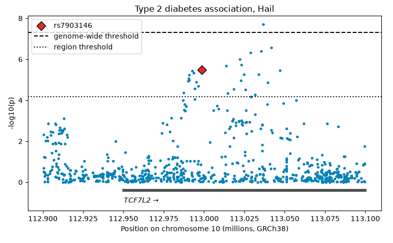
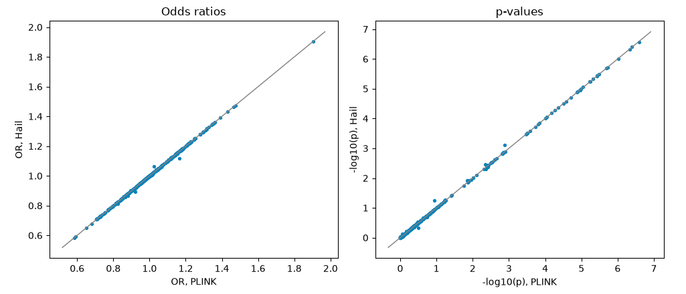

**Omics series, class 3 of 7** · Python + Hail · 120 minutes

[Open the notebook on GitHub](https://github.com/CWML/All-of-Us-Training-Resources/blob/main/notebooks/omics/4.3%20gwas_hail.ipynb){.btn .btn-outline-primary .btn-sm}
[Omics series overview](index.qmd){.btn .btn-outline-secondary .btn-sm}
[Omics for Beginners](omics-for-beginners.qmd){.btn .btn-outline-secondary .btn-sm}

## Overview

**Hail** is the Python library *All of Us* uses for its own large genomic analyses, including the All by All results. In this class we run the **same** GWAS as 4.2 in Hail, on the same people, and check that the two tools agree. You don't need to know Python already: the notebook has a guide for R users.

### Why this class matters

Two reasons. **Reproducibility:** a result that changes with the software is a warning sign, and checking a key finding with a second tool is good practice. **Scale:** PLINK is fast on one computer, but genome-wide analyses of hundreds of thousands of genomes need a tool that can spread the work over a cluster, and Hail is built for that.

### By the end you'll be able to

1. Explain what Hail is, and how a **MatrixTable** holds genomic data
2. Read part of the *All of Us* genomes with Hail, and save a small working copy (a **checkpoint**)
3. Run QC and a logistic-regression GWAS with Hail
4. Turn Hail results into a pandas table, and plot them
5. Compare Hail's results with PLINK's, and explain the small differences

### Analysis at a glance

| | |
|---|---|
| ❓ **Question** | Does a second tool, Hail, give the same GWAS results as PLINK? |
| 🧪 **The analysis** | The same QC and **logistic regression** per variant as 4.2, in Hail; then a variant-by-variant comparison with PLINK |
| 🎯 **Why** | **Reproducibility**, and learning the tool *All of Us* uses at scale |
| ✅ **What we conclude** | Whether the tools agree, and why small differences arise |
| ⚠️ **What it can't tell us** | Nothing new about diabetes: this class is about tools and data structures |
| 🔗 **Connections** | Compares with **4.2**; the approach behind the All by All results in **4.4** |

### Time and cost

| | |
|---|---|
| ⏱️ **Class time** | 120 minutes |
| ⏱️ **Run time** | about 5 minutes. Slowest: reading the genomes into the checkpoint (2–3 minutes) |
| 💰 **Cost** | about **$1** per student: no BigQuery query; the app (about $0.27 an hour) |
| 📋 **Before class** | run **4.1** and **4.2** (this class uses their sample and PLINK results) |

## Class plan

| Time | Part | You do |
|---|---|---|
| 0:00 | **1. Key concepts**: Hail and Spark, MatrixTables, lazy evaluation, `splitMT`, Python for R users | listen, ask |
| 0:25 | **2. Setup and samples** | run the cells |
| 0:35 | **3. Read the genomes with Hail**: start the checkpoint (2–3 min), talk while it runs | ✋ **Try It Out 1** (5 min) |
| 0:55 | **4. Quality control** | run the cells |
| 1:10 | ☕ **Break** (5 min) | |
| 1:15 | **5. Run the GWAS** | run the cells |
| 1:25 | **6. Results and plots** | ✋ **Try It Out 2** (5 min) |
| 1:40 | **7. Compare with PLINK; scaling up** | ✋ **Try It Out 3** (5 min) |
| 1:55 | **Wrap-up** | discuss |

## Key concepts

### The MatrixTable

| Part | In *All of Us* | Example fields |
|---|---|---|
| **Rows** | variants | `locus`, `alleles` |
| **Columns** | people | `s` (the participant's ID) |
| **Entries** | one person's genotype at one variant | `GT` |
| **Globals** | facts about the whole dataset | |

### Lazy evaluation

Hail **plans** first and works later: filtering and annotating only add to the plan, and finish instantly. Nothing is read until you ask for an answer (a count, a table, a file). So one cell, the **checkpoint**, does all the slow work: it reads our window for all 535,000 people, keeps our 5,000, and saves a small copy that every later step reads in seconds.

### `splitMT`: one row per ALT allele

*All of Us* provides Hail genomes in two versions. `multiMT` keeps a variant with several ALT alleles in one row; `splitMT`, which we use, **splits** it into one row per ALT allele, because regression needs one allele per row. So Hail has **more rows** than PLINK for the same window.

### Python for R users

| Idea | R | Python |
|---|---|---|
| Load a package | `library(dplyr)` | `import pandas as pd` |
| Data frame | tibble | pandas **DataFrame** |
| Use a function on an object | `df %>% filter(...)` | a **method**: `mt.filter_rows(...)` |
| Text with values | `str_glue("{x} people")` | `f"{x} people"` |
| Counting from | 1 | **0** |

## Follow along in the Workbench

1. Start your app and pull the newest notebooks, as in [4.1](4-1-dna-intro.qmd#follow-along-in-the-workbench).
2. Open `notebooks/omics/4.3 gwas_hail.ipynb`. Check the kernel says **Python 3**.
3. Run the setup cell. Hail prints a lot, including two expected warnings (about **Java 17** and the **Spark** version): both are harmless.

::: {.callout-warning}
## Don't `pip install` into this app

Installing other Python packages can replace ones Hail needs. In our tests, installing PheTK downgraded `numpy` and stopped Hail from loading. If it happens, ask your instructor for the repair commands.
:::

## Try It Out

::: {.callout-tip}
## ✋ Try It Out 1 · 5 minutes · Part 3, "Your turn"

The repeat (STR) that topped 4.2 is at position **113,036,665**. How many rows does it have in Hail's MatrixTable?

**✅ Check:** about 15 rows: one per ALT allele. In PLINK's files it was one row.
:::

::: {.callout-tip}
## ✋ Try It Out 2 · 5 minutes · Part 6, "Your turn"

How many rows pass the region threshold, and how many the genome-wide threshold?

**✅ Check:** the region threshold is a little stricter than in 4.2, because splitting gives more rows to test.
:::

::: {.callout-tip}
## ✋ Try It Out 3 · 5 minutes · Part 7, "Your turn"

Rerun the GWAS with `test="firth"` instead of `"wald"`. Does rs7903146's p-value change?

**✅ Check:** almost no change: Firth regression matters for rare alleles, and rs7903146's T allele is common.
:::

## Code walk-through

### Keep our window and our people

```python
mt = hl.filter_intervals(mt, [hl.parse_locus_interval(WINDOW)])   # <1>
mt = mt.semi_join_cols(samples_ht)                                 # <2>
mt = mt.annotate_cols(pheno = samples_ht[mt.s])                    # <3>
```
1. Keep only variants in our 200,000-letter window (like PLINK's `--chr --from-bp --to-bp`).
2. Keep only the people in our sample table (like a semi-join in R, or PLINK's `--keep`).
3. Add each person's phenotype and covariates: `samples_ht[mt.s]` means "the row of the sample table matching this person's ID". All three lines are **instant**: they only add to the plan.

### The checkpoint

```python
if REBUILD or not os.path.exists(CHECKPOINT_PATH):
    mt = mt.checkpoint(CHECKPOINT_PATH, overwrite=True)   # <1>
else:
    mt = hl.read_matrix_table(CHECKPOINT_PATH)            # <2>
```
1. Run the plan and save the result to the app's disk: the slow step (150 seconds in our test).
2. If the copy already exists (e.g. when rerunning), just open it.

### The GWAS

```python
covariates = [1.0, mt.pheno.age, mt.pheno.sex_male] + [mt.pheno[pc] for pc in PCS]   # <1>

gwas = hl.logistic_regression_rows(
    test="wald",                     # <2>
    y=mt.pheno.is_case,              # <3>
    x=mt.GT.n_alt_alleles(),         # <4>
    covariates=covariates,
)
```
1. The covariates. `1.0` is the **intercept**: Hail needs it written out (R and PLINK add it for you). `[... for pc in PCS]` builds a list of the 10 PCs.
2. The standard Wald test.
3. The outcome: case or control.
4. The genotype as 0, 1, or 2 copies of the ALT allele.

## What we found

Results from our test run in October 2026 (CDR v9).

| | |
|---|---|
| Checkpoint | **150 seconds**; 12,054 rows × 5,000 people |
| QC: rows failing each filter | frequency 10,970; call rate 4,405; Hardy-Weinberg 129 (a row can fail several) |
| Tests | 765, of which **488** matched a PLINK variant |
| Agreement with PLINK | correlation **0.9998** for log odds ratios, **0.9999** for −log₁₀(p) |
| rs7903146 (T allele) | OR **1.2512** in Hail vs **1.2511** in PLINK; p = 3 × 10⁻⁶ in both |

**💬 Discuss:**

- Why do only 488 of 765 tests match PLINK? (Split multi-allelic rows, especially repeats, are trimmed differently; and the frequency filter works per allele in Hail, per variant in PLINK.)
- The regional plot showed **two** clusters: one at rs7903146 and one a little to the right, with the top hit. One signal or two? A **conditional analysis** (adding rs7903146 as a covariate) would tell.

### The plots

{fig-alt="Hail regional plot of a 200,000-letter window of chromosome 10. Points show minus log10 p-values by position; rs7903146 is a red diamond near 5.5, and a second cluster of small p-values sits a little to the right, around 113.02 to 113.05 million, with one point above the genome-wide line."}

{fig-alt="Two scatter plots comparing PLINK and Hail for the same variants: odds ratios on the left and minus log10 p-values on the right. Almost every point lies on the diagonal line, showing the two tools agree."}

## Instructor notes

::: {.callout-tip collapse="true"}
## Instructor tip: timing and pitfalls

- Start the **checkpoint cell** before explaining lazy evaluation, so the 2–3 minutes pass while you talk.
- If the checkpoint is interrupted, a half-written copy is left behind: set `REBUILD = True` and rerun.
- Expect the question "why learn Hail if PLINK is faster here?" Answer: scale, and *All of Us*'s own tools and tutorials use it.
:::

## Key takeaways

- **Hail** works with genomes as a **MatrixTable**: variants × people
- Hail is **lazy**: it plans until you ask for a result; **checkpoint** after the expensive step
- `splitMT` gives **one row per ALT allele**
- The same model in **PLINK** and **Hail** gives the same answers: a reproducibility check
- Hail scales to the whole genome on a **cluster**

## Further reading

- [Hail documentation](https://hail.is/docs/0.2/)
- [Hail's `logistic_regression_rows`](https://hail.is/docs/0.2/methods/stats.html#hail.methods.logistic_regression_rows)

## Next

**[4.4 PheWAS](4-4-phewas.qmd)**: flip the question. Which diseases are linked to rs7903146?
