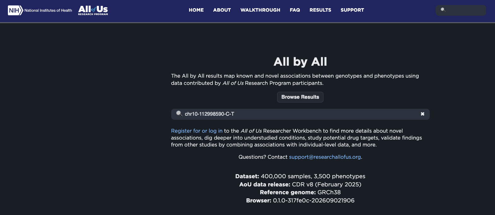
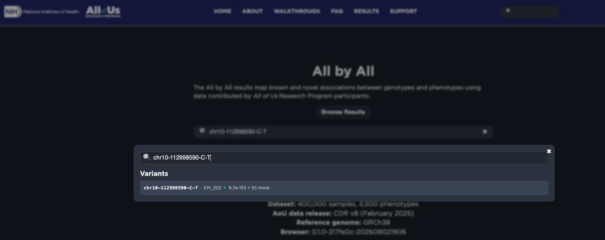
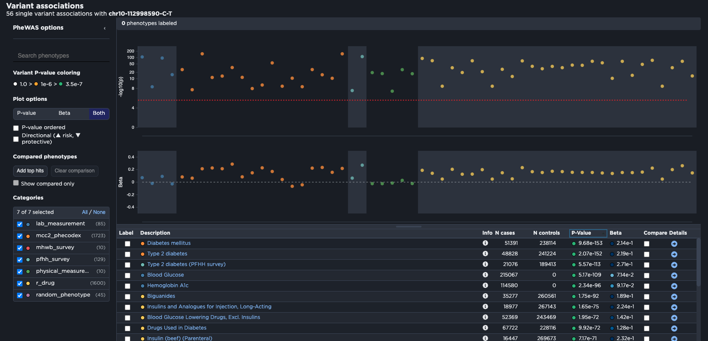
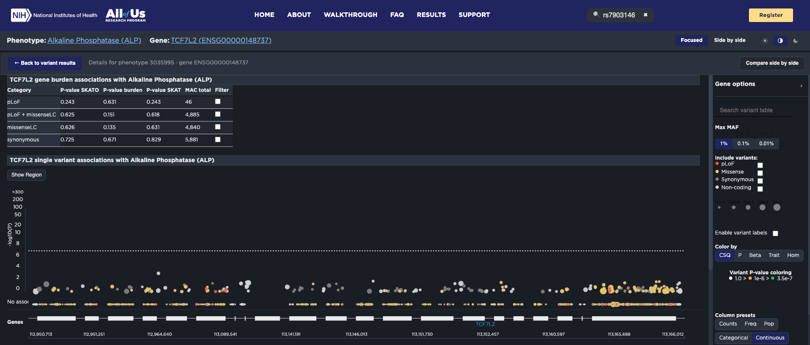
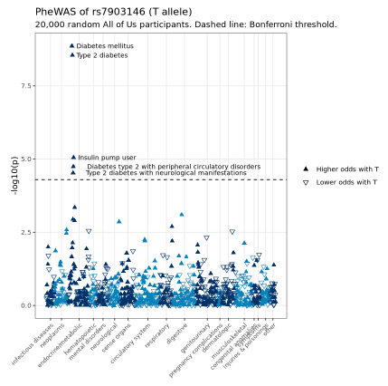

**Omics series, class 4 of 7** · R · 120 minutes

[Open the notebook on GitHub](https://github.com/CWML/All-of-Us-Training-Resources/blob/main/notebooks/omics/4.4%20phewas.ipynb){.btn .btn-outline-primary .btn-sm}
[Omics series overview](index.qmd){.btn .btn-outline-secondary .btn-sm}
[Omics for Beginners](omics-for-beginners.qmd){.btn .btn-outline-secondary .btn-sm}

## Overview

A GWAS asks *which variants are linked to one disease?* A **PheWAS** flips it: *which diseases are linked to one variant?* We take **rs7903146** and test it against **hundreds of diseases** in the health records: first in *All of Us*'s free **All by All** browser, then ourselves, in R, on a random sample of 20,000 participants.

### Why this class matters

A PheWAS shows **everything** a variant is linked to: its main disease, that disease's **treatments** and **complications**, and sometimes surprises. It also teaches two of the most important ideas in observational research, through real examples: **selection bias** (why the sample must be random) and **collider bias** (why adjusting can create a link that isn't there).

### By the end you'll be able to

1. Explain what a PheWAS tests, and how it differs from a GWAS
2. Explain **phecodes**: how diagnosis codes become diseases, with case and control rules
3. Read results in the **All by All** browser, including converting a beta to an odds ratio
4. Build phecode phenotypes from the EHR, and run a PheWAS with `glm()`
5. Explain why a PheWAS needs a **random** sample, and why many hits are **consequences**

### Analysis at a glance

| | |
|---|---|
| ❓ **Question** | Which diseases are linked to rs7903146? |
| 🧪 **The analysis** | **Logistic regression** once per disease (phecode, with at least 100 cases), adjusted for age, sex, and 10 PCs, in a random sample of 20,000; Bonferroni correction |
| 🎯 **Why** | One variant can affect several traits, and a disease's consequences show up too. A random sample, because one chosen by diabetes status creates false links |
| ✅ **What we conclude** | Which diseases are linked, and whether they look like consequences of diabetes |
| ⚠️ **What it can't tell us** | Direct effects vs consequences, without care: adjusting for diabetes can **create** associations |
| 🔗 **Connections** | The variant comes from **4.2**; All by All checks our results in a much bigger sample; **4.5** asks whether it changes gene activity |

### Time and cost

| | |
|---|---|
| ⏱️ **Class time** | 120 minutes |
| ⏱️ **Run time** | about 15 minutes. Slowest: the diagnosis-code query and download, and the PheWAS loop (about 5 minutes) |
| 💰 **Cost** | about **$1 to $2** per student: two BigQuery queries, plus the app |
| 📋 **Before class** | nothing: this class works on its own |

## Class plan

| Time | Part | You do |
|---|---|---|
| 0:00 | **1. Key concepts**: PheWAS vs GWAS, phecodes, why a random sample | listen, ask |
| 0:20 | **2. All by All, in the browser** (no code) | ✋ **Try It Out 1** (10 min) |
| 0:40 | **3. A random sample and its genotypes**: start the queries | run the cells |
| 0:55 | **4. Diagnosis codes and phecodes** | run the cells |
| 1:15 | **5. Run the PheWAS**: start the loop (about 5 min), then a break | ☕ **Break** while it runs |
| 1:25 | **6. Read the results**: top phecodes, the PheWAS plot, consequences, collider bias | ✋ **Try It Out 2** (5 min) |
| 1:55 | **Wrap-up** | discuss |

## Key concepts

### Phecodes

Diagnoses are recorded as **ICD codes**: tens of thousands, very specific, in two systems (ICD-9-CM and ICD-10-CM). **Phecodes** group them into about **1,800 research diseases**. For example, ICD-10 `E11.9` and `E11.65` and ICD-9 `250.00` all map to phecode **250.2, Type 2 diabetes**.

| Rule | Means |
|---|---|
| **Case** | at least **2 days** with a code for the phecode |
| **Excluded** | only 1 day, or a **related** phecode (e.g. type 1 when testing type 2) |
| **Control** | everyone else |
| **Roll-up** | a specific phecode also counts for its parent (250.2 → 250) |

### Why a random sample?

The case-control sample from 4.1–4.3 is **half** diabetes cases. In it, anything that goes with diabetes (blood pressure, kidney disease, obesity, diabetes medicines) also goes with the T allele, just because of how the sample was chosen: **selection bias**. So this class takes a **random** 20,000, with diabetes at its natural rate (about 1 in 5).

## Follow along in the Workbench

1. Start your app and pull the newest notebooks, as in [4.1](4-1-dna-intro.qmd#follow-along-in-the-workbench).
2. Open `notebooks/omics/4.4 phewas.ipynb`, with the **R** kernel.
3. For Part 2, open [allbyall.researchallofus.org](https://allbyall.researchallofus.org) in a **new browser tab**. It's public: no login needed.

### All by All, step by step

The browser's results come from **CDR v8** (about 400,000 samples), an earlier release than the CDR v9 data in our Workbench. That's why its numbers differ a little from ours.

**1.** Type `chr10-112998590-C-T` in the search box.

{fig-alt="All by All home page with chr10-112998590-C-T typed in the search box. Text below says the dataset is 400,000 samples and 3,500 phenotypes, from CDR v8, February 2025."}

**2.** In the drop-down, click the row under **Variants**.

{fig-alt="The All by All search drop-down, listing one variant, chr10-112998590-C-T, with the smallest p-value, 9.7 times 10 to the minus 153, and 55 more associations."}

**3.** On the variant page, find **Variant associations**: the PheWAS plot (p-values on top, betas below) and the table. Click **P-Value** to sort.

{fig-alt="All by All variant page for chr10-112998590-C-T: 56 single-variant associations. A PheWAS plot shows minus log10 p-values by phenotype category, almost all above the red significance line, and betas below, mostly positive. The table sorted by p-value lists Diabetes mellitus, Type 2 diabetes, Type 2 diabetes from the survey, Blood glucose, Hemoglobin A1c, Biguanides, and insulin and other diabetes drugs."}

**4.** For the gene, search **`TCF7L2`**. Its page shows **burden tests** (rare variants that break the gene, tested together) and a regional plot.

{fig-alt="All by All gene page for TCF7L2 with the phenotype alkaline phosphatase. A table of gene burden tests shows p-values between 0.13 and 0.83, none significant, and a regional plot of single variants below the dotted significance line, above a map of the TCF7L2 gene."}


## Try It Out

::: {.callout-tip}
## ✋ Try It Out 1 · 10 minutes · Part 2 (in the browser)

1. In All by All, search for **`chr10-112998590-C-T`** and sort the table by p-value. Convert type 2 diabetes's **beta** to an odds ratio (OR = e^beta).
2. Find **waist circumference**. Is its beta positive or negative? What does that mean?
3. Search for the gene **`TCF7L2`**. Are any of the **burden** tests (rare variants that break the gene) significant?

**✅ Check:** beta ≈ 0.22, so OR ≈ 1.24; waist circumference has a **negative** beta; no burden test is significant.
:::

::: {.callout-tip}
## ✋ Try It Out 2 · 5 minutes · Part 6, "Your turn"

Test rs7903146 against **phecode 278.1, Obesity**. Is the T allele linked to obesity? Does adding `extra_covariates = "has_t2d"` change the answer, and should you trust the adjusted version?

**✅ Check:** an OR **below 1**; adjusting for diabetes pushes it further below 1, which is **collider bias**, so prefer the unadjusted result.
:::

## Code walk-through

### From ICD codes to phecodes

```r
person_phecodes <- icd %>%
  inner_join(phecode_map, by = c("vocabulary_id", "code"), relationship = "many-to-many") %>%        # <1>
  inner_join(phecode_rollup_map, by = c("phecode" = "code"), relationship = "many-to-many") %>%      # <2>
  group_by(person_id, phecode = phecode_unrolled) %>%
  summarise(n_days = sum(n_days), .groups = "drop")                                                 # <3>
```
1. Look up each person's ICD codes in the phecode map. Codes with no phecode drop out; a few codes map to more than one phecode.
2. Add each phecode's **parents** (e.g. 250.2 also counts for 250).
3. One row per person per phecode, with the number of days it was coded.

### Cases, controls, and excluded

```r
phecode_status <- function(pc) {
  cases <- person_phecodes %>%
    filter(phecode == pc, n_days >= 2) %>%            # <1>
    pull(person_id)

  related  <- phecode_exclude %>% filter(code == pc) %>% pull(exclusion_criteria)   # <2>
  excluded <- person_phecodes %>%
    filter(phecode %in% c(pc, related)) %>%
    pull(person_id)

  case_when(phewas_samples$person_id %in% cases    ~ 1,          # <3>
            phewas_samples$person_id %in% excluded ~ NA_real_,
            TRUE                                   ~ 0)
}
```
1. **Cases:** at least 2 days with a code for this phecode.
2. **Related** phecodes, from the PheWAS project's exclusion table.
3. For everyone in the sample: 1 = case, `NA` = excluded (one code day, or a related phecode), 0 = control. `case_when()` uses the first rule that matches, so cases come first.

## What we found

Results from our test run in October 2026 (CDR v9).

**In All by All** (CDR v8, about 400,000 participants): type 2 diabetes p = 2 × 10⁻¹⁵², beta 0.22 (**OR ≈ 1.24**); also blood glucose, HbA1c, diabetes medicines (metformin, insulins, sulfonylureas); and waist circumference with a **negative** beta (−0.015, p = 4 × 10⁻⁸). The *TCF7L2* rare-variant burden tests: nothing significant.

**Our PheWAS** (20,000 random participants; 18.7% with type 2 diabetes):

| | |
|---|---|
| Diagnosis codes | about 1.6 million person–code rows |
| Phecodes tested | **992**, in 4.8 minutes |
| Type 2 diabetes (250.2) | OR **1.20**, p = 2.8 × 10⁻⁹ |
| Also significant | insulin pump user (OR 1.28); type 2 diabetes with circulatory (1.39) and neurological (1.25) complications |
| Just below the line | diabetic retinopathy, polyneuropathy, gastroparesis |
| Morbid obesity (278.11) | OR **0.90** (p = 0.003); **0.85** (p = 8 × 10⁻⁶) after adjusting for diabetes |

{fig-alt="PheWAS plot of rs7903146 in 20,000 random All of Us participants: one triangle per disease, grouped by disease category along the x-axis, with minus log10 p-value on the y-axis. Diabetes mellitus and type 2 diabetes are highest, near 8.5, followed by insulin pump user and type 2 diabetes with circulatory and neurological complications, just above the dashed Bonferroni line; everything else is below it."}

**💬 Discuss:**

- The complications have **larger** ORs than diabetes itself. Why? (They come with longer or harder-to-control diabetes.)
- Morbid obesity got **more** significant after adjusting for diabetes. Both the T allele and obesity **cause** diabetes, so diabetes is a **collider**; comparing people within diabetes groups creates a negative link between them. The unadjusted 0.90 is the cleaner estimate, and it agrees with All by All's smaller waist.

```
T allele ──→ type 2 diabetes ←── obesity
```

## Instructor notes

::: {.callout-tip collapse="true"}
## Instructor tip: timing and pitfalls

- Start the **diagnosis-code query** and the **PheWAS loop** at natural pauses: together they take 10 minutes or more.
- PheTK (a Python PheWAS tool) **breaks Hail** if installed into the shared app; the PheWAS R package doesn't install (a dependency fails to build). The notebook loads only the PheWAS project's **lookup tables**.
- The collider example is the most memorable part of the class: draw the arrows on the board.
:::

## Key takeaways

- A **PheWAS** tests one variant against many phenotypes, with the same regression as a GWAS
- **Phecodes** turn thousands of ICD codes into about 1,800 research diseases
- A PheWAS needs a **random** sample: choosing by disease creates **selection bias**
- Many hits are **consequences** of the main disease; adjusting for it can create **collider bias**
- **All by All** has free, ready-made results: look there first

## Further reading

- [All by All browser](https://allbyall.researchallofus.org)
- [PheWAS resources (phecodes), Vanderbilt](https://phewascatalog.org/)

## Next

**[4.5 RNA-seq](4-5-rnaseq.qmd)**: from DNA to gene activity. Does rs7903146 change how much *TCF7L2* is made in blood?
