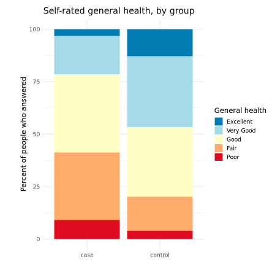

**Survey series, class 1 of 3** · R + SQL · 90 minutes

[Open the notebook on GitHub](https://github.com/CWML/All-of-Us-Training-Resources/blob/main/notebooks/surveys/5.1%20survey_basics.ipynb){.btn .btn-outline-primary .btn-sm}
[Survey series overview](index.qmd){.btn .btn-outline-secondary .btn-sm}

## Overview

Most *All of Us* participants answer **surveys** about their background, health, habits, family, and life circumstances. Survey answers tell us things health records rarely do (smoking, income, family history), but they have their own structure and their own traps. In this class we learn how the survey data is organised, how to find the questions we need, and how to turn raw answers into a clean table with **one row per person**.

### Why this class matters

Survey answers are easy to **misread**. A missing answer, a skipped answer, and "prefer not to answer" mean different things, and a missing answer often means the question was **never asked**. Treating them all as "no" or as "missing" quietly changes who is in an analysis. And the people who answer later, optional surveys aren't a random sample.

### By the end you'll be able to

1. Name the *All of Us* surveys, and explain why each was answered by a different number of people
2. Find questions by **text** and by **concept ID**, in the Workbench and in the public **Survey Explorer**
3. Tell the **non-answers** apart, and know when *PMI: None* or *PMI: Other* is a real answer
4. Explain **skip logic**: why a missing answer often means "never asked"
5. Handle **select all that apply** questions (several answers per person)
6. Build a tidy table with one row per person, and compare cases and controls

### Analysis at a glance

| | |
|---|---|
| ❓ **Question** | Which surveys did the people in our cohort answer, and how do we turn their answers into usable variables? |
| 🧪 **The analysis** | Four BigQuery queries (the surveys, a question dictionary, who answered what, five example questions); counts and percents by group |
| 🎯 **Why** | Coding non-answers and skip logic correctly decides **who** is in every later analysis |
| ✅ **What we conclude** | Which surveys and questions we can use, how complete they are in cases and controls, and how to code them |
| ⚠️ **What it can't tell us** | Anything about cause. And people who answer later surveys aren't a random sample |
| 🔗 **Connections** | Uses the sample from **1.1**; builds on **2.1** (cleaning), **2.2** (reshaping), **3.1** (Table 1); **5.2** and **5.3** use these skills |

### Time and cost

| | |
|---|---|
| ⏱️ **Class time** | 90 minutes |
| ⏱️ **Run time** | about 5 minutes. Slowest: the question dictionary |
| 💰 **Cost** | about **$2** per student: four queries on `ds_survey`, a large table, plus the app |
| 📋 **Before class** | **0.0 setup** run once. `cohort_sample.csv` from **1.1** is used if it's in your bucket; otherwise the notebook makes it |

## Class plan

| Time | Part | You do |
|---|---|---|
| 0:00 | **1. Key concepts**: surveys, questions, answers, non-answers, skip logic | listen, ask |
| 0:15 | **2. Setup**: load the sample; the columns of `ds_survey` | run the cells |
| 0:20 | **3. The ten surveys**, and who answered them | run the cells, discuss |
| 0:35 | **4. Finding questions**: a question dictionary | ✋ **Try It Out 1** (5 min) |
| 0:50 | **5. Answers**: non-answers, several answers, skip logic | run the cells, discuss |
| 1:10 | **6. One row per person**; cases vs controls | ✋ **Try It Out 2** (5 min) |
| 1:20 | **Wrap-up** | discuss |

## Key concepts

### How the surveys work

Participants answer surveys online (or with staff), one **module** at a time. **The Basics**, **Overall Health**, and **Lifestyle** are answered when people join, so almost everyone has them. The others are offered **later** and are optional, so fewer people answer them.

| Word | Means | Example |
|---|---|---|
| **Survey** (module) | one questionnaire | *Lifestyle* |
| **Question** | one item, with a **concept ID** and a **concept code** | 1585857, `Smoking_100CigsLifetime` |
| **Answer** | the option chosen, also with a concept ID | *Yes* |
| **Select all that apply** | several answers allowed: **one row per answer** | race: *White* **and** *Asian* |
| **Skip logic** | follow-up questions shown only after certain answers | "How often do you smoke now?" only after *Yes* to 100 cigarettes |

The answers are in the `ds_survey` table (questions and answers as text, plus their concept IDs). The standard OMOP `observation` table holds the same answers as concept IDs.

### Non-answers

| Code | Means | Usually treat as |
|---|---|---|
| *PMI: Skip* | saw the question, and skipped it | missing |
| *PMI: Prefer Not To Answer* | chose "prefer not to answer" | missing, or its own category |
| *PMI: Dont Know*, *PMI: Not Sure* | chose "don't know" or "not sure" | missing, or its own category |
| *PMI: None* | chose "none of these" | often a **real answer** |
| *PMI: Other* | chose "other" | a **real answer** |
| *PMI: Does Not Apply To Me* | chose "does not apply" | a **real answer** |
| **no row at all** | **not asked** (skip logic), or never took the survey | depends on why: **check** |

*PMI* is the program's former name, the Precision Medicine Initiative.

### Where to read the questions

- **[Survey Explorer](https://www.researchallofus.org/data-tools/survey-explorer/)**: every survey's questions, answer options, and branching, plus the Survey Data Codebooks
- **[Data Browser](https://databrowser.researchallofus.org/)**: how many participants gave each answer
- **In the Workbench**: the question dictionary built in Part 4

## Follow along in the Workbench

1. Start your app and pull the newest notebooks, as in [1.1](../core/1-1-build-cohorts.qmd#follow-along-in-the-workbench).
2. Open `notebooks/surveys/5.1 survey_basics.ipynb`, with the **R** kernel.

## Try It Out

::: {.callout-tip}
## ✋ Try It Out 1 · 5 minutes · Part 4, "Your turn"

Find the questions about **food** (e.g. worrying that food would run out). Which survey are they in, and how many people answered them?

**✅ Check:** questions from **Social Determinants of Health**, answered by far fewer people than The Basics.
:::

::: {.callout-tip}
## ✋ Try It Out 2 · 5 minutes · Part 6, "Your turn"

Make an **income** variable, keeping *Prefer Not To Answer* as its own category. Who prefers not to give their income, cases or controls?

**✅ Check:** one row per income category and group; *Prefer not to answer* is one of the largest categories.
:::

## Code walk-through

### A question dictionary

```r
questions <- run_query(str_glue("
  WITH q AS (
    SELECT survey, question_concept_id,
           ANY_VALUE(question)       AS question,                        # <1>
           COUNT(DISTINCT person_id) AS n_people
    FROM `{CURRENT_DATASET}.ds_survey`
    GROUP BY survey, question_concept_id
  )
  SELECT q.*, c.concept_code
  FROM q
  LEFT JOIN `{CURRENT_DATASET}.concept` AS c ON c.concept_id = q.question_concept_id   # <2>
"))
save_data(questions, "survey_questions.csv")                             # <3>

find_questions <- function(pattern) {                                    # <4>
  questions %>%
    filter(str_detect(question, regex(pattern, ignore_case = TRUE))) %>%
    arrange(desc(n_people))
}
find_questions("smok")
```
1. One row per question. `ANY_VALUE()` picks one text per ID: the same ID can be worded slightly differently in different survey versions.
2. The concept **code** (e.g. `Smoking_100CigsLifetime`) from the `concept` table: the name used in the codebooks.
3. Saved to your bucket, so you query once and search for free.
4. Search the dictionary by a word or pattern, ignoring upper and lower case.

### Skip logic: one smoking variable from two questions

```r
smoking <- smoking %>%
  mutate(smoking_status = case_when(                                                   # <1>
    str_detect(smoked_100, regex("^no$", ignore_case = TRUE))                    ~ "Never",    # <2>
    str_detect(smoke_frequency, regex("every day|some days", ignore_case = TRUE)) ~ "Current",
    str_detect(smoked_100, regex("^yes$", ignore_case = TRUE)) &
      str_detect(smoke_frequency, regex("not at all", ignore_case = TRUE))        ~ "Former",  # <3>
    TRUE                                                                          ~ NA_character_))
```
1. `case_when()` checks each rule in order, and uses the first that's true.
2. *No* to 100 cigarettes: never asked the follow-up, so a **never smoker**, not "missing".
3. *Former* needs *Yes* first: someone who skipped the first question and answered *Not At All* could be a former smoker **or** someone who never smoked.

## What we found

Results from our test run in October 2026 (CDR v9).

### The ten surveys

| Survey | People who answered (all of *All of Us*) | Questions | Our sample: cases | Our sample: controls |
|---|---|---|---|---|
| The Basics | 746,993 | 34 | 100% | 100% |
| Overall Health | 680,103 | 24 | 99.0% | 98.6% |
| Lifestyle | 674,065 | 31 | 98.8% | 98.4% |
| Healthcare Access & Utilization | 368,572 | 57 | 53.0% | 58.6% |
| Personal and Family Health History | 354,743 | 606 | 48.9% | 56.6% |
| Social Determinants of Health | 314,521 | 81 | 41.5% | 49.9% |
| COVID-19 Vaccine Survey | 167,718 | 72 | 25.4% | 26.7% |
| Behavioral Health and Personality | 139,637 | 60 | 18.7% | 24.7% |
| Emotional Health History and Well-Being | 137,946 | 103 | 18.4% | 23.9% |
| COVID-19 Participant Experience (COPE) | 103,323 | 192 | 15.5% | 18.1% |

- **Cases answered every later survey less often than controls.** Any comparison that uses a later survey includes only part of each group, and a different part.
- People who answered **Social Determinants of Health** were a little older (mean age 60 vs 58), more often female (62% vs 57%), and less often cases (45% vs 54%) than those who didn't.
- **When:** the enrollment surveys span 2017 to 2024; Social Determinants of Health started in 2021, the two newest surveys in 2023.

### Finding questions

- **1,260** survey questions in CDR v9. Personal and Family Health History alone has 606: each condition is its own question.
- **Skip logic shows in the counts:** about 674,000 people answered *Smoking: 100 Cigs Lifetime*, but only about 261,000 the follow-up questions, the people who said *Yes*.
- *Including yourself, who in your family has had type 2 diabetes?* (select all that apply) was answered by about 199,000 people. **5.2** uses it.

### Answers and non-answers

- Non-answers were 1–2% for most questions. **Income** was the exception: about 14% *Prefer Not To Answer* and 7% *Skip*, and more often in cases (24%) than in controls (18%).
- **Race** is one combined race and ethnicity question, with several answers allowed: about 7% of our sample chose more than one.
- **Smoking:** everyone who said *No* to 100 cigarettes had no follow-up answer (never asked), but many who **skipped** the first question did get the follow-up. Combined: about 56% never, 26% former, and 14% current smokers.

### Self-rated general health

| General health | Cases | Controls |
|---|---|---|
| Excellent | 3.2% | 12.8% |
| Very good | 18.2% | 33.8% |
| Good | 37.4% | 33.2% |
| Fair | 32.1% | 16.2% |
| Poor | 9.1% | 4.0% |

{fig-alt="Stacked bar chart of self-rated general health, as a percent of people who answered, for cases and controls. Cases have much more Fair and Poor, about 41 percent together, than controls, about 20 percent, and far less Excellent, about 3 percent versus 13 percent."}

**💬 Discuss:** cases are also **older** (3.1), and age affects self-rated health too. How would you compare like with like? (A model adjusted for age, as in 3.2.)

## Instructor notes

::: {.callout-tip collapse="true"}
## Instructor tip

- **Who answers later surveys** is the best moment of the class: ask students to guess which group answers more before showing the table.
- *PMI* comes up every time: it's the program's former name, the Precision Medicine Initiative.
- Students often ask why the survey race differs from the `race` column in the cohort file: the program maps the same question to the `person` table with its own rules for several answers and non-answers.
- *PMI: Dont Know* has **no apostrophe**: a filter on `"Don't Know"` silently matches nothing.
- If time is short, skip the "Who answers a later survey?" cell and the income exercise.
:::

## Key takeaways

- *All of Us* has **ten surveys**; later ones were answered by fewer, and **different**, people
- Find questions in a **dictionary** (or the Survey Explorer), then query by **concept ID**
- **Non-answers** start with `PMI:`; some (*None*, *Other*, *Does Not Apply To Me*) are real answers
- A **missing** answer can mean "never asked": use the **skip logic**
- **Select-all** questions give several rows per person: reshape before joining
- Answers have **dates**: check whether they came before or after a diagnosis

## Next

**[5.2 Family history and lifestyle](5-2-family-history-lifestyle.qmd)**: family history of diabetes, smoking, and alcohol, in cases and controls.
