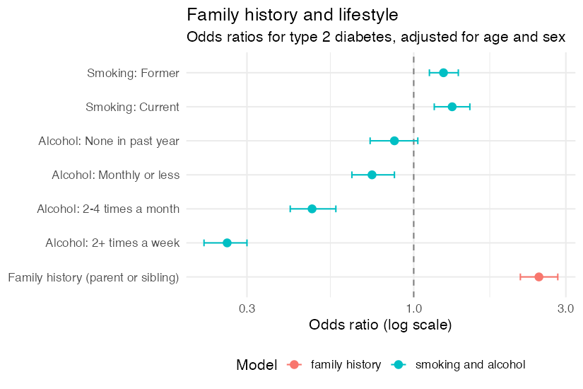

**Survey series, class 2 of 3** · R + SQL · 90 minutes

[Open the notebook on GitHub](https://github.com/CWML/All-of-Us-Training-Resources/blob/main/notebooks/surveys/5.2%20family_history_lifestyle.ipynb){.btn .btn-outline-primary .btn-sm}
[Survey series overview](index.qmd){.btn .btn-outline-secondary .btn-sm}

## Overview

Type 2 diabetes runs in families, and is linked to habits like smoking and drinking. Health records rarely capture these, but the *All of Us* surveys do. In this class we turn **family history of diabetes**, **smoking**, and **alcohol** into variables, and ask how they relate to type 2 diabetes. Along the way we meet the biggest trap in survey analysis: answers given **after** a diagnosis.

### Why this class matters

A survey answer describes a person **when they answered**, and most people with diabetes answered years after their diagnosis. Their answers can reflect the diagnosis (people quit smoking after it), and other differences between groups, like income, can create links that aren't causal. This class shows how to **check** these explanations, not just name them.

### By the end you'll be able to

1. Code a **select all that apply** family history question into one variable per relative
2. Choose the right **denominator**: who could have answered a question at all
3. Compare **self-reported** diabetes with the health records
4. Check **when** a survey was answered relative to a diagnosis, and explain **reverse causation**
5. Fit age- and sex-adjusted **logistic regression** models, and run **sensitivity analyses**

### Analysis at a glance

| | |
|---|---|
| ❓ **Question** | Are family history of diabetes, smoking, and alcohol use linked to type 2 diabetes? |
| 🧪 **The analysis** | Percents by group; **logistic regression** adjusted for age and sex; the same model with only cases who answered **before** diagnosis; two ways to code a skipped answer |
| 🎯 **Why** | Logistic regression compares the **odds** of diabetes, adjusted for age and sex, which differ between groups |
| ✅ **What we conclude** | How strongly each factor is linked to type 2 diabetes, and how much answer timing and coding choices matter |
| ⚠️ **What it can't tell us** | Cause. Most answers came after diagnosis; income and health can confound; family history is reported, not verified |
| 🔗 **Connections** | Uses files from **5.1**; models from **3.2**; family history connects to the genetics of **4.2**; confounding by income leads to **5.3** |

### Time and cost

| | |
|---|---|
| ⏱️ **Class time** | 90 minutes |
| ⏱️ **Run time** | about 3 minutes |
| 💰 **Cost** | about **$1.50** per student: two queries on `ds_survey`, plus the app |
| 📋 **Before class** | run **5.1**: this class uses its question dictionary and `survey_basics.csv` |

## Class plan

| Time | Part | You do |
|---|---|---|
| 0:00 | **1. Key concepts**: family history, denominators, reverse causation, confounding | listen, ask |
| 0:15 | **2. Setup**: find the alcohol questions by concept code | run the cells |
| 0:20 | **3. When did people answer?** | run the cells, discuss |
| 0:30 | **4. Family history**: group relatives, the denominator, self-report vs records | ✋ **Try It Out 1** (5 min) |
| 0:50 | **5. Alcohol** | run the cells |
| 1:00 | **6. Describe and model**; a forest plot | ✋ **Try It Out 2** (5 min) |
| 1:15 | **7. Sensitivity analyses**: before diagnosis; what a skip means | discuss |
| 1:25 | **Wrap-up** | |

## Key concepts

### Family history, and its denominator

*Including yourself, who in your family has had type 2 diabetes? Select all that apply.* The answers name family members (*Mother*, *Sibling*, …) **and** *Self*, so one question gives family history **and** self-reported diabetes.

The question is in **Personal and Family Health History**, which only about half our sample took. So who counts as "no family history"?

| Took the survey? | Answer to this question | Family history |
|---|---|---|
| no | none | **unknown** (`NA`) |
| yes | none | **no** relative reported |
| yes | a relative | **yes** |
| yes | only *PMI: Skip* | unclear: **unknown**, or "no one"? (tested in Part 7) |

### Reverse causation and confounding

| | Means | Example |
|---|---|---|
| **Reverse causation** | the outcome changes the "risk factor" | people quit smoking **after** a diabetes diagnosis |
| **Sick quitter** | people stop a habit because they're ill | non-drinkers who stopped for health reasons |
| **Confounding** | a third factor is linked to both | income is linked to drinking **and** to diabetes |
| **Sensitivity analysis** | rerun with a different, defensible choice | only cases who answered **before** diagnosis |

## Follow along in the Workbench

1. Start your app and pull the newest notebooks, as in [1.1](../core/1-1-build-cohorts.qmd#follow-along-in-the-workbench).
2. Open `notebooks/surveys/5.2 family_history_lifestyle.ipynb`, with the **R** kernel.

## Try It Out

::: {.callout-tip}
## ✋ Try It Out 1 · 5 minutes · Part 4, "Your turn"

Is a **mother** with type 2 diabetes reported more often than a **father**?

**✅ Check:** mothers were reported a little more often in our test run. People often know more about their mother's health: reporting shapes survey data.
:::

::: {.callout-tip}
## ✋ Try It Out 2 · 5 minutes · Part 6, "Your turn"

Does the family history odds ratio change if you also adjust for **smoking** and **alcohol**?

**✅ Check:** compare the two odds ratios. If they're close, family history isn't explained by smoking or drinking.
:::

## Code walk-through

### One column per relative

```r
family <- family %>%
  mutate(member   = if_else(str_starts(answer, "PMI:"), answer,
                            str_trim(str_extract(answer, "[^?:-]+$"))),            # <1>
         relative = case_when(
           str_starts(answer, "PMI:")                                     ~ "non-answer",
           str_detect(member, regex("^self$", ignore_case = TRUE))        ~ "self",
           str_detect(member, regex("grand", ignore_case = TRUE))         ~ "grandparent",  # <2>
           str_detect(member, regex("mother|father", ignore_case = TRUE)) ~ "parent",
           …))

family_wide <- family %>%
  filter(relative != "non-answer") %>%
  distinct(person_id, relative) %>%                                                  # <3>
  mutate(value = TRUE) %>%
  pivot_wider(names_from = relative, values_from = value, values_fill = FALSE)      # <4>
```
1. Keep only the family member, the text after the last `?`, `-`, or `:`. The question says "Including your**self**", so searching the **whole** answer for *self* matches every row.
2. Order matters: *Grandmother* contains *mother*, so grandparents are checked first.
3. One row per person per group: *Mother* and *Father* make one `parent`.
4. One `TRUE`/`FALSE` column per group (**2.2**).

### Only cases who answered before diagnosis

```r
before_data <- model_data %>%
  filter(cohort == "control" | lifestyle_date < first_t2d_date)                     # <1>

m_before <- glm(t2d ~ age10 + sex_at_birth + smoking_status + alcohol_use,
                family = binomial, data = before_data)                               # <2>
```
1. All controls, and only the cases whose Lifestyle answers came **before** their first type 2 diabetes date: their answers can't reflect the diagnosis.
2. The same model as before, so the odds ratios can be compared side by side.

## What we found

Results from our test run in October 2026 (CDR v9), 5,000 cases and 5,000 controls.

### Timing and family history

- **77%** of cases answered the Lifestyle survey **after** their diabetes was first recorded, a median of **2.6 years** after.
- **Family history** (a parent or sibling): **45%** of cases and **26%** of controls who took the survey.
- **Self-report vs records:** only **59%** of cases reported *Self*, and about **2%** of controls did. Neither source is perfect.
- **PMI: Skip** was one of the most common answers to the select-all family question: about 1 in 5 people who took the survey had only a skip, more often controls.

### Odds ratios

| Adjusted for age and sex | All cases | Cases who answered before diagnosis |
|---|---|---|
| Family history (parent or sibling) | **2.47** (2.16 to 2.83) | |
| Former smoker (vs never) | 1.24 (1.12 to 1.38) | 1.25 (1.06 to 1.48) |
| Current smoker (vs never) | 1.32 (1.16 to 1.50) | **1.71** (1.41 to 2.06) |
| Alcohol: none in past year (vs never drank) | 0.87 (0.73 to 1.03) | 0.76 (0.58 to 0.98) |
| Alcohol: monthly or less | 0.74 (0.64 to 0.87) | 0.70 (0.55 to 0.88) |
| Alcohol: 2–4 times a month | 0.48 (0.41 to 0.57) | 0.59 (0.46 to 0.77) |
| Alcohol: 2+ times a week | **0.26** (0.22 to 0.30) | **0.31** (0.24 to 0.41) |

{fig-alt="Forest plot of odds ratios for type 2 diabetes, adjusted for age and sex, on a log scale with a dashed line at 1. Former and current smoking are a little above 1, about 1.2 and 1.3. The four alcohol groups fall below 1, decreasing with drinking frequency from about 0.87 for none in the past year to 0.26 for 2 or more times a week. Family history of a parent or sibling with type 2 diabetes is highest, about 2.5."}

- **Family history** had the strongest link: about two and a half times the odds. Counting a skipped answer as "no family history" instead of unknown raised it to **2.95** (2.59 to 3.36), because controls skipped more often. The link is strong either way, but its size depends on the coding choice: report both.
- **Current smoking** rose from 1.32 to **1.71** with cases who answered before diagnosis, as reverse causation predicts: some smokers quit after diagnosis, which hides part of the link in later answers.
- **Alcohol:** the more often people drank, the lower their odds, and this **barely changed** with answers given before diagnosis. So it isn't mainly people cutting down after diagnosis. It still doesn't show that alcohol prevents diabetes: **confounding** by income, education, and health is a likely explanation, which **5.3** examines.

**💬 Discuss:** cases who answered before their diagnosis were diagnosed **after** joining *All of Us*. How might they differ from cases diagnosed long ago?

## Instructor notes

::: {.callout-tip collapse="true"}
## Instructor tip

- **The alcohol result** always prompts "so drinking prevents diabetes?" Ask students for explanations **before** Part 7: reverse causation, sick quitters, confounding by income and health. Part 7 rules out the first as the main one; 5.3 looks at income.
- **The "self" bug** is worth showing: searching the whole answer for *self* matches every row, because the question says "Including yourself". Always check how answers were grouped.
- **Family history and genes:** link back to 4.2. Family history captures many genes **and** a shared household.
- **Why not count everyone without an answer as "no family history"?** Half the sample never took the survey: they're unknown, not "no".
:::

## Key takeaways

- A select-all question becomes **one column per relative**, after checking how each answer was grouped
- Choose the **denominator** carefully: no answer can mean "no", "never asked", or "skipped"
- Self-reported diabetes and the records **mostly** agree: a useful check of any case definition
- Most answers came **after** diagnosis: test for **reverse causation**, and think about **confounding**
- **Sensitivity analyses** show which conclusions hold up

## Next

**5.3 Social factors** (coming soon): income, education, food security, and health care access, and type 2 diabetes.
