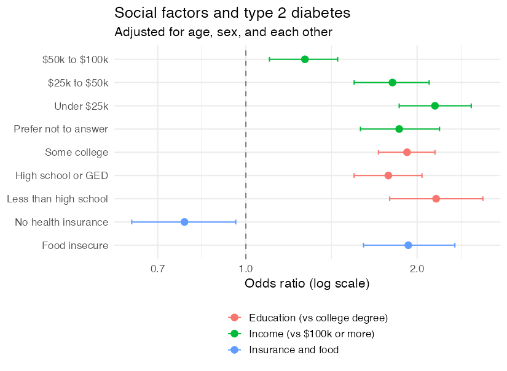

**Survey series, class 3 of 3** · R + SQL · 90 minutes

[Open the notebook on GitHub](https://github.com/CWML/All-of-Us-Training-Resources/blob/main/notebooks/surveys/5.3%20social_factors.ipynb){.btn .btn-outline-primary .btn-sm}
[Survey series overview](index.qmd){.btn .btn-outline-secondary .btn-sm}

## Overview

How much people earn, how much schooling they had, whether they have health insurance, and whether they can afford enough food all shape their health. These are **social determinants of health**, and type 2 diabetes is one of the conditions most closely tied to them. In this class we code four social factors from the surveys, compare cases and controls, and answer the question 5.2 left open: is the link between alcohol and diabetes explained by **confounding**?

### Why this class matters

Social factors are among the strongest risk factors for type 2 diabetes, and the most common **confounders** of other links. This class shows confounding happening, on real data: an odds ratio that changes when a confounder is added. It's also where careful **language** matters most.

### By the end you'll be able to

1. Turn ordered answers (income, education) into groups, and keep *Prefer not to answer* as a category
2. Find and code questions from the **Social Determinants of Health** survey
3. Compare social factors between cases and controls, and model them with **logistic regression**
4. Show **confounding**: how an odds ratio changes when a confounder is added, on the **same people**
5. Tell a **confounder** from a step on the path (a **mediator**), and describe social factors as associations

### Analysis at a glance

| | |
|---|---|
| ❓ **Question** | Are income, education, health insurance, and food insecurity linked to type 2 diabetes? Does adjusting for them explain the alcohol result from 5.2? |
| 🧪 **The analysis** | Percents by group; **logistic regression** adjusted for age and sex; the 5.2 alcohol model **with and without** income and education, on the same people |
| 🎯 **Why** | Social factors are strong risk factors, and common confounders of other links |
| ✅ **What we conclude** | How strongly each factor is linked to type 2 diabetes, and how much of the alcohol and smoking links they explain |
| ⚠️ **What it can't tell us** | Cause. Diabetes can also lower income; and these factors reflect circumstances (where people live, discrimination, access to care), not individual choices |
| 🔗 **Connections** | Uses files from **5.1** and **5.2**; models from **3.2**; "who gets diagnosed" from **3.4** |

### Time and cost

| | |
|---|---|
| ⏱️ **Class time** | 90 minutes |
| ⏱️ **Run time** | about 3 minutes |
| 💰 **Cost** | about **$1.50** per student: two queries on `ds_survey`, plus the app |
| 📋 **Before class** | run **5.1** and **5.2**: this class uses their files |

## Class plan

| Time | Part | You do |
|---|---|---|
| 0:00 | **1. Key concepts**: social determinants, confounding, mediators, careful words | listen, ask |
| 0:15 | **2. Setup**: find the questions by code and by text | run the cells |
| 0:25 | **3. Income, education, insurance** | run the cells |
| 0:45 | **4. Food insecurity** | run the cells |
| 0:55 | **5. Describe and model**; a forest plot | ✋ **Try It Out** (5 min) |
| 1:10 | **6. Confounding: alcohol, again** | predict, then run |
| 1:25 | **Wrap-up** | discuss |

## Key concepts

| Factor | Survey | Question (short) |
|---|---|---|
| **Income** | The Basics | annual household income, in ranges |
| **Education** | The Basics | highest grade or degree completed |
| **Health insurance** | The Basics | do you have health insurance? |
| **Food insecurity** | Social Determinants of Health | worried food would run out; food didn't last (the **Hunger Vital Sign**) |

### Confounder or mediator?

| | Comes… | Adjust for it? | Example |
|---|---|---|---|
| **Confounder** | **before** both the factor and the outcome | yes | income, for the alcohol–diabetes link |
| **Mediator** | **between** the factor and the outcome | not if you want the total effect | BMI, for the income–diabetes link |

To see confounding fairly, compare models on the **same people**: `glm()` drops anyone missing a variable, so a model with more variables can quietly use fewer people.

### Careful words

Write "people with lower incomes had higher odds of type 2 diabetes", not "low income causes diabetes". Social factors reflect circumstances and structures, and diabetes can itself lower income.

## Follow along in the Workbench

1. Start your app and pull the newest notebooks, as in [1.1](../core/1-1-build-cohorts.qmd#follow-along-in-the-workbench).
2. Open `notebooks/surveys/5.3 social_factors.ipynb`, with the **R** kernel.

## Try It Out

::: {.callout-tip}
## ✋ Try It Out · 5 minutes · Part 5, "Your turn"

In the question dictionary, find a **Healthcare Access & Utilization** question about **delaying** or **not getting** care because of **cost**. How many people answered it?

**✅ Check:** several questions about delaying care, or skipping care or medicines, because of cost. It's a later survey: about half our sample took it.
:::

## Code walk-through

### Income: nine ranges to four groups, plus *Prefer not to answer*

```r
income = case_when(
  answer %in% c("less 10k", "10k 25k")                 ~ "Under $25k",          # <1>
  answer %in% c("25k 35k", "35k 50k")                  ~ "$25k to $50k",
  answer %in% c("50k 75k", "75k 100k")                 ~ "$50k to $100k",
  answer %in% c("100k 150k", "150k 200k", "more 200k") ~ "$100k or more",
  answer == "PMI: Prefer Not To Answer"                ~ "Prefer not to answer", # <2>
  TRUE                                                 ~ NA_character_),
income = factor(income, levels = c("$100k or more", …))                         # <3>
```
1. Combine neighbouring ranges: nine small groups give unstable odds ratios.
2. Keep *Prefer not to answer* as its own group: it's common, and more common in cases.
3. The first level is the model's **reference**: every odds ratio compares a group with the highest incomes.

### Confounding, on the same people

```r
confounding_data <- model_data %>%
  left_join(lifestyle, by = "person_id") %>%
  drop_na(t2d, age10, sex_at_birth, smoking_status, alcohol_use, income, education)   # <1>

m_5_2      <- glm(t2d ~ age10 + sex_at_birth + smoking_status + alcohol_use,
                  family = binomial, data = confounding_data)                         # <2>
m_adjusted <- glm(t2d ~ age10 + sex_at_birth + smoking_status + alcohol_use + income + education,
                  family = binomial, data = confounding_data)                         # <3>
```
1. Keep only people with **every** variable, so both models use exactly the same rows.
2. The model from 5.2.
3. The same model, plus income and education. Any change in the alcohol odds ratios comes from the adjustment, not from different people.

## What we found

Results from our test run in November 2026 (CDR v9), 5,000 cases and 5,000 controls.

### Cases and controls

| | Cases | Controls |
|---|---|---|
| Household income under $25k | 29.8% | 20.8% |
| Household income $100k or more | 16.4% | 29.2% |
| Income: prefer not to answer | 17.6% | 13.0% |
| College degree | 34.8% | 53.3% |
| Health insurance | 95.0% | 94.7% |
| Food insecure (of those who answered) | 24.4% | 15.3% |

### Odds ratios

{fig-alt="Forest plot of odds ratios for type 2 diabetes, adjusted for age, sex, and each other, on a log scale with a dashed line at 1. Income groups rise from about 1.3 for 50 to 100 thousand dollars to about 2.2 for under 25 thousand, compared with 100 thousand or more; prefer not to answer is about 1.9. All three education groups without a college degree are about 1.8 to 2.2. Food insecurity is about 1.9. No health insurance is below 1, about 0.78."}

- **Income** showed a clear **gradient**: OR 1.27, 1.81, and **2.15** as income fell, compared with $100k or more. *Prefer not to answer* (OR 1.86) looked like the lower-income groups.
- **Education:** no college degree went with about **twice** the odds, even adjusted for income.
- **Food insecurity:** OR **1.93**, after adjusting for income.
- **No health insurance:** OR **0.78**, **lower** odds. Not protection: diabetes is diagnosed in health care, and people without insurance see doctors less, so their diabetes is less often **found and recorded**.

### Confounding: the 5.2 results, adjusted for income and education

| Same people | As in 5.2 | + income and education |
|---|---|---|
| Alcohol monthly or less (vs never drank) | 0.79 (0.67 to 0.93) | **0.97** (0.82 to 1.15) |
| Alcohol 2–4 times a month | 0.51 (0.43 to 0.61) | 0.71 (0.59 to 0.86) |
| Alcohol 2+ times a week | 0.27 (0.23 to 0.33) | **0.40** (0.33 to 0.49) |
| Current smoker (vs never) | 1.38 (1.21 to 1.58) | **0.91** (0.79 to 1.05) |

- **Alcohol:** every odds ratio moved toward 1. Income and education explained a **large part** of the alcohol link; regular drinking still had lower odds, which other unmeasured factors may explain.
- **Smoking:** current smoking went from higher odds to **no clear difference**. Much of its apparent link was confounding by income and education.

**💬 Discuss:** should we also adjust for **BMI**? (It could be a confounder, or on the path: it depends on the question, and on what comes first.)

## Instructor notes

::: {.callout-tip collapse="true"}
## Instructor tip

- **Language matters most here.** Model "people with lower incomes had higher odds", never "the poor get diabetes".
- **Before Part 6,** ask students to predict how far the alcohol odds ratio will move. Then show the smoking row: most don't expect it to change too.
- **The insurance puzzle** (lower odds without insurance): ask why before explaining under-diagnosis. It connects to "who gets tested" in 3.4.
- **Both food questions say "worried"**: a pattern meant to pick one matches both. The notebook uses *run out* to tell them apart: a good reminder to check every match.
:::

## Key takeaways

- Combine ordered answers into **groups**; keep **Prefer not to answer** as its own group when it's common
- Look for **gradients** across income and education
- Show confounding by fitting models **with and without** a variable, on the **same people**
- Ask whether a variable is a **confounder** or a **mediator** before adjusting for it
- A "protective" result can be a sign of **who gets diagnosed**
- Social factors are **associations**, reflecting circumstances, not choices or biology

## Next

That's the end of the survey series. The **wearables series** (coming soon) adds Fitbit data: steps, sleep, and heart rate.
