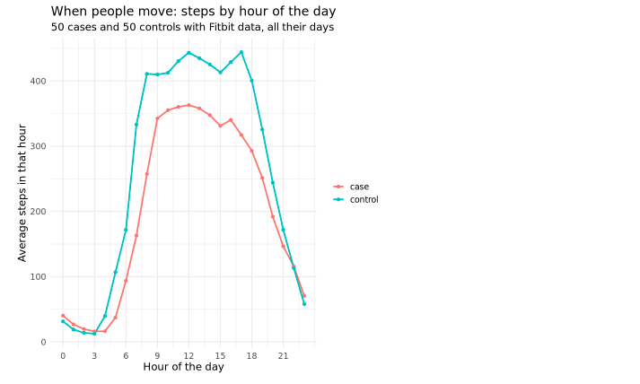
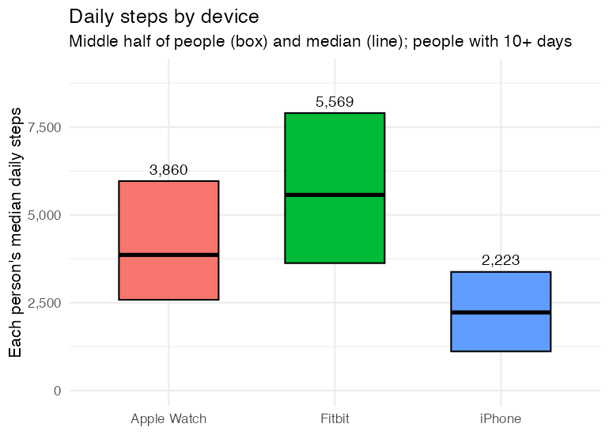

**Wearables series, class 1 of 3** · R + SQL · 95 minutes

[Open the notebook on GitHub](https://github.com/CWML/All-of-Us-Training-Resources/blob/main/notebooks/wearables/6.1%20wearables_basics.ipynb){.btn .btn-outline-primary .btn-sm}
[Wearables series overview](index.qmd){.btn .btn-outline-secondary .btn-sm}

## Overview

Tens of thousands of *All of Us* participants share data from a **Fitbit** or from **Apple Health** (iPhone and Apple Watch). In this class we learn where the wearable data is, what it costs to use, and how to turn months of daily records into **one clean value per person**, ready for the analyses in 6.2 and 6.3.

### Why this class matters

Wearable data is easy to misuse in three ways: a day the device wasn't worn looks like an inactive day; a phone and a watch count steps differently; and one careless query on a minute-level table can cost tens of dollars. This class builds the habits that prevent all three: **price every query, keep only valid days, and never pool different devices**.

### By the end you'll be able to

1. Describe the Fitbit and Apple HealthKit data: tables, layouts, and who has them
2. Estimate and check the **cost** of a query, and query huge **minute-level** tables safely
3. Define a **valid wear day**, and check a wear measure against a better one
4. Summarise many days into **one value per person**
5. Explain why Fitbit, iPhone, and Apple Watch steps can't simply be pooled
6. Describe who has wearable data, and what that means for **generalisability**

### Analysis at a glance

| | |
|---|---|
| ❓ **Question** | Who in our cohort has wearable data, how much, and how do we turn it into usable variables? |
| 🧪 **The analysis** | Table sizes and costs; valid wear days; median daily steps per person, by device; steps by hour of the day; who has data |
| 🎯 **Why** | Un-worn days, different devices, and huge tables each lead to wrong or expensive results if ignored |
| ✅ **What we conclude** | How many cases and controls have usable data, and a per-person step summary for **6.2** |
| ⚠️ **What it can't tell us** | Anything about cause. And people with wearables aren't typical: results describe **them** |
| 🔗 **Connections** | Cohort from **1.1**; units and cleaning from **2.1**; long vs wide from **2.2**; no survey weights from **5.1** |

### Time and cost

| | |
|---|---|
| ⏱️ **Class time** | 95 minutes |
| ⏱️ **Run time** | about 5 minutes |
| 💰 **Cost** | about **$1.40** in queries in our test run ($1.20 of it the Apple HealthKit query), plus the app |
| 📋 **Before class** | **0.0 setup** run once. `cohort_sample.csv` from **1.1** is used if it's in your bucket; otherwise the notebook makes it |

## Class plan

| Time | Part | You do |
|---|---|---|
| 0:00 | **1. Key concepts**: two data sources, wear time, one value per person, devices, cost | listen, ask |
| 0:20 | **2–3. Setup; the tables and their cost** | run the cells |
| 0:30 | **4. Fitbit daily data and valid days** | ✋ **Try It Out 1** (5 min) |
| 0:50 | **5. Minute-level data, safely**; is our wear measure any good? | run the cells, discuss |
| 1:05 | **6. Apple HealthKit**: phone vs watch | run the cells |
| 1:20 | **7. Who has wearables?** | ✋ **Try It Out 2** (5 min) |
| 1:30 | **Wrap-up** | discuss |

## Key concepts

### Two sources of wearable data

| | Fitbit | Apple HealthKit |
|---|---|---|
| **Where** | the main CDR v9 dataset | a **separate** CDR v9 dataset (`C_V9_R6_offcycle_healthkit`, September 2026), joined by `person_id`; not in the Data Explorer |
| **People with steps** | about **68,500** | about **18,000** |
| **Layout** | **wide**: a column per measure (`steps`, `sedentary_minutes`, …) | **long**: a row per measurement, with `data_type`, `value` (stored as **text**), and `units` |
| **Detail** | **daily** summary tables, and **minute-level** tables | individual measurements, seconds to hours apart; no daily summary |
| **Also has** | heart-rate zones, sleep stages, scales | resting heart rate, heart rate variability, blood pressure, **blood glucose** (about 1,000 people), walking speed |

### Valid wear days

A day with 300 steps could be an inactive day, or a device left on the charger. Studies keep only **valid days**:

| Rule | Why |
|---|---|
| at least **10 hours of wear**, judged from **heart-rate** minutes | Fitbit only records heart rate on a wrist |
| **100 to 45,000** steps | fewer is barely worn; more is likely an error |
| a person needs **10 or more** valid days | for their average to mean something |

Then each person gets **one** value: their **median** daily steps over valid days.

### Cost: big tables, clustering, and dry runs

The minute-level Fitbit tables are over **6 TB each** (a full read is about $40). They're **clustered by `person_id`**: each person's rows are stored together, so a query filtered by person reads only those people. A **dry run** (free) prices a query before it runs, clustering included:

| The same minute-level query, for… | Reads | Costs |
|---|---|---|
| 50 people | about 5.7 GB | about **$0.04** |
| our 10,000 people | about 3,000 GB | about **$19** |

Cost grows with the number of people: keep minute-level queries to small groups.

## Follow along in the Workbench

1. Start your app and pull the newest notebooks, as in [1.1](../core/1-1-build-cohorts.qmd#follow-along-in-the-workbench).
2. Open `notebooks/wearables/6.1 wearables_basics.ipynb`, with the **R** kernel.

## Try It Out

::: {.callout-tip}
## ✋ Try It Out 1 · 5 minutes · Part 4, "Your turn"

Use **8 hours** of wear (480 minutes) instead of 10. How many more valid days does that give, and does median daily steps change much?

**✅ Check:** a few more valid days, and a slightly lower median: partly-worn days have fewer steps.
:::

::: {.callout-tip}
## ✋ Try It Out 2 · 5 minutes · Part 7, "Your turn"

Compare people **with and without HealthKit data**: age, sex, and case status. Are they like Fitbit users?

**✅ Check:** Apple users are selected in their **own** way: an iPhone isn't a Fitbit.
:::

## Code walk-through

### Two cost helpers

```r
run_if_cheap(sql, max_dollars = 1)    # <1>
last_query_cost()                     # <2>
```
1. A free **dry run** first; the query runs only if it costs less than `max_dollars`. With `max_dollars = 0` it only prints the estimate.
2. What the most recent query **actually** billed.

### Daily steps plus wear time, in one query

```sql
WITH wear AS (                                                  -- <1>
  SELECT person_id, date, SUM(minute_in_zone) AS wear_minutes
  FROM heart_rate_summary
  WHERE person_id IN (…)
  GROUP BY person_id, date
)
SELECT a.person_id, a.date, a.steps, …, w.wear_minutes
FROM activity_summary AS a
LEFT JOIN wear AS w ON a.person_id = w.person_id AND a.date = w.date   -- <2>
WHERE a.person_id IN (…)
```
1. Fitbit counts minutes in each heart-rate **zone**; their sum is a cheap measure of wear time.
2. `LEFT JOIN` keeps every activity day, even days without heart-rate data.

### HealthKit: long data, text values, one device at a time

```sql
SELECT a.person_id,
       DATE(SAFE_CAST(a.start_datetime AS TIMESTAMP)) AS date,
       CASE WHEN d.product_type LIKE 'Watch%'  THEN 'Apple Watch'      -- <1>
            WHEN d.product_type LIKE 'iPhone%' THEN 'iPhone'
            ELSE 'other' END AS device,
       SUM(SAFE_CAST(a.value AS FLOAT64)) AS steps                     -- <2>
FROM activity_measurements AS a
LEFT JOIN device_and_source AS d ON a.device_source_id = d.device_source_id
WHERE a.data_type = 'STEP_COUNT' AND a.person_id IN (…)               -- <3>
GROUP BY 1, 2, 3                                                      -- <4>
```
1. Which device recorded each measurement.
2. `value` is stored as **text**; `SAFE_CAST` turns it into a number (anything that isn't becomes `NULL`).
3. In the long layout, `data_type` picks the measure.
4. One total per person, day, **and device**: adding the phone and watch together would count the same steps twice.

## What we found

Results from our test run in November 2026 (CDR v9), 5,000 cases and 5,000 controls.

### Fitbit, in our sample

- **926** people had Fitbit data (about 850,000 person-days, 2009 to 2024); **840** had 10 or more valid days, with a median of **390** valid days each.
- **64%** of days were valid. Most of the rest had **no heart-rate data**, so we couldn't tell whether the device was worn.
- Median daily steps rose from **5,142** (all days) to **5,897** (valid days): the bias un-worn days create.

### Is our wear measure any good?

For 100 people, we compared the cheap measure with the one published *All of Us* studies use:

| Wear measure | Median minutes | Days with 10+ hours |
|---|---|---|
| heart-rate **zone total** (daily table) | 1,440 (exactly 24 hours on 61% of days) | 98.6% |
| minutes with a **heart-rate reading** (minute-level table) | 1,392 (about 23 hours) | 95.5% |

These Fitbit users wear their devices almost around the clock. The zone total overstates wear, but at the 10-hour cutoff the two disagree on only about **3%** of days: good enough for class; for a paper, use the minute-level count.

### When people move

{fig-alt="Line chart of average steps in each hour of the day, for 50 cases and 50 controls with Fitbit data. Both lines are near zero overnight, rise from about 5 am, stay high through the day, and fall in the evening. Controls are clearly higher from about 8 am to 6 pm, around 400 to 450 steps an hour versus 330 to 360 for cases; the lines are similar at night."}

Controls took more steps through the working day; the groups were similar at night.

### Phones, watches, and Fitbits

{fig-alt="Box chart of each person's median daily steps by device. Fitbit has the highest median, 5,569, with the middle half of people from about 3,600 to 7,900. Apple Watch has a median of 3,860, middle half about 2,600 to 6,000. iPhone has the lowest median, 2,223, middle half about 1,100 to 3,400."}

- The **iPhone** records far fewer steps: it misses every step taken without it.
- **Within the same people** (151 with both an iPhone and an Apple Watch), the iPhone recorded about **59%** of their Watch steps.
- So Fitbit is the main data for **6.2**; Apple steps are a separate measure, never pooled with Fitbit.

### Who has wearable data?

| | Cases | Controls |
|---|---|---|
| Fitbit, 10+ valid days | 7.3% | 9.5% |
| Apple HealthKit steps | 1.8% | 3.3% |

People with Fitbit data were a little younger (mean age 58 vs 59), more often female (63% vs 59%), and less often cases (43% vs 51%). **Selection**: results describe wearable users.

## Instructor notes

::: {.callout-tip collapse="true"}
## Instructor tip

- **Start with the cost table**: "what would one careless query cost?" gets everyone's attention.
- **The wear-measure check** is a good habit to model: a cheap measure looked suspicious (a median of exactly 24 hours), so we tested it against a better one, on a small group, for $0.04.
- **iPhone vs Watch:** ask students where their phone is right now. Most aren't carrying it.
- **Plots:** a default box plot draws single people (whisker ends, outliers). The notebook draws it from percentiles, and the page shows only boxes and medians.
- **Privacy:** never plot one person's minute-level data outside the Workbench.
:::

## Key takeaways

- *All of Us* has **Fitbit** data (main dataset) and **Apple HealthKit** data (a separate dataset)
- **Price** queries before running them, and check what they cost: minute-level costs grow with the number of people
- Keep only **valid days**, then summarise to **one value per person**; check your wear measure
- **iPhone, Apple Watch, and Fitbit** steps measure different things: don't pool them
- Wearable users are a **selected** group

## Next

**[6.2 Steps and type 2 diabetes](6-2-steps-and-t2d.qmd)**: daily steps measured **before** a diagnosis.
