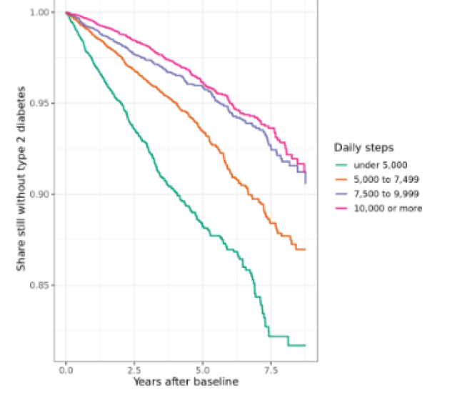

**Wearables series, class 2 of 3** · R + SQL · 95 minutes

[Open the notebook on GitHub](https://github.com/CWML/All-of-Us-Training-Resources/blob/main/notebooks/wearables/6.2%20steps_and_t2d.ipynb){.btn .btn-outline-primary .btn-sm}
[Wearables series overview](index.qmd){.btn .btn-outline-secondary .btn-sm}

## Overview

Do people who take more steps a day develop type 2 diabetes **less often**? In this class we follow every *All of Us* participant with Fitbit data **forward in time**: their daily steps are measured first, and then we watch who is diagnosed with type 2 diabetes later, and when. It's the design of a published *All of Us* study, and it fixes the biggest problem we met in the survey series: answers given **after** a diagnosis.

### Why this class matters

In **5.2**, most people with diabetes answered the Lifestyle survey **after** their diagnosis, so their answers could reflect the diagnosis (people quit smoking, or cut down on alcohol, because of it). A **prospective** design, where the exposure is measured before the outcome, is the standard way around that, and wearables make it possible: Fitbit records steps day by day, with exact dates.

### By the end you'll be able to

1. Explain a **prospective cohort** design, and why it avoids reverse causation
2. Build **baseline** steps, eligibility, and **follow-up** from dates, mostly inside BigQuery
3. Calculate **incidence rates** per 1,000 person-years
4. Draw **Kaplan–Meier** curves and fit a **Cox model** for a new outcome (from **3.4**)
5. Choose what to adjust for: **confounders** vs a possible **mediator**
6. Test the result with a **sensitivity analysis** (a lag)

### Analysis at a glance

| | |
|---|---|
| ❓ **Question** | Among adults **without** diabetes, do those who take more steps a day develop type 2 diabetes less often? |
| 🧪 **The analysis** | Baseline steps over each person's first 6 months of Fitbit data; follow-up for a **new** diagnosis; incidence rates; Kaplan–Meier curves; Cox models (age and sex, then + BMI); a 1-year lag |
| 🎯 **Why** | Steps measured **before** any diagnosis can't be the result of it. Survival methods use everyone's follow-up, however long |
| ✅ **What we conclude** | How the rate of new type 2 diabetes differs by daily steps |
| ⚠️ **What it can't tell us** | Cause. People who walk more differ in many ways (income, health, diet). And Fitbit users aren't typical |
| 🔗 **Connections** | Valid days and costs from **6.1**; the cohort query from **1.1**; survival methods from **3.4**; reverse causation from **5.2**; confounders and mediators from **5.3** |

### Time and cost

| | |
|---|---|
| ⏱️ **Class time** | 95 minutes |
| ⏱️ **Run time** | about 5 minutes |
| 💰 **Cost** | about **$1** per student: the cohort query, and one query for everyone's baseline steps and BMI (**$0.18** in our test run) |
| 📋 **Before class** | **6.1** is helpful (valid days, costs), and **3.4** (survival analysis) |

## Class plan

| Time | Part | You do |
|---|---|---|
| 0:00 | **1. Key concepts**: the design, in one timeline | listen, discuss |
| 0:20 | **2–3. The cohort; baseline steps in BigQuery** | run the cells |
| 0:40 | **4. Who's in the analysis**: the flow table; follow-up | run the cells |
| 0:55 | **5. Incidence rates and Kaplan–Meier curves** | run the cells, discuss |
| 1:10 | **6. Cox models**: with and without BMI | ✋ **Try It Out** (5 min) |
| 1:20 | **7. A 1-year lag** | discuss |
| 1:30 | **Wrap-up** | |

## Key concepts

### Measure first, then follow

```
first valid           end of baseline                          end of follow-up
Fitbit day            (6 months later)                         (last EHR visit, death, or 2025)
    |──── baseline ────|──────────────── follow-up ─────────────────────|
      median daily          does type 2 diabetes appear? when?
      steps
excluded: anyone with type 2 diabetes (or another kind of diabetes) before the end of baseline
```

**This design avoids reverse causation by construction:** steps are measured **before** any diagnosis, so the diagnosis can't have changed them. It follows the published *All of Us* study of step counts and chronic disease (Master et al., *Nature Medicine*, 2022).

Why not use our sample of 5,000 cases and 5,000 controls? The cases were chosen **because** they already had diabetes, and for most of them Fitbit data starts **after** the diagnosis. Only a few hundred have Fitbit data at all (**6.1**). Following **all** Fitbit users forward is both larger and more honest.

### Words for this design

| Term | Means |
|---|---|
| **Baseline** | when the exposure is measured: each person's first 6 months of valid Fitbit days |
| **Exposure** | what might affect the outcome: median daily steps at baseline |
| **Incident** case | a **new** diagnosis during follow-up. A **prevalent** case already had diabetes at baseline: excluded |
| **Censoring** | follow-up ends without the outcome: the last EHR visit, death, or the end of the data |
| **Person-years** | total time followed: 100 people for 2 years = 200 person-years |
| **Incidence rate** | new cases ÷ person-years, often per **1,000 person-years** |
| **Hazard ratio** | the rate in one group ÷ another, at any moment: HR 0.5 = half the rate |

### What to adjust for

| Variable | Role | Adjust? |
|---|---|---|
| **Age**, **sex** | affect both steps and diabetes risk: **confounders** | yes |
| **BMI** | a confounder (heavier people may walk less) **and** a possible **mediator** (walking → lower weight → less diabetes) | show **both** models |

The model **without** BMI is the main result. The model **with** BMI shows the part of the link not explained by weight.

## Follow along in the Workbench

1. Start your app and pull the newest notebooks, as in [1.1](../core/1-1-build-cohorts.qmd#follow-along-in-the-workbench).
2. Open `notebooks/wearables/6.2 steps_and_t2d.ipynb`, with the **R** kernel.

## Try It Out

::: {.callout-tip}
## ✋ Try It Out · 5 minutes · Part 6, "Your turn"

Compare people **in** the analysis with **all** adults in the cohort query: age, percent female, percent cases. Who uses a Fitbit, and who might the result not apply to?

**✅ Check:** Fitbit users are a selected group, with far fewer cases (people with diabetes at baseline were excluded, and fewer of them use Fitbits).
:::

## Code walk-through

### Baseline steps for everyone, in one query

```sql
WITH wear AS (…),                                          -- <1>
valid AS (…),
first_day AS (
  SELECT person_id, MIN(date) AS first_valid FROM valid GROUP BY person_id   -- <2>
),
baseline AS (
  SELECT v.person_id,
         MAX(v.date) AS baseline_end,
         COUNT(*)    AS baseline_days,
         APPROX_QUANTILES(v.steps, 100)[OFFSET(50)] AS baseline_steps        -- <3>
  FROM valid AS v JOIN first_day AS f ON v.person_id = f.person_id
  WHERE v.date < DATE_ADD(f.first_valid, INTERVAL 6 MONTH)                   -- <4>
  GROUP BY v.person_id
),
bmi AS (…)                                                                    -- <5>
SELECT … FROM baseline … WHERE baseline_days >= 10                            -- <6>
```
1. Wear minutes and valid days, as in **6.1**.
2. Each person's first valid Fitbit day.
3. BigQuery's fast **median**: the 50th of 100 percentiles.
4. Only the first **6 months**: the baseline.
5. The latest BMI in the 2 years before the end of baseline.
6. One row per person with at least 10 valid baseline days. BigQuery does the work; only tens of thousands of rows come back, instead of tens of millions.

### Follow-up, from dates

```r
followup <- joined %>%
  filter(cohort != "excluded",
         !(cohort == "case" & t2d_date <= baseline_end),          # <1>
         age_at_baseline >= 18,
         followup_end > baseline_end) %>%                          # <2>
  mutate(event     = as.integer(cohort == "case" & t2d_date <= followup_end),   # <3>
         exit_date = if_else(event == 1, t2d_date, followup_end),
         years     = as.numeric(exit_date - baseline_end) / 365.25)            # <4>
```
1. Leave out **prevalent** cases: diagnosed before baseline ended.
2. Keep people with some EHR follow-up **after** baseline.
3. The event: a type 2 diabetes diagnosis during follow-up.
4. Years from the end of baseline to diagnosis, or to censoring.

### Cox models, on the same people

```r
m_age_sex <- coxph(Surv(years, event) ~ steps_group + age10 + sex_at_birth, data = cox_data)          # <1>
m_bmi     <- coxph(Surv(years, event) ~ steps_group + age10 + sex_at_birth + bmi5, data = cox_data)   # <2>
m_per1000 <- coxph(Surv(years, event) ~ steps_1000 + age10 + sex_at_birth, data = cox_data)           # <3>
```
1. The main model: adjusted for the confounders, age and sex.
2. Plus BMI: what's left after accounting for weight.
3. Steps as a number: the hazard ratio for each extra 1,000 steps a day.

## What we found

Results from our test run in November 2026 (CDR v9).

### Who was studied

| Rule | People |
|---|---|
| Fitbit baseline, and in the cohort query (adults with EHR) | 39,553 |
| not "excluded" (type 1 or unclear diabetes) | 38,516 |
| no type 2 diabetes by the end of baseline | 33,874 |
| 18 or older | 33,819 |
| some EHR follow-up after baseline | **25,724** |

**1,185** new cases of type 2 diabetes over **85,879** person-years (a median of **2.6** years each): **13.8** per 1,000 person-years.

### Rates by daily steps

| Daily steps at baseline | People | New cases | Rate per 1,000 person-years |
|---|---|---|---|
| under 5,000 | 7,096 | 424 | **25.5** |
| 5,000 to 7,499 | 7,526 | 371 | 14.5 |
| 7,500 to 9,999 | 5,619 | 205 | 9.6 |
| 10,000 or more | 5,483 | 185 | **8.3** |

{fig-alt="Kaplan-Meier curves of the share still without type 2 diabetes over about 9 years after baseline, by daily steps. All four curves start at 1. The under-5,000 group falls fastest, to about 0.82 by year 8. The 5,000 to 7,499 group falls to about 0.87. The 7,500 to 9,999 and 10,000-or-more groups fall slowest and nearly overlap, ending around 0.91 to 0.92."}

The curves separate from the first year (log-rank chi-square 250, p < 0.001). The biggest gap is between **under 5,000** and the rest; the two highest groups nearly **overlap**. The curves stop where any group has fewer than 50 people still followed.

### Hazard ratios

| Compared with under 5,000 steps a day | Age and sex | + BMI | With a 1-year lag |
|---|---|---|---|
| 5,000 to 7,499 | 0.50 (0.41 to 0.61) | 0.62 (0.51 to 0.76) | 0.58 (0.45 to 0.74) |
| 7,500 to 9,999 | 0.32 (0.25 to 0.41) | 0.46 (0.36 to 0.60) | 0.36 (0.26 to 0.48) |
| 10,000 or more | **0.27** (0.21 to 0.34) | **0.42** (0.32 to 0.55) | 0.32 (0.23 to 0.43) |
| **Per extra 1,000 steps** (age and sex) | **0.86** (0.83 to 0.88) | | |

- **Main result:** people taking 10,000 or more steps a day had about a **quarter** of the rate of new type 2 diabetes of those taking under 5,000, adjusted for age and sex. Each extra 1,000 steps a day went with a **14%** lower rate.
- **BMI** explained part of the link (hazard ratios moved toward 1), but most remained.
- **The 1-year lag** barely changed the results: early, undiagnosed illness doesn't explain them.
- **The benefit levels off** above about 7,500 steps. "10,000 steps a day" isn't a threshold.

**💬 Discuss:** this is still an **association**, in a **selected** group. What else differs between people who walk more and less? Could people who walk more see doctors **less**, and be diagnosed later? What evidence would convince you that walking itself lowers the risk?

## Instructor notes

::: {.callout-tip collapse="true"}
## Instructor tip

- **Draw the timeline** before anything else. Most of the class follows from it.
- **"Avoids reverse causation by construction"** is the key phrase: compare with 5.2, where most survey answers came after diagnosis.
- **BMI: confounder or mediator?** Ask students to argue both sides before showing model 2.
- **The flow table** is worth slowing down for: each rule is a decision a reader needs to know about.
- **Kaplan–Meier curves end early on purpose**: where few people remain, curves describe very few people and jump around.
- **Proportional hazards:** the check gave p = 0.004 for steps. Discuss what it means for activity measured once, over 6 months, but followed for years.
- **Likely question:** "Is 10,000 steps magic?" No: the number came from a 1960s Japanese pedometer advertisement. Look at the **gradient**, which levels off above about 7,500 here.
:::

## Key takeaways

- A **prospective** design measures the exposure **before** the outcome: it avoids reverse causation by construction
- Build baseline, eligibility, and follow-up from **dates**, and report a **flow table**
- **Incidence rates**, **Kaplan–Meier** curves, and **Cox** models answer "how often" and "how soon"
- Adjust for **confounders**; show models with and without a possible **mediator**
- A **lag** tests whether undiagnosed illness explains the result
- It's still an **association**, in a **selected** group

## Next

**6.3 Sleep and heart rate** (coming soon): the same design for sleep and resting heart rate.
