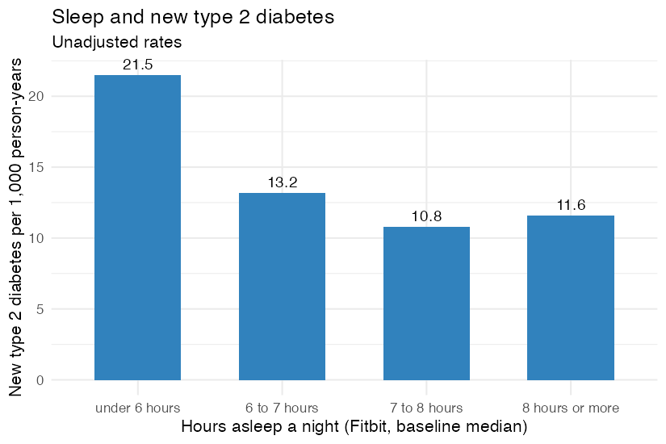

**Wearables series, class 3 of 3** · R + SQL · 95 minutes

[Open the notebook on GitHub](https://github.com/CWML/All-of-Us-Training-Resources/blob/main/notebooks/wearables/6.3%20sleep_and_heart_rate.ipynb){.btn .btn-outline-primary .btn-sm}
[Wearables series overview](index.qmd){.btn .btn-outline-secondary .btn-sm}

## Overview

In **6.2**, more daily steps went with a much lower rate of new type 2 diabetes. Is the same true for **sleep**, and for **resting heart rate**? This class reuses the 6.2 design, measure first, then follow, written as a **function** so every measure gets exactly the same rules. Sleep comes from **Fitbit**; resting heart rate from **Apple HealthKit**. We finish with a first look at HealthKit **blood glucose**.

### Why this class matters

Real research rarely asks one question once. Turning a design into a function makes it **reusable** and **consistent**. This class also shows three things wearable studies meet all the time: a link that might **not be a straight line**, a smaller data source with **wider** confidence intervals, and a data type whose users are selected **by the outcome**.

### By the end you'll be able to

1. Turn an analysis design into a reusable **function**
2. Build valid **nights** of sleep from Fitbit, and baseline resting heart rate from HealthKit's **long** data
3. Recognise a **non-linear** (e.g. U-shaped) association, and choose a **reference** group for it
4. Compare results from data sources of very different sizes, and read **confidence intervals**
5. **Describe** a new data type (blood glucose) carefully before modelling it

### Analysis at a glance

| | |
|---|---|
| ❓ **Question** | Among adults without diabetes, are sleep duration and resting heart rate linked to developing type 2 diabetes? |
| 🧪 **The analysis** | The 6.2 design as a function: baseline sleep (Fitbit) or resting heart rate (HealthKit), then follow-up for new type 2 diabetes; incidence rates and Cox models. A description of HealthKit blood glucose |
| 🎯 **Why** | Measured before any diagnosis, these avoid reverse causation, as in 6.2 |
| ✅ **What we conclude** | Whether the links appear in *All of Us* wearable users, and their shape |
| ⚠️ **What it can't tell us** | Cause. Sleep and heart rate reflect overall health, stress, work, and fitness. Fitbit and Apple users are different, selected groups |
| 🔗 **Connections** | The design from **6.2**; valid days from **6.1**; HealthKit's long, text-valued data from **6.1**; functions from **3.1**; survival models from **3.4** |

### Time and cost

| | |
|---|---|
| ⏱️ **Class time** | 95 minutes |
| ⏱️ **Run time** | about 5 minutes |
| 💰 **Cost** | about **$1** in our test run: sleep $0.15, steps $0.01, resting heart rate $0.39, glucose $0.32, plus the cohort query and the app |
| 📋 **Before class** | **6.2** (the design), and **3.4** (survival analysis) |

## Class plan

| Time | Part | You do |
|---|---|---|
| 0:00 | **1. Key concepts**: the same design; not every link is a straight line; what the devices measure | listen, predict |
| 0:15 | **2. The design as a function** | run the cells |
| 0:25 | **3. Sleep (Fitbit)**: valid nights, rates, Cox models | ✋ **Try It Out** (5 min) |
| 0:50 | **4. Resting heart rate (HealthKit)** | run the cells, discuss |
| 1:10 | **5. Blood glucose: a first look** | discuss |
| 1:25 | **Wrap-up** | |

## Key concepts

### The same design, a new exposure

```
first valid           end of baseline                          end of follow-up
measurement           (6 months later)                         (last EHR visit, death, or 2025)
    |──── baseline ────|──────────────── follow-up ─────────────────────|
      median sleep, or      does type 2 diabetes appear? when?
      resting heart rate
excluded: anyone with type 2 diabetes before the end of baseline
```

As in 6.2, the exposure is measured **before** any diagnosis, so the design avoids reverse causation by construction.

### Not every link is a straight line

Steps (6.2) had a **gradient**. Sleep is often different: in many studies both **short** and **long** sleep go with worse health, a **U shape**. So:

- One "per hour of sleep" number could **average away** a U.
- The **reference** group is the middle (**7 to 8 hours**), so the others are compared with the expected lowest-risk group.

### What the devices measure

| Measure | Device | Watch out for |
|---|---|---|
| **Sleep duration** | Fitbit: movement and heart rate through the night; one **main sleep** per night | Fitbits usually record **less** sleep than people report; only nights the device was worn |
| **Sleep stages** | Fitbit (newer models) | rough estimates; older devices have no stages |
| **Resting heart rate** | Apple Watch: its own daily estimate | lower with **fitness**; higher with stress, illness, some medicines |
| **Blood glucose** | devices and apps that share through Apple Health (e.g. continuous glucose monitors, **CGMs**) | who uses one is **not** random |

## Follow along in the Workbench

1. Start your app and pull the newest notebooks, as in [1.1](../core/1-1-build-cohorts.qmd#follow-along-in-the-workbench).
2. Open `notebooks/wearables/6.3 sleep_and_heart_rate.ipynb`, with the **R** kernel.

## Try It Out

::: {.callout-tip}
## ✋ Try It Out · 5 minutes · Part 3, "Your turn"

Fit sleep as a **number** (per hour) instead of groups: `coxph(Surv(years, event) ~ sleep_hours + age10 + sex_at_birth, data = sleep_cox_data)`. Does one hazard ratio describe the groups' results well?

**✅ Check:** a single "per hour" number assumes a straight line. Compare it with the group results: here, the excess is concentrated in the shortest sleepers.
:::

## Code walk-through

### The 6.2 design, as a function

```r
build_followup <- function(baseline, cohort, end_of_data = as.Date("2025-01-01")) {   # <1>
  baseline %>%
    inner_join(cohort, by = "person_id") %>%
    mutate(…) %>%
    filter(cohort != "excluded",
           !(cohort == "case" & t2d_date <= baseline_end),                           # <2>
           age_at_baseline >= 18,
           followup_end > baseline_end) %>%
    mutate(event = …, years = …)
}

sleep_followup <- build_followup(sleep_baseline, cohort)                              # <3>
rhr_followup   <- build_followup(rhr_baseline, cohort)
```
1. Any baseline table with `person_id` and `baseline_end` goes in; the people eligible for follow-up come out.
2. The same rules as 6.2's flow table, written once.
3. Sleep and resting heart rate get **exactly** the same rules.

### Rates that refuse to reveal a hidden count

```r
rates_by <- function(data, group) {
  out <- data %>%
    group_by({{ group }}) %>%                                     # <1>
    summarise(people = n(), n = sum(event), person_years = sum(years)) %>%
    … %>%
    hide_small_counts()                                           # <2>
  if (sum(is.na(out$new_cases)) == 1) stop("Only one group is hidden …")   # <3>
  out
}
```
1. `{{ group }}` passes a column name into the function.
2. Hide new cases of 1 to 20, and their rates.
3. If exactly **one** group is hidden, its count could be worked out from the printed total and the other groups (the **derived counts** rule from **3.1**), so the function stops before printing anything. In our test run this happened with four resting-heart-rate groups, so the notebook uses three.

### Sleep: the main sleep, valid nights

```sql
WHERE LOWER(CAST(is_main_sleep AS STRING)) IN ('true', '1', 't')    -- <1>
  AND minute_asleep BETWEEN 180 AND 960                           -- <2>
```
1. One main sleep per night (naps are separate). Comparing the **text** form works however the column is stored.
2. Valid nights: 3 to 16 hours asleep.

## What we found

Results from our test run in November 2026 (CDR v9).

### Sleep (Fitbit)

- **54,158** Fitbit users had a sleep baseline: a median of **6.7 hours** asleep a night. 79% had sleep stages, with a median of 20% REM and 15% deep sleep, in the usual healthy range.
- **24,507** were followed: **1,251** new cases of type 2 diabetes over 91,514 person-years (median 2.9 years).

{fig-alt="Bar chart of new type 2 diabetes per 1,000 person-years by hours asleep a night, unadjusted. Under 6 hours: 21.5. 6 to 7 hours: 13.2. 7 to 8 hours: 10.8, the lowest. 8 hours or more: 11.6."}

| Compared with 7 to 8 hours | Age and sex | + BMI | + BMI + steps |
|---|---|---|---|
| under 6 hours | **1.97** (1.59 to 2.44) | 1.48 (1.19 to 1.84) | **1.46** (1.18 to 1.81) |
| 6 to 7 hours | 1.18 (0.96 to 1.44) | 1.09 (0.89 to 1.33) | 1.13 (0.92 to 1.38) |
| 8 hours or more | 0.93 (0.65 to 1.34) | 0.98 (0.68 to 1.40) | 0.90 (0.63 to 1.29) |

*Cox models on the 15,712 people with BMI and steps (591 new cases).*

- **Short sleep** (under 6 hours) went with about **twice** the rate of new type 2 diabetes. BMI explained part of it; daily steps almost none.
- **Long sleep** wasn't linked: **no U shape** here. Many studies of **self-reported** sleep find one; Fitbit measures sleep differently, and few people slept 8+ hours by its measure. We expected a U; the data decided.

### Resting heart rate (Apple HealthKit)

- **11,258** HealthKit users had a resting-heart-rate baseline; **5,306** could be followed, with **133** new cases: far fewer than for sleep.
- Every **10 beats per minute** higher: **HR 1.44** (1.19 to 1.75), adjusted for age and sex; **1.25** (1.00 to 1.55) with BMI.
- A higher resting heart rate went with more new diabetes, but the interval is much **wider** than for sleep, and with BMI it barely excludes 1. Fewer people and fewer new cases: **less certainty**.

### Blood glucose: who shares it?

| | People | Likely CGM | Median days of data | Median glucose (mg/dL) | Readings in range (70–180) |
|---|---|---|---|---|---|
| Cases (type 2 diabetes) | 340 | 30% | 45 | 129 | 92% |
| Controls (no diabetes) | 303 | 26% | **6** | 103 | 100% |
| Excluded (type 1 or unclear diabetes) | 114 | **83%** | 104 | 144 | **74%** |
| Not in the cohort query (no EHR) | 263 | 33% | 23 | 120 | 97% |

- People with **type 1** (or unclear) diabetes mostly use **CGMs**, record for months, and spend the least time in range.
- **Controls** share only a **few days**, perhaps short trials of over-the-counter CGMs.
- Who has glucose data, and how much, depends on diabetes status: **selection by the outcome**. This data suits questions about diabetes **management**, not about who **develops** diabetes.

**💬 Discuss:** resting heart rate is lower in people who are fit. Is its link with diabetes about the heart, about fitness, or about something else (stress, illness, medicines like beta-blockers)?

## Instructor notes

::: {.callout-tip collapse="true"}
## Instructor tip

- **The function** is the bridge from 6.2: show that it's the 6.2 flow table, written once.
- **Ask for predictions** before showing the sleep results: straight line or U? Many students will predict a U. The result (short sleep only) is a good "the data decides" moment.
- **Resting heart rate** is the place to discuss **power**: the same kind of question, with far fewer people, gives a much less certain answer.
- **Derived counts:** the four-group resting heart rate table would have revealed a small count through subtraction. Show students why `rates_by()` stops, rather than warns.
- **Glucose** is the course's clearest example of **selection by the outcome**.
- **Privacy:** glucose traces are very personal. Only show group summaries outside the Workbench.
:::

## Key takeaways

- A design written as a **function** applies the **same rules** to every exposure
- Look at **groups** before using one number, and let the data decide the shape: here, **short sleep**, not a U
- Smaller data sources give **wider** confidence intervals: "can't tell" isn't "no link"
- Check for **derived counts** in every table with a printed total
- **Describe** a new data type before modelling it: glucose users are selected **by the outcome**

## Next

That's the end of the wearables series. The **machine learning series** (coming soon) uses steps, sleep, surveys, and more to **predict** who develops type 2 diabetes.
